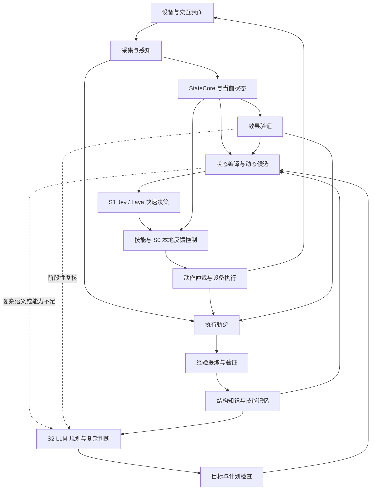
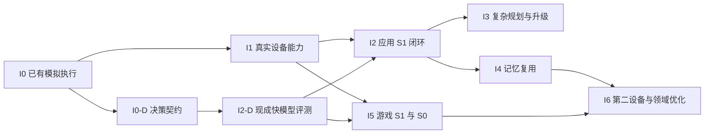

# 通用电脑与手机交互系统：完整技术设计

> **历史稿**：已由 [完整设计文档 v0.4](docs/design/complete-design.md) 整合替代。下文保留 v0.3 当时的设计与评审上下文，不再作为当前实施入口。

> 版本：v0.3；整合日期：2026-09-29。
> 范围：桌面与手机上的应用、游戏；围绕屏幕交互，不包含物理机器人控制。
> 核心分工：专用感知 + S1 Jev/Laya 快速决策 + S0 本地反馈控制 + S2 LLM 复杂规划与复核。
> 工程状态：已有 Rust I0 协议、虚拟时钟与模拟执行原型；真实设备、感知、Jev/Laya/LLM 接入、记忆服务和训练仍待实施。
> 文档地位：合并通用架构、快速决策、接口实现和模型学习四份拆分稿，并纳入 WoW 领域能力。当时的统一维护入口；当前主设计见文首链接，历史来源见第 30 章。

> 一期桌面补充（2026-09-30）：[模块化架构与 MediaPipe 技术决策](docs/architecture/desktop-modular-design.md) 冻结七个功能模块及 macOS Electron 的实现边界。MediaPipe 用于 Environment 神经感知及后续 S0 神经控制；Laya S1 与 Harness S2 保持独立后端。本文继续维护通用执行、跨设备、游戏和学习契约；一期具体部署与适配选择以补充设计为准。

系统希望将绝大多数日常决策留在低延迟模型与本地控制闭环中，让 LLM 处理需要长程推理的工作。应用通过结构化界面记忆减少重复探索；游戏通过专用时序状态、导航与局部策略持续响应。二者共享证据、任务、技能、执行、取消和发布契约。

设计目标包括固定支持范围内 ≥90% 的语义选择由 S1 承担，并以任务完成质量、LLM 断开测试和完整端到端延迟共同验收。这里的比例尚未实测；I0 模拟结果不作为真实设备或模型能力证明。

## 阅读导航

- [1. 产品定位、范围与设计原则](#sec01)
- [2. 总体架构与三个闭环](#sec02)
- [3. 部署、进程与状态所有权](#sec03)
- [4. 统一消息、身份、版本与时间](#sec04)
- [5. 设备能力、采集、坐标与通道](#sec05)
- [6. StateCore、对象、证据与领域状态](#sec06)
- [7. 专用感知、模型清单与调度](#sec07)
- [8. 快速决策模型、后端与校准](#sec08)
- [9. 状态编译与动态候选生成](#sec09)
- [10. 类型化判断与 DecisionProgram](#sec10)
- [11. 快速决策请求、接纳、去重与取消](#sec11)
- [12. S2 LLM 规划、升级与阶段复核](#sec12)
- [13. 根任务、技能、工作流与完成条件](#sec13)
- [14. 输入仲裁、持续 Guard、撤销与恢复](#sec14)
- [15. 应用能力与界面闭环控制](#sec15)
- [16. 界面记忆、检索、发布与持久恢复](#sec16)
- [17. 游戏能力与 S0 局部控制](#sec17)
- [18. 空间定位、World Atlas 与可选三维地图](#sec18)
- [19. WoW 环境包：从专用方案到通用模块](#sec19)
- [20. 宿主调度、失败恢复与降级](#sec20)
- [21. 原始轨迹、训练样本与泄漏约束](#sec21)
- [22. 学习、微调、蒸馏与模型晋级](#sec22)
- [23. 多速率调度、完整时延与资源预算](#sec23)
- [24. 应用端到端案例：关闭通知设置](#sec24)
- [25. 游戏端到端案例：到达地标并交互](#sec25)
- [26. 评测指标、故障矩阵与验收门](#sec26)
- [27. 操作界面、调试工具与当前 I0 实现](#sec27)
- [28. 实施路线、工作包与依赖关系](#sec28)
- [29. 待冻结配置、风险与可验证边界](#sec29)
- [30. 整合来源、章节映射与资料说明](#sec30)

<a id="sec01"></a>

## 1. 产品定位、范围与设计原则

### 1.1 核心目标

让电脑与手机上的应用、游戏共用一个可持续观察、快速决策、可验证执行和积累经验的系统。

默认链路是专用神经感知形成环境事实，Jev / Laya 类 S1 快速决策模型承担绝大多数日常选择，技能与 S0 本地控制器完成动作和反馈。S2 LLM 负责复杂目标理解、长程规划、未知机制、复杂失败处理、阶段性复核与经验提炼。正常动作不逐步等待 LLM。

产品入口分为“应用”和“游戏”，内核按设备、交互能力和环境适配组合，首个业务闭环就包含快速模型。应用长期记忆重点是界面结构、转换和工作流；游戏扩展重点是时序状态、导航、目标选择和局部控制。

### 1.2 三类扩展边界

实现按三个独立维度组合：

| 维度 | 职责 | 示例 |
|---|---|---|
| 设备适配 | 采集、输入、焦点、设备状态、输入释放 | 桌面系统、手机、浏览器表面 |
| 交互能力 | 一类交互的状态、技能、控制和验证 | 表单、列表、拖拽、空间导航、实时对抗 |
| 环境适配 | 特定软件的规则、结构和配置 | 某办公软件、某手机应用、WoW |

WoW 的背包使用界面能力，移动使用空间能力；三维编辑软件也可同时使用这两类能力。不同任务不必共享模型权重或完整状态结构。

### 1.3 来源政策与工作假设

- 感知来源由任务配置声明。可支持 `visual_only` 与 `visual_with_structure`，但严格纯视觉模式不能暗中读取 DOM、辅助功能树或隐藏业务数据。
- 截图与结构化界面信息均标明来源和时效。结构树不自动证明对象可见、未被遮挡或处于活动层。
- 暂以电脑承载主要编排和推理、设备端承载采集与执行为原型部署建议。真机、模拟器、本机和远程的可用能力分别登记。
- 首版采用模块化部署，保留必要的推理工作进程与独立执行停止机制；不要求每个逻辑模块都是网络服务。
- 环境结构知识使用显式对象与关系表达；未来可增加学习式世界模型，但它不是第一版前置条件。
- 操作范围来自任务与设备授权。流程内部的常规观察、验证和有界恢复不需要每一步额外确认。

### 1.4 固定原则

1. 快速决策输入从当前证据编译，不逐帧调用 LLM 描述画面。
2. 环境事实、模型推断、预测和长期经验分别记录；未知不转成否定或肯定。
3. 当前目标绑定必须从新观察建立，历史坐标、句柄和行号不能直接执行。
4. 任务目标、完成条件和根预算在受信入口接纳后冻结，恢复不降低标准或重置预算。
5. 最终执行端独占输入提交与释放；决策与规划模型只提出候选。
6. 输入结束、业务效果和根任务完成分别确认。
7. 取消、撤销、到期释放独立于模型、图像负载和存储任务。
8. 学习与知识发布有独立验收，正在执行的版本不被后台训练悄悄改变。
9. 泛化依靠通用技能、对象关系和决策程序，不要求为每个软件手写坐标脚本。
10. 决策覆盖率、质量和完整反应时间共同验收，不能只展示模型前向耗时。

<a id="sec02"></a>

## 2. 总体架构与三个闭环



1. 实时闭环：专用感知、状态编译、S1 快速选择、S0 局部控制、执行反馈。游戏控制持续运行；应用主要按变化与操作结果触发。
2. 任务闭环：子目标与进度由宿主推进；复杂目标编译、复杂重规划和复核由 S2 LLM 异步参与。已安装计划内的正常动作不依赖 LLM 在线。
3. 学习闭环：轨迹、候选知识或策略、验证、发布、回滚。不会直接修改正在执行的技能版本。

确定性机制负责资源、时间、取消和契约。模型负责识别、预测、评分与规划。可替换模型接入相同闭环。

### 2.1 智能分层

| 层 | 做什么 | 调用节奏 |
|---|---|---|
| S0 局部控制 | 跟随当前路径、短转向、拖拽纠偏、输入反馈 | 本地事件或控制周期；游戏持续运行 |
| S1 快速决策 | 下一技能、候选目标、观察方式、已知恢复分支、是否请求规划 | 有意义的状态/效果变化触发，按任务设置节流 |
| S2 复杂规划 | 理解复杂目标、建立子目标关系、未知机制推理、跨阶段调整、经验提炼 | 任务接纳或升级事件触发，异步 |
| 执行监督 | 授权、依赖、期限、仲裁、撤销、释放 | 独立设备事件与看门狗，不依赖任何模型返回 |

普通点击可能无需学习型 S0，直接调用有界 UI 技能即可。游戏的连续转向不需要每次向 Jev 发网络请求；S1 选定局部目标后，由 S0 基于新观察持续控制。S0/S1 都不能自行延长动作或扩大任务范围。

### 2.2 内核模块职责

| 模块 | 负责 | 不负责 |
|---|---|---|
| DeviceAdapter | 来源帧、表面几何、输入原语与回执 | 判断业务任务成功 |
| PerceptionScheduler | 根据任务、变化和缺失证据调度感知 | 直接发送输入 |
| StateCore | 接纳观测，形成一致状态与事件 | 将历史知识直接当成当前观测 |
| TaskManager | 任务目标、约束、预算、取消、跨设备依赖 | 生成任意不可验证的成功结论 |
| SkillRuntime | 参数绑定、执行状态、反馈等待、恢复和抢占 | 绕过输入仲裁 |
| PolicyAdapter | 从允许候选中选择技能或短动作 | 自授执行许可、修改完成标准 |
| DecisionStateCompiler | 从当前事实与记忆投影有界状态，组织动态候选及类型化问题 | 每帧调用 LLM 写摘要、丢弃关键未知项 |
| DecisionRouter | 默认调度 S1，管理期限、结果接纳与复杂问题升级 | 将模型置信度当作执行许可 |
| PlannerAdapter | 异步获得 LLM 子目标、复杂方案和复核建议 | 同步审批每个日常动作 |
| ExecutionSupervisor | 提交前与执行中的依赖检查、物理资源仲裁、许可撤销、输入期限与释放 | 长期任务规划 |
| Verifier | 根据任务和技能契约评估证据 | 因执行者说成功就确认成功 |
| MemoryService | 结构、转换、经验、技能与版本检索 | 隐式训练在线权重 |
| TraceRecorder | 关联观测、决策、实际输入及结果 | 用自然语言总结替代原始记录 |

StateCore 对当前状态单写；MemoryPublisher 对长期知识的发布单写。两者使用版本引用衔接。

<a id="sec03"></a>

## 3. 部署、进程与状态所有权

| 逻辑单元 | 所在位置建议 | 权威数据与职责 |
|---|---|---|
| HostRuntime | 编排电脑 | 任务目标、预算、StateCore、技能实例、规划请求 |
| DeviceAgent | 最终执行设备或能实际控制该设备的代理端 | 设备会话、实际输入资源、执行许可、去重账本、输入释放 |
| ModelWorker | 本地或指定推理主机 | 已加载模型与临时推理状态，只发布结果 |
| FastDecisionService | 本地常驻 Worker 或托管 API 适配器 | Jev/Laya 等类型化决策，返回选择/分布；不操作设备 |
| MemoryService | 编排电脑起步 | 版本化知识、检索、候选与发布清单 |
| LearningWorker | 后台作业 | 经验提炼、数据集、训练与评测候选 |
| OperatorUI | 用户控制界面 | 展示状态、任务与证据，发出用户控制请求 |

如果一个手机控制后端实际依赖电脑测试进程，则该进程是 DeviceAgent 的执行边界；不能据此声称手机本身具有独立代理或断线停止能力。物理断连后能否终止已提交手势，必须由后端能力声明和实测决定。

本机原型允许逻辑模块共进程，但阻塞推理、数据库写入和媒体编码不能阻塞输入看门狗。DeviceAgent 对输入账本单写，StateCore 对环境快照单写；两者通过事件投影关联。

LLM 通信客户端只负责请求编码、传输、流式结果和用量。任务、工具执行、权限、重试决策、历史检索和上下文压缩由 HostRuntime 负责。可复用现有通信库，但其当前 API 与版本需在接入时验证，不把宿主功能塞回客户端。

### 3.1 工程边界

一期桌面以 MediaPipe Framework / Tasks 的独立 C++ worker 承载专用神经感知，先建立 CPU 基线；后续 S0 神经模型沿用该管线，仍只输出受限提议。设备采集、StateCore 接纳/绑定、Reaction 接纳与实际 Execution 保持独立。Laya 使用单独本地 S1 后端，复杂规划采用现有 Harness Runtime 的受控装配。macOS GPU 路径和模型兼容性必须分别验收，不能从 iOS/Web 的支持推导原生桌面能力。详见[一期模块化架构](docs/architecture/desktop-modular-design.md)。

已有执行原型采用 Rust；后续 HostRuntime 延续明确的契约边界。模型原型使用其官方支持的运行环境，可通过本地 IPC 或指定推理服务接入。第一版不要求所有模型统一语言、进程或部署格式。

Laya 优先评测为本地常驻 Worker；Jev 通过托管 API Adapter 评测。任务路径外完成权重获取、模型加载和预热，不在每次决策时启动进程。设备看门狗有独立执行资源，进程隔离本身不保证 GPU 或 CPU 调度隔离。

任务、快照和根预算由宿主维护，当前输入许可与输入账本由 DeviceAgent 维护，长期发布由 MemoryPublisher 维护。地图/模型内部可变工作区只能通过一致快照向外发布，不能新增第二个当前状态写入入口。

### 3.2 建议模块组织

```text
interaction-system/
├─ core/                 # 状态、任务、技能、执行与验证契约
├─ adapters/             # 设备、采集、输入、可选界面结构
├─ perception/           # 神经感知、图像方法与调度
├─ decisions/            # 状态编译、Jev/Laya、接纳与路由
├─ controllers/          # UI 局部反馈、游戏运动与手势
├─ planning/             # 异步 LLM 与 PlanBundle
├─ capabilities/         # 表单、列表、空间导航、实时交互
├─ environments/         # 应用变体、WoW 等环境包
├─ memory/               # 结构、经验、工作流与发布
├─ learning/             # 数据、训练、校准、蒸馏
├─ evaluation/           # 故障注入、夹具、闭环对照
└─ assets/               # 证据、权重与不可变清单
```

这是目标逻辑组织。当前实际代码布局与 I0 实现边界见第 27 章。

<a id="sec04"></a>

## 4. 统一消息、身份、版本与时间

### 4.1 业务消息链

```text
Observation
  → BeliefSnapshot
  → DecisionRequest / DecisionProposal
  → SkillRequest
  → ActionIntent
  → ActionReceipt
  → EffectResult
```

这里的 BeliefSnapshot 表示“当前有证据支持的理解”，不要求第一版实现完整的概率信念分布。

| 消息 | 最小责任 |
|---|---|
| Observation | 来源、设备/会话/表面、源时间、证据、值、观测性质与有效范围 |
| BeliefSnapshot | 一致快照、对象身份、已知事实、未知项、冲突、领域扩展、知识版本 |
| DecisionRequest / DecisionProposal | 决策程序、模型/校准版本、当前候选、相关证据、期限、类型化选择与升级信号；仍是宿主待实现接口 |
| SkillRequest | 根任务、目标、技能参数、相关依赖、预算、完成要求 |
| ActionIntent | 技能尝试、目标绑定、输入原语、证据引用、必要依赖及版本、资源、执行窗口 |
| ActionReceipt | 拒绝/接收/提交/部分提交/取消/未知，以及原因、已提交输入和释放状态 |
| EffectResult | 验证谓词、目标身份、前后证据、满足/不满足/未知、确认范围 |

公共信封包含协议版本、消息 ID、设备与会话身份、任务及尝试身份；各消息按需要填写。领域字段由注册表检查，不用一个无限制 JSON 字典替代所有类型约束。

执行控制另有 `RevokeExecution` 与撤销回执：绑定设备会话、任务/技能尝试或执行许可及其代次，携带失效依赖与原因。撤销不等待下一次正常决策；回执分别记录许可已撤销、待执行输入已取消、已持有输入的释放结果。没有收到回执时，不能声称设备已经停止。设备端处理规则见第 14.4 节。

关键区别：

- `observed`、`estimated`、`predicted`、`unknown`、`invalid` 保持可区分。
- 检测分数、OCR 分数和模型自报信心不是可直接比较的成功概率。
- 同一帧的多个派生结论保留共同证据来源，不能当成独立重复支持。
- 效果未知和任务失败分开。没有收到输入回执也不表示输入未执行。
- 目标状态已满足和本次动作造成该状态分开。例如队友已经开门可以满足通行目标，但不能生成“本次点击开门成功”的因果标签。

### 4.2 身份与版本

| 身份 | 用途 | 变化条件 |
|---|---|---|
| device_id / device_session_epoch | 哪台设备、哪次有效连接 | 设备身份持久；会话在重新建立执行连接时更新 |
| surface_id / surface_epoch | 哪个可交互表面及其实例 | 表面替换、重建或无法证明连续性时更新 |
| semantic_target_ref / binding_ref | 任务中的语义对象 / 当前观察实例 | 语义目标固定；滚动、布局或实例变化后重新绑定 |
| root_task_id / task_revision / attempt_id | 根目标 / 用户或受信任务修订 / 本次尝试 | 重试只换尝试，不重置根预算 |

焦点、活动层、几何、模型和知识发布分别有修订号。普通帧更新只推进 frame sequence 和状态提交号，不使所有动作失效。当前动作按依赖清单检查相关版本与语义是否兼容。

### 4.3 公共信封

```text
Envelope
  protocol_version, message_id, message_type
  producer_id, producer_sequence
  device_id?, device_session_epoch?, surface_id?, surface_epoch?
  root_task_id?, task_revision?, attempt_id?
  source_clock_domain, source_time, emitted_time
  trace_id, payload
```

每种消息的注册表定义哪些字段必需。源时间、推理完成时间和消息抵达时间分开；没有时钟映射时不能跨设备计算年龄。消息 ID 去重不代替动作意图的执行去重。

协议升级采用版本协商。未知消息或字段是否允许由协议版本决定；执行相关必需能力不兼容时拒绝执行，不能静默忽略约束。

### 4.4 时钟与真实新鲜度

来源端和执行端使用明确的时钟域。不同设备的单调时间不能直接相减。远程协议需提供经过误差界定的时间映射。没有可靠映射时，只能使用执行端本地产生且能回查原始采集时间的证据，或具有已证明年龄上界的因果协议；无法界定证据年龄时，拒绝依赖该证据的动作。来源序列递增或消息刚抵达都不能证明画面新鲜，不能用接收时间刷新原始证据。

采集时间还需与来源活性区分：采集函数可能不断返回同一份缓存。适配器应提供来源新鲜度状态与依据，不能仅凭新时间戳或新帧号延长动作有效期。

最终持有输入的一端拥有独立到期释放和停止能力。根任务、动作、证据和许可分别限时；控制连接有心跳不代表旧证据仍可续期。

期限是动作有效性的上界。期限内一旦必要条件失效或变为未知，仍须按第 14.4 节撤销，不能等到计时结束才释放输入。

### 4.5 接口级别

本章与后文的 Envelope、BeliefSnapshot、DecisionRequest、SkillRequest 等是目标接口设计。当前 I0 只实现其中的执行协议子集，字段与语义以第 27 章列出的 Rust 类型和导出 Schema 为准。

observed_time、available_time、emitted_time、received_time、submitted_time 和 verified_time 分别记录。UTC 用于跨记录索引，单调时钟用于同会话期限；跨域时延需要带误差界限的时间映射。视频保留 video_id、PTS 与连续片段边界，上传时间不作为资源实际观测时间。

<a id="sec05"></a>

## 5. 设备能力、采集、坐标与通道

### 5.1 设备能力清单

能力清单报告当前实际可用能力，每项具有 `available / unavailable / unknown`、原因、配置修订、验证记录和适用表面。

| 能力组 | 必需描述 |
|---|---|
| capture | 截图/连续帧、像素尺寸、来源时钟、新鲜度检测、裁剪方式 |
| surface | 可枚举表面、焦点或活动层的可观察范围、几何变更通知 |
| structure | 是否存在 UI 树/DOM、来源种类、可见性与时效限制 |
| input | 指针、按键、文本、滚动、触控等已实现原语 |
| interruption | 逐步取消、输入释放、最长不可中断片段、失败报告 |
| transport | 控制消息顺序、回执查询、帧通道与控制通道隔离 |
| limits | 已测或已知的动作范围、并发通道、输入速率及停止能力 |

“系统支持某平台”与“本次设备具备某能力”分开。能力不是任务授权；截图可用不表示允许输入，结构树可用不表示当前模式可读取它。

### 5.2 启动与模式

1. 建立可信本地 IPC 或经过身份确认的远程连接，协商协议。
2. DeviceAgent 创建新会话，提供能力、表面和时钟信息；不恢复旧许可。
3. 读取任务的输入来源策略、目标表面和动作范围。
4. 验证采集、几何与输入释放能力，取得新观察；必要能力未知时该任务不能启动执行。
5. 加载当前任务需要的模型、知识与技能版本，登记能力依赖。
6. 进入观察或影子模式；执行模式沿用已有用户授权与设备权限，不能由模型切换。
7. 完成任务级准入后启动技能；持续检查从第一条动作开始生效。

某可选模型失败只禁用依赖该模型的技能；输入看门狗、会话身份或必要坐标变换失效时，停止受影响执行通道。

运行模式为 observe、shadow 与 execute。observe 只获取允许来源；shadow 记录建议但不提交输入；execute 需要已有任务授权和实际设备能力。模型不能提升模式。已授权范围内的常规观察、验证、恢复和输入直接推进。

### 5.3 DeviceAdapter 与 Executor

| 接口 | 输入与输出 | 约束 |
|---|---|---|
| describe_capabilities | → CapabilityManifest | 报告能力来源和验证边界 |
| list_surfaces | → SurfaceDescriptor 列表 | 不把无法观察的焦点猜成确定值 |
| subscribe_frames | 表面、采集配置 → FramePacket 流 | 帧不可变，包含源序列与几何修订 |
| read_structure | 表面、来源策略 → StructureSnapshot | 仅在输入策略允许时调用，不隐式跟随截图读取 |
| subscribe_device_events | → 焦点、几何、会话、能力变化 | 与图像负载隔离，交给设备端监督器 |
| submit_intent | ActionIntent → 接收/拒绝回执 | 只有 Executor 可将意图映射到实际后端输入 |
| query_intent | 意图 ID → 当前执行状态 | 结果未知时保留 UNKNOWN，不用超时推断未执行 |
| revoke_execution | 任务/尝试/许可代次、原因 → 撤销回执 | 按第 14.4 节 执行，不等待模型 |
| release_owned_inputs | 执行账本作用域 → 释放状态 | 清理特例；不需要原焦点与业务许可仍有效 |
| close_session | 会话 → 关闭与释放结果 | 拒绝旧会话的新输入，并保留可查询回执 |

submit_intent 不开放给任意模型进程。策略只能提出意图，由 HostRuntime 检查后送达执行端，执行端再按自身权威许可与当前状态复验。接收、提交、输入结束和效果验证分别反馈。

正常原语最小集合为指针激活、按下/抬起、按键序列、文本输入、滚动以及有界手势。语义技能 `EnsureValue` 通过这些原语实现，不由设备后端猜测业务意图。

文本能力需说明是否支持逐键、Unicode、输入法和有副作用的剪贴板路径；不能把一种实现静默伪装成另一种。不可中断手势、特殊键和多点触控没有被验证时保持不可用。

### 5.4 帧与结构来源

FramePacket 保存图像引用、原始尺寸、像素格式、帧序列、源时间、来源新鲜度、表面实例及几何修订。图像缓冲使用只读租约或独立副本；消费者持有期间不能被新帧覆盖。

StructureSnapshot 单独记录来源时间、树版本与节点实例。UI 树和截图不是天然同步；必须检查二者的时差和表面身份。树用于候选定位时，不能仅凭树节点存在就断言它在当前活动层可操作。

来源不明、时差不可界定或画面冻结时，相关观测按未知/无效传播，不刷新旧对象的最后真实观察时间。

### 5.5 坐标转换

| 坐标空间 | 含义 |
|---|---|
| model_px | 模型实际输入图像像素，包含缩放与填充 |
| roi_px | 感知使用的裁剪区域像素 |
| capture_px | 原始采集图像像素 |
| surface_local | 后端表面局部坐标，单位由描述符声明 |
| input_native | 最终后端要求的桌面或触控坐标 |

每个点、框和轨迹携带 coordinate_space_ref。`model_px → roi_px → capture_px → surface_local → input_native` 的每一步保存尺寸、缩放、填充、裁剪、旋转、偏移、单位和 transform_revision；无需经过的步骤可以省略，但不能把空间名称相同当成恒等变换。

归一化坐标必须声明范围与参照尺寸，不能把 0–1、0–1000 和像素混用。多显示器、DPI、浏览器缩放、手机旋转和画面裁边必须纳入变换或明确判为当前不支持。

新布局、滚动或表面变化后先使相关绑定失效，再用新观测绑定。几何改变后不直接把旧点击点换算成新点击点继续发送，因为原点对应的语义对象可能已经移动或被替换。

### 5.6 独立通道与背压

| 通道 | 数据 | 拥塞处理 |
|---|---|---|
| 执行控制 | 撤销、停止、许可、输入回执、关键设备事件 | 有界优先通道，禁止被推理或视频阻塞；顺序/容量异常使受影响许可失效 |
| 状态事件 | 观测、技能结果、任务变更 | 按来源顺序归约；丢弃或合并必须有显式语义 |
| 图像数据 | 帧与 ROI | 检测可保留最新帧；需要连续性的跟踪/几何流采用独立有序队列 |
| 轨迹与资产 | 证据、输入、决策、结果 | 异步存储并记录缺口，不阻塞停止路径 |

本机可使用 IPC 与共享图像引用，远程使用独立控制和媒体流。首版不绑定具体网络协议；任何实现都必须满足控制优先、消息身份与顺序、帧来源时间和可检测断连。

普通图像过载可丢弃旧帧；输入回执与撤销不能按图像策略静默丢弃。需要完整证据的记录持续拥塞时，停止接纳新业务动作并保留清理路径；正在结束的输入仍尽力记账，存在缺口的 episode 标为 incomplete，不进入正式训练或基准。

<a id="sec06"></a>

## 6. StateCore、对象、证据与领域状态

### 6.1 一致环境快照

建议公共状态保持精简：

```text
BeliefSnapshot
├─ context: device, session, surface, application, account scope
├─ interaction: focus, active layer, geometry, held inputs
├─ objects: semantic identities, current bindings, relations
├─ task: goal, progress, pending effects, budgets
├─ evidence: provenance, age, uncertainty, conflicts
├─ runtime: skills, capabilities, health, versions
└─ domains
   ├─ ui: controls, containers, navigation, loading, dirty fields
   ├─ spatial: location hypotheses, routes, obstacles, motion
   └─ game-specific: player state, abilities, combat context
```

可共享对象身份和证据引用；应用页面不需要被强制表示为三维地图，游戏位置也不需要被压成一棵界面树。

页面身份采用结构模板与当前实例分离。弹窗、焦点、滚动、输入值分别建模，不为每一种组合创建一个完整页面节点，以免状态图组合爆炸。

### 6.2 对象特征

每个当前对象建议携带四组信息：

```text
ObjectFeature
  identity: semantic_ref?, instance_ref, binding_revision
  appearance: text_ref?, role_candidates, visual_feature_ref?
  relations: parent, group, neighbors, active_layer, spatial_context?
  evidence: source_refs, observed_time, available_time, age, missing_mask
```

几何、状态值和动作相关属性按领域扩展；未知值使用显式 mask，不填成 0 或 false。视觉特征引用记录编码器、预处理与源帧版本；特征缓存不能刷新证据年龄。

observed_time 表示来源采集或观察时刻，available_time 表示结果何时真正可供决策使用。决策结束后才完成的 OCR，不能被当成当时已经知道的事实。

任务文本编码可按冻结的 task_revision 缓存，稳定标签可按来源与编码器版本缓存；输入值、活动层、目标实例和当前证据仍需刷新。

### 6.3 归约规则

StateCore 以单写事件归约器接纳观测：检查来源/会话/表面 → 检查源序列与时间 → 检查模型及预处理兼容性 → 更新涉及对象和字段 → 保留冲突与未知 → 发布不可变快照及相关依赖变化。

过期或不兼容结果只入历史，不覆盖当前事实。同一来源派生的 OCR、检测与语义解释共享证据组，不能算成多份独立支持。当前状态同时保留 observed / estimated / predicted / unknown / invalid 和有效范围，不要求第一版实现完整概率信念分布。

证据年龄由原始观察时刻计算；缓存、重发或后台重算不会刷新。目标从未见到、被遮挡、来源冻结、检测失败和已确认不存在分别表达。动作后的观察需满足验证契约规定的时序，不能用动作前的截图确认效果。

<a id="sec07"></a>

## 7. 专用感知、模型清单与调度

### 7.1 感知分工

| 分支 | 输入 / 输出 | 第一版基线 | 什么时候需要学习或微调 |
|---|---|---|---|
| 全局变化 | 画面与设备事件 → 布局、焦点、活动层变化候选 | 差分、稳定锚点、可用设备事件 | 动画与真实结构变化难以区分时 |
| 文字 | ROI → 文本框、原文、分数 | 现成 OCR，保留缺失和不确定 | 小字号、特殊字体、动态背景误读影响任务时 |
| 界面元素 | 截图 → 控件区域、角色与描述候选 | 现成屏幕解析或 GUI 定位模型 | 目标环境的误绑定集中出现时 |
| 稳定数值/状态 | 条形值、开关、图标 ROI → 值与有效性 | 图像方法、模板、小分类器 | 视觉变体使规则覆盖不足时 |
| 游戏对象 | 主场景 → 检测、身份轨迹 | 已验证的检测与跟踪组合 | 需要目标游戏专有类别和外观时 |
| 地形与地点 | 画面/地图 → 地形、地标、定位候选 | 有限地标与路线基线 | 扩大路线、视角与环境覆盖时 |
| 有界语义判断 | 当前结构化状态与候选 → 选择、分级与命题判断 | Jev/Laya 快速决策 | 先测冷启动，按领域错误与校准结果决定适配 |
| 复杂语义与规划 | 当前证据与任务 → 解释、目标或工作流候选 | 升级触发的视觉语言模型/LLM | 无法用当前有界问题解决时调用，是否微调由失败分布决定 |

“疑似可点击”只是感知属性，后续仍要检查目标语义、活动层、任务范围与设备能力。OCR 分数、检测分数和相似度保留各自含义，不相互替代。

### 7.2 感知请求

```text
PerceptionRequest
  request_id, task_ref, snapshot_ref
  surface_ref, frame_refs, roi_refs
  requested_fields, relevant_target_refs
  model_revision, preprocessing_revision
  result_deadline, required_source_policy
```

返回观测或明确的失败原因：模型未就绪、输入不支持、源过期、推理超时、无法识别、上下文失效。推理完成后重新检查上下文；取消请求不保证 GPU 计算立即停止，但迟到结果不能进入不兼容的当前状态。

### 7.3 模型适配与清单

清单记录模型任务、权重标识与哈希（本地）、供应商及响应版本（托管）、预处理、输出类型、类别/词表版本、坐标约定、时序窗口、支持运行时、设备占用和校准记录。感知、类型化决策与局部控制分别注册。决策后端另有上下文/候选预算、支持语言、部署方式、超时/重试与共同负载记录，接口相似不表示可共用阈值。

运行状态为 unloaded、loading、ready、degraded、failed。只有 ready 且适用范围匹配的能力参与动作准入；加载成功不等于闭环能力已验证。

第一轮允许直接封装模型官方推理实现。若后续评估 ONNX Runtime，可用其 Execution Provider 机制接入不同硬件，但某个模型是否完整支持、是否发生执行设备回退及其延迟均需验证；官方机制按受支持的节点或子图分配计算，并不保证任何模型都能无差别加速。[官方说明](https://onnxruntime.ai/docs/execution-providers/)

### 7.4 调度算法

1. 当前技能声明必要字段、目标身份、可接受年龄和结果期限。
2. StateCore 判断现有事实是否仍适用；缺失或即将过期的必要字段进入感知请求。
3. 调度器保留焦点、活动层和整体布局变化监测，再安排任务相关 ROI。
4. 优先满足维持当前有界动作所需的证据；新任务和可选理解使用剩余预算。
5. 同一来源与兼容预处理的请求可合并；不得合并不同目标实例或输入来源政策。
6. 结果进入归约器时检查来源时序、身份、版本和年龄；过期结果只保留为历史。
7. 过载时降低非关键理解与离线工作的频率；必要证据无法及时获得则撤销相关动作。

调度配置声明目标刷新间隔、允许队列长度、推理期限与最大证据年龄，数值由任务需求和设备共同负载实测确定。第一版不承诺固定模型组合在未知硬件上达到某个帧率。

### 7.5 全局变化与时序连续性

新页面可做一次较全面的解析，稳定页面主要刷新任务 ROI；焦点、弹窗、活动层与布局监测始终保留。UI 差分不能因为局部区域不变而推断整个上下文不变。

检测可消费最新帧，跟踪与几何流按来源有序处理，跳帧和变间隔显式记录。跟踪器若只按固定节奏验证，就不能在任意变间隔数据上保持原速度模型；重新初始化或启用经过验收的变间隔适配。

UI、地图、加载、普通场景和空间转换帧按类型路由。地图覆盖画面不进入主场景几何；剪辑和配置变化不当成连续运动。共享编码器、特征缓存、批量推理分别比较完整延迟和质量。

<a id="sec08"></a>

## 8. 快速决策模型、后端与校准

本节合并 2026-09-27 已核对的官方资料。2026-09-29 本轮仅整理既有设计，未再次调用服务或更新模型结论；实际接入时重新核对并固定版本。

| 组件 | 官方能力与接入方式 | 在本系统中的位置 |
|---|---|---|
| Jev | 原核对记录为文本/JSON 状态输入、官方托管决策 API，未查到官方本地权重，不提供客户微调 | 非硬实时的技能选择、语义分支、异常分类和升级路由；必须测网络尾延迟 |
| Laya | 开放权重的非自回归类型化决策模型，可本地推理并进行领域适配 | 优先评测为常驻的本地语义决策后端；中文任务评测多语言 checkpoint |
| 专用视觉/局部策略 | 按应用、导航、战斗等领域分别选型 | 画面到事实、跟踪、短移动和拖拽反馈等，不由文本决策接口自动替代 |

Jev 输入限制和定制方式来自 [State](https://docs.typesafe.ai/concepts/state) 与 [Models](https://docs.typesafe.ai/models)；Laya 部署与训练方向来自 [官方仓库](https://github.com/NandhaKishorM/laya) 与 [官方模型卡](https://huggingface.co/convaiinnovations/laya)。这里选择的是评测优先级，还没有确定生产模型。

两类接口均提供 choice、score、noul 这类有界判断。Jev 的 choice/score 给出分布及 confidence，noul 给出肯定概率；confidence 是分布形状的统计量，不能当成本任务正确率。[问题类型](https://docs.typesafe.ai/primitives)、[confidence 定义](https://docs.typesafe.ai/confidence)。本项目保存原始返回值，再用独立领域校准决定自动接纳范围。

有界输出能减少格式解析问题，不能保证选项正确、感知正确或动作成功。Laya 作者的毫秒级推理报告和 Jev 的厂商比较都不能直接当成电脑/手机闭环性能；本项目必须测量采集到提交的完整路径。

### 8.1 后端部署与适配

Jev 首轮按官方托管 API 接入；请求与回执保存实际模型版本，评测不将浮动别名视为固定权重。[TypeSafe Quick Start](https://docs.typesafe.ai/introduction/quickstart)

原核对记录显示 Laya 提供可下载权重与本地推理入口，支持同类 typed questions；本项目尚未下载或运行。其公开的约 33 ms 是作者指定 T4 条件下的推理数据，不是本系统采集到执行延迟，也不是目标 Mac/手机的性能结果。[Laya 官方仓库](https://github.com/NandhaKishorM/laya)

| 部署 | 首轮实现责任 | 单独测量的边界 |
|---|---|---|
| Jev 托管 | 在任务来源策略允许时发送有限 DecisionState；绑定截止时间、请求和模型版本 | 网络、服务队列、超时、费用、返回后证据是否仍有效 |
| Laya 本地 | 固定 checkpoint、语言路由、预处理、问题预算与本地进程 | 加载、tokenization、推理、显存竞争、语言/选项截断和端到端延迟 |

两者共用内部适配契约，不预设概率定义、运行配置或质量完全等价。切换后端需使用已验证的兼容组合并记录来源；调用失败不应造成旧动作重放或隐式更换输入来源政策。

### 8.2 领域校准

Jev 的 confidence 是概率分布形状的摘要，并不等于“这次操作正确”的概率。保留供应商原值，同时用目标任务留出数据检验其路由作用。[TypeSafe Confidence](https://docs.typesafe.ai/confidence)

Laya 模型卡明确列出自域校准、选项预算和语言适配问题，并提示 noul 标签偏置及 act_probability 信号不足。不能直接依赖该字段决定是否执行；基础权重与领域适配权重分别评测。[Laya 模型卡限制](https://huggingface.co/convaiinnovations/laya#honest-limits)

按问题类型、语言、候选数量、任务与动作类别报告可靠性图、Brier/NLL 或适用的校准误差，并同时报告错误率与接受覆盖。原始分数不改名为成功概率；声明概率时明确事件与分布。未执行候选没有实测结果标签，不能借校准之名补出其反事实成功率。任何高分都不能补齐 unknown 证据或绕过 Guard。

### 8.3 可评测组件

| 组件/方向 | 可接入位置 | 需要补充的目标领域数据 | 明确边界 |
|---|---|---|---|
| [Jev](https://docs.typesafe.ai/models) | 默认快速语义决策的托管候选 | 当前状态、动态候选、领域判断与校准集 | 文本状态输入；领域配置通过请求，不能假定支持客户微调 |
| [Laya](https://huggingface.co/convaiinnovations/laya) | 默认快速语义决策的本地候选 | UI/游戏语义选择、多语言与校准/适配数据 | 本地推理速度及领域质量均需本项目验收 |
| [OmniParser](https://github.com/microsoft/OmniParser) | 截图到界面元素与描述的感知分支 | 实际主题、缩放、图标和控件评测集 | 不提供完整任务闭环或游戏空间控制 |
| [UI-TARS](https://github.com/bytedance/UI-TARS) | GUI 定位或动作候选策略 | 任务指令、目标位置、操作与恢复轨迹 | 使用结构化动作解析；坐标转换、执行与验证仍由宿主负责 |
| [PaddleOCR](https://www.paddleocr.ai/main/en/version3.x/pipeline_usage/OCR.html) | 文字框、识别文本与分数 | 目标字体、语言、字号和背景的转写标签 | 文本识别不证明控件可操作，也不等于任务语义 |
| [VPT 研究路线](https://arxiv.org/abs/2206.11795) | 后续视频到动作伪标签与行为学习 | 先有时间对齐的画面/真实输入，再评估目标领域视频 | 原研究是 Minecraft；不把其权重或结果当成 WoW 已验证能力 |

这些是职责上的候选，不是最终模型清单。先用现成权重建立任务评测基线，再决定微调或替换。实际使用时分别记录代码、权重、训练数据的来源与使用条件，并验证硬件支持和共同负载性能。

<a id="sec09"></a>

## 9. 状态编译与动态候选生成

### 9.1 DecisionStateCompiler

DecisionStateCompiler 从同一 BeliefSnapshot、冻结目标、候选注册表和允许读取的记忆生成有限输入。它负责确定性筛选、序列化和引用绑定，不负责凭空推断缺失事实。需要语义提取时由已登记感知器提供带来源的候选；复杂缺口才升级 LLM，不把每帧摘要作为常驻前置步骤。

```text
DecisionState
  task_ref, goal_spec_ref, current_subgoal
  snapshot_ref, context_refs, source_policy_ref
  relevant_objects: semantic_ref, instance_ref, roles, relations, values
  evidence: refs, observed_time, available_time, age, status, conflicts
  candidates: candidate_id, skill, target_ref, parameters, precondition_status
  recent_results: executed_action_refs, effects, unresolved_effects
  memory_refs: published_revision, applicable_conditions, known_limits
  missing_fields, omitted_items, candidate_set_digest
```

这是本项目的待实现内部对象，不是供应商 API Schema。适配器将其转换为供应商支持的文本或结构化 state，保存发送后的实际内容、模板与编译器版本。证据引用之外还要提供判断所需的有限事实，不能要求模型凭一个无法读取的 ID 理解图像。

必须保留 unknown、冲突、来源、年龄以及候选 ID 到当前目标的映射。旧记忆提供结构先验，不能覆盖当前不可见、不可操作或未确认状态。环境文字作为数据字段，不能写入受信问题模板或替换 GoalSpec。

模型输入预算不足时，先去除无关对象与重复历史；记录被省略内容。若必要目标、证据或候选无法完整容纳，编译失败并要求分解/观察，不能静默截断后继续行动。候选语义描述与 ID 均须保持可区分；分层选择的每一层都保留覆盖和映射记录。

### 9.2 候选实例化

感知提供对象及属性候选，如“可见文本区域”“疑似开关”“当前道路走廊”。注册的 CandidateFactory 根据对象、目标和能力生成技能候选，再由运行时验证前置条件。

```text
对象与关系
  → 已注册技能模板匹配
  → 参数类型与当前实例绑定
  → 能力、任务范围、证据检查
  → executable / needs_observation / rejected
```

技能模板可以通用，参数来自当前页面。例如 `ui.read_value(target)` 不需要为每个应用手写一个技能；无法确认控件是否可操作时，生成重新观察候选，不能把推断直接当执行许可。

### 9.3 作用域与业务效果

TaskSpec 固定允许操作的应用、账户、对象和业务效果范围。SkillManifest 声明可能的业务效果和物理资源；环境知识可提供控件语义，但必须经过当前绑定验证。

运行时在技能接纳和具体目标解析后检查效果范围。模型自报“只读”不能覆盖实际技能的声明；一个通用点击的语义效果无法判断时，不因坐标合法就视为满足任务范围，应先获取信息或缩小操作范围。已有任务授权能够覆盖的正常步骤直接执行，不为每一步重复请求确认。

这个检查不承诺从任意按钮文字可靠推断全部副作用；缺少可信语义时保留未知，并限制自动执行能力。

### 9.4 候选覆盖与缺失

候选截断可能遗漏正确动作，因此记录原候选数量、截断原因与召回覆盖。当前工作流必要步骤及观察/停止路径不能被普通 Top-K 排序挤掉。

候选缺失、必要条件未知和模型判断不确定分开报告。没有有效候选时由宿主选择登记的观察、升级或停止路径，不能从全部已拒绝候选中选一个“相对最高分”执行。可执行动作先经过确定性准入；需要补证据的业务动作不与已经可执行的动作混为同一选择类型。

快速模型优先解决当前可表达的判断，包括陌生页面中已可定位控件的选择。候选缺失先检查感知和候选生成，必要时有界补充观察；复杂长程规划、仍无法消歧或恢复预算耗尽才升级 LLM。模型拒答、超时、解析失败和依赖失效均有独立结果码，不能统称“低置信度”。

### 9.5 状态投影与预算

数值比较、剩余期限、坐标转换和已知冷却条件由代码计算后提供结果。模型输入携带当前子目标、剩余预算、活动层、相关对象、最近实际输入/效果、适用知识及候选语义描述；记录 tokenizer、模板、编译器、候选集合与省略项。

动态候选可以表达通用入口激活、容器滚动、读值、交互、地标推进和重新观察。工作流必要节点与 observe_more、none_suitable、request_plan、stop_or_yield 保留。首轮先测小候选集，再测召回扩展或层次选择；每层记录裁剪前覆盖，不能靠删除歧义提高表面确定性。

<a id="sec10"></a>

## 10. 类型化判断与 DecisionProgram

### 10.1 宿主策略输入

| 输入 | 说明 |
|---|---|
| goal_ref | 已冻结目标或当前子目标 |
| snapshot_ref / history_window | 当前一致状态与有限近期变化 |
| candidate_refs | 已登记候选及其可执行/需观察状态 |
| memory_refs | 适用且版本固定的相关结构与经验 |
| visual_refs | 必要局部图像或明确版本的视觉特征 |
| deadline / budget_ref | 由宿主分配的期限与根预算 |

输出为候选选择、技能继续、获取信息、请求规划或停止，并包含依据引用。候选评分可保留原始值；只有经过独立校准且适用条件匹配时，才输出具有明确事件含义的成功概率。

```text
PolicyProposal
  StartSkill(skill, parameters)
  / ContinueSkill(instance)
  / ObserveMore(required_facts)
  / RequestReplan(reason)
  / StopOrYield(reason)
```

这些是宿主拟议的策略结果类型；后端通过类型化选择映射到对应已登记候选。

| 判断类型 | 系统内示例 | 消费方式 |
|---|---|---|
| choice | 在当前候选中选择“打开通知页 / 在当前列表查找 / 重新观察 / 请求规划” | 映射为一个已登记候选 ID |
| score | 当前观测更符合“无进展 / 少量进展 / 明确进展”哪一级 | 作为恢复路由信号，不冒充精确位移或真实奖励 |
| noul | 页面文案是否表明还需要显式保存 | 作为带不确定性的语义观测，必要时补证据 |

已知焦点是否有效、许可是否过期、授权是否覆盖等确定性问题直接由运行时判断。不能用一个“是否可以安全执行”的模型回答覆盖这些检查。未知提交结果也不能由概率直接改成成功。

### 10.2 可版本化决策程序

每个能力包提供可版本化的决策程序：字段投影、问题模板、候选生成规则、模型适用范围、校准策略、观察与升级预算、技能调用映射。它不是每个应用的固定坐标脚本；同一程序可以接受不同页面生成的对象与候选。

LLM 可在复杂任务开始时提出 `PlanBundle`：子目标、依赖、技能组合、应观察的效果、恢复方向、终止条件。宿主检查后安装。LLM 提议的新问题模板或恢复规则先作为候选验证，不能未经检查直接替换当前程序；GoalSpec、权限和根预算保持原有约束。

明确单义的流程无需为每一步再问模型；遇到语义分支时调用 S1。这样快速决策层的价值是处理环境变化和选择，而不是把确定流程改成无意义的高频调用。

### 10.3 批量问题与联合动作

对同一状态的独立分类、进展判断可合并请求，避免多次网络往返。相关问题不能假定互相读取答案：若“操作方式”依赖已选目标，则用同一候选表达 `(skill, target, parameters)`，或明确增加一次有期限的后续判断。禁止把各问题独立的最高分随意拼成互不兼容的动作。

每轮最多接纳一个争用同一输入资源的动作选择，其余输出仅更新有来源的判断记录。并行返回不是并行点击授权。

### 10.4 未知与结果解释

需要明确 unknown 的判断可在 choice 中加入未知项，或因必要证据缺失由宿主先阻止问题接纳；noul=0.5 只表达模型分布，不能自动等同状态未知。score 的等级、方向和可消费范围固定版本，不用于生成精确坐标或按住时长。

问题回答只能形成带来源的推断或技能提议。类型合法不表示语义正确；高 confidence 不补齐目标、焦点、权限或新鲜度证据。端到端 GUI 模型的坐标输出也先映射成当前绑定候选，未登记操作和生成代码不直接执行。

<a id="sec11"></a>

## 11. 快速决策请求、接纳、去重与取消

以下为拟议宿主接口，尚未加入 I0 wire Schema。

```text
DecisionRequest
  decision_id, lane_id, request_generation
  task_ref, plan_revision, device_session, surface_ref
  snapshot_ref, candidate_set_ref, dependency_refs, evidence_refs
  decision_program_revision, model_revision, calibration_revision
  state_projection, questions, source_policy
  created_at, result_deadline, root_budget_ref

DecisionProposal
  decision_id, request_generation, candidate_set_ref
  resolved_model_revision, raw_answers, typed_choice?
  provider_confidence?, distributions?, failure_reason?
  queue_and_inference_timing, truncation_metadata

DecisionAdmission
  accepted / observe_more / request_plan / expired / rejected
  selected_candidate_ref?, reason, checked_dependency_refs
```

1. 宿主依据可信能力清单和技能前置条件生成请求，模型不能自行减少必要依赖。
2. 同一 lane 有界并发；新请求明确取代旧请求时提升 generation。无关状态变化不必生成新请求。
3. 返回后检查请求身份、当前任务/计划、会话、候选集合、适用模型版本、期限及相关证据。快照编号增加本身不构成失效；相关依赖改变才需要重算。
4. 在候选当前仍合法且接纳策略通过时，宿主原子检查该 decision_id 仍为当前 generation 的 pending 状态，接纳并固定到唯一 skill_attempt_id；设备持续 Guard 仍独立复验。
5. 过期或被取代的结果只入轨迹。超时不能重复上一个动作、延长按住状态或隐式重试未知输入。

同一逻辑 decision_id 只能消费一次，重试与重复响应返回既有接纳记录；不能生成新的技能/意图 ID 绕过去重。切换后端或替换请求只允许对 pending 决策原子提升 generation，使旧响应不可接纳；已消费决策不能通过升代再次执行。接纳记录与 skill_attempt 映射先记录，再投递；跨进程恢复无法确定是否已投递时先查询/核对效果，不重放。设备 intent 去重不代替这层技能去重。

模型缓存使用任务/程序/模型/候选和相关状态指纹。缓存命中不刷新观测年龄，不跨会话复用绑定；缓存结果仍需接纳检查。线上模型版本不能随 `latest` 别名无记录漂移。

### 11.1 后端接口

FastDecisionAdapter 提供 describe、warmup、decide、cancel：报告真实能力/模型版本、在任务路径外加载预热、接收有界状态与问题、取消等待或请求取消计算。取消不保证 GPU 或远程计算立即结束，迟到结果仍需隔离。

决策由相关状态变化、技能效果或明确观察事件触发；空闲 tick 不产生重复技能。每个 lane 有在途与积压上限。替换为备用后端必须通过同一个逻辑 decision 的 pending 检查，原子提升 generation 并绑定该后端的独立校准版本。

没有合格后端时等待/停止相关能力。重试不超出决策期限，不重复最后动作、不延长许可。已安装且条件有效的局部控制在自己的有界任务内运行，设备停止路径保持独立。

<a id="sec12"></a>

## 12. S2 LLM 规划、升级与阶段复核

### 12.1 升级条件

路由由宿主结合模型信号、证据和任务预算决定，不只看一个 confidence 数字。

| 情况 | 首选处理 |
|---|---|
| 已知技能、目标可绑定、语义选择处于已验证范围 | S1 选择并进入技能闭环 |
| 信息缺失，如开关值未知、列表目标未出现 | 有界观察、读取、滚动或候选扩展，再交 S1 |
| 新页面但角色与通用技能仍适用 | S1 继续探索；没有工作流本身不触发 LLM |
| 新机制、复杂语义冲突、跨页面长依赖或候选无法表达必要操作 | 异步请求 LLM 解释和规划 |
| 同类失败重复、无进展预算耗尽、可靠性分布明显变化 | 暂停受影响技能，升级诊断/规划 |
| 执行依赖无效、授权外操作、输入释放失败 | 确定性停止或隔离；LLM 无权重新授权 |

升级请求按根任务和原因合并，设置冷却、并发上限与根预算。模型服务错误也要区分：可用且经过独立校准的备用后端可以接替；没有合格后端时等待/停止受影响能力，不能自动回到逐动作调用 LLM 掩盖架构失效。

LLM 运行期间，已安装子目标下、仍符合条件的 S0/S1 可继续。必须依赖新计划的分支明确等待。LLM 新计划在技能边界检查当前状态并原子替换，不能复活旧候选、回滚进度或双重争用输入。需要立即停止的情况先走执行撤销，不等规划完成。

### 12.2 规划生命周期

```text
REQUESTED → IN_FLIGHT → PROPOSED → VALIDATED → INSTALLED
                    └→ FAILED / EXPIRED / CANCELLED
```

每个结果绑定任务修订、依赖和请求身份。流式输出只用于展示与缓冲，完整方案通过结构、对象引用、范围与当前依赖检查后才安装。结果返回时不恢复其旧快照。

同一根任务的规划请求由宿主合并并限制并发；新请求取代旧请求时使旧请求不可安装。LLM 失效时，已知技能仅在必要条件仍满足时继续；超出 S1 能力且必须等待复杂规划的分支返回需要规划或未验证，不重复最后一个动作。

这里的“需要规划”取决于快模型能力与任务复杂度，不能仅按页面陌生或工作流缺失判定。已安装子目标下的 S1 选择与 S0 控制继续运行；确实依赖新计划的分支等待。LLM 返回 PlanBundle 提议，宿主在当前技能边界校验并安装，不逐动作等待审批。

上下文固定包含原始目标、冻结 GoalSpec、当前子目标、未知项、允许候选、相关记忆与少量证据。摘要不能覆盖任务原文、当前事实或原始证据；引用历史时保留来源与适用范围。

### 12.3 PlanBundle 内容

```text
PlanBundle
  task_ref, request_id, plan_revision, basis_snapshot_ref
  subgoals, dependencies, registered_skill_refs
  required_observations, expected_effects, recovery_branches
  semantic_checkpoints, termination_conditions, root_budget_ref
```

该对象是拟议的受限方案。LLM 可提出冻结 GoalSpec 前的目标表达，以及冻结目标之内的子目标和步骤；不能修改已冻结成功标准。新问题模板、恢复规则与工作流先作为候选校验，不能直接获得可执行发布状态。

每次调用组装有限上下文：原始目标、当前子目标、相关事实和未知项、允许技能、相关结构记忆、近期失败与必要图像。历史摘要保留来源，不覆盖当前证据；OCR、网页和检索内容均是环境数据。

阶段性复核关注目标偏移、错误绑定、异常恢复与效果证据充分性。复核意见经过运行时检查；普通动作的同步效果判断由 Verifier 和专用感知完成。LLM 可以提炼语义定位、参数化工作流与失败恢复候选，发布规则见第 16 章。

<a id="sec13"></a>

## 13. 根任务、技能、工作流与完成条件

### 13.1 技能生命周期

每个技能定义目标参数、前置条件、占用资源、内部状态、效果观察、超时、有限恢复和取消处理。

```text
PENDING → VALIDATING → RUNNING → WAITING_OBSERVATION
                            ↑          │
                            └──────────┤ 继续
                                       ├→ SUCCEEDED
                                       ├→ RECOVERING → RUNNING / FAILED
                                       └→ CANCELLED / UNVERIFIED
```

根任务预算跨子技能、重规划与恢复共享。暂停或重新创建同类技能不能重置总预算。

任务目标与技能完成条件分两层：

- 原子技能使用注册的固定效果定义，例如输入释放、目标已激活、文本已输入。
- 业务任务由受限验证操作组合成 GoalSpec，例如 `context_matches`、`read_value`、`equals`、`observed_after` 和重新进入页面的证据要求。

LLM 可以依据用户任务提出 GoalSpec、目标绑定和参数；运行时检查后冻结任务版本，执行者不能在失败时降低标准。任意自然语言目标不保证都能编译成精确谓词。语义目标可使用注册的语义评估器并保留证据和不确定性；无法确认时报告未验证。

成功标准既不能要求预编码每个应用，也不能退化成 LLM 任意返回 `success: true`。

### 13.2 受限工作流

采用受限、可检查的工作流图。节点只允许调用注册技能、读取状态、分支、等待、受限循环和错误处理；不接受任意脚本代码。

| 节点 | 语义 |
|---|---|
| observe | 请求指定事实并等待新证据 |
| bind | 将语义目标解析成当前实例，生成可失效 binding_ref |
| call | 调用注册技能，获得 SkillResult |
| branch | 对 true / false / unknown 分别选择路径 |
| wait | 等待相关事件，具有期限 |
| loop | 受根预算与次数/期限约束 |
| verify | 执行注册验证表达式，返回满足/不满足/未知 |
| finish | 提交工作流结果，由 TaskManager 判断根任务是否完成 |

每个工作流保存参数类型、前置条件、依赖、可能效果、资源、完成要求、恢复分支与版本。复合技能共享根预算与取消传播；检查点保存语义进度，不保存可直接续跑的旧按键序列。

### 13.3 GoalSpec 与当前绑定

GoalSpec 在受信任务接纳后冻结；其中的 semantic_target_ref 是用户要求的对象描述和范围。运行中允许重新解析该对象的当前实例，不允许通过重绑定把“每日推荐”换成另一个更容易操作的开关。

基本验证操作包括上下文相符、目标语义绑定、读值、等值比较、证据时序、页面重新进入以及受限逻辑组合。采用三值逻辑：unknown 不当 false；否定 unknown 仍为 unknown；AND 有 false 则为 false，无 false 但有 unknown 则为 unknown。

“没有观察到保存失败”单独不能证明提交成功。UI 重访确认与提交确认分别命名：任务只要求 UI 重访状态时可报告该范围已满足；要求提交确认而缺少必要证据时保持未验证，不自动降低目标。

### 13.4 根预算与失败类型

RootTaskBudget 统一记录总 deadline、动作/观察额度、恢复、重规划和特定信息获取计数。按 attempt 幂等消费；嵌套技能、重复计划、会话重建和模型切换均沿用根预算。明确用户新任务才建立新根身份。

连续无进展指纹结合根任务、语义目标、失败类别和区域/节点，重复失败且没有新证据时提前结束。它防止循环，不能代替总预算或跨不同任务误去重。

失败至少区分 SOURCE_INVALID、EVIDENCE_EXPIRED、TARGET_AMBIGUOUS、CONTEXT_UNRESOLVED、MODEL_UNAVAILABLE、CONTEXT_INSUFFICIENT、CANDIDATE_MISSING、INPUT_REJECTED、PARTIAL_INPUT、EFFECT_UNKNOWN、RELEASE_FAILED、CONTROL_PROFILE_INVALID、BUDGET_EXHAUSTED 和 CANCELLED。名称为目标注册表设计，当前 I0 使用其实际 receipt 类型。

父技能协调子技能，不能在子技能持有输入时再发另一套输入。暂停后的恢复从语义检查点、新观察和剩余预算开始；不保存可直接重放的旧按键序列。

<a id="sec14"></a>

## 14. 输入仲裁、持续 Guard、撤销与恢复

### 14.1 实际资源仲裁

资源按实际输入通道划分。两个桌面窗口可能共享同一指针与键盘，不能仅以窗口 ID 认为它们可以并发；独立设备或隔离输入通道可分别执行。

拖拽从按下到释放占用连续资源；组合键和多点手势同理。焦点切换不能插入依赖焦点的输入序列。声明的逻辑资源由执行端注册表展开成真实资源，不能信任模型自行声明的完整性。

### 14.2 去重与未知输入

同一输入尝试使用稳定 intent ID 与载荷摘要，执行端记录已有状态并拒绝同 ID 的不一致载荷。连接重建使用新的会话 epoch，拒绝旧连接迟到输入。

网络超时后先查询回执和重新观察。不能换新 ID 自动重放非幂等动作。进程可能在系统输入与持久记录之间崩溃；此时允许 UNKNOWN，不能承诺操作系统副作用的绝对 exactly-once。

停止先撤销新动作与释放持有输入，再异步处理后续诊断。重启不恢复旧按键、租约或会话事实。

### 14.3 动作与许可期限

每条 ActionIntent 是有限原语序列，携带任务、当前目标、证据、必要依赖、许可代次、最晚启动及固定时长。执行端注册表决定必要条件，生产者不能省略依赖。

许可、证据、根任务和动作分别限时。持续条件先失效即撤销；未撤销许可得到真正更新的兼容证据后可续期，但单次动作终点不延长。心跳、新消息 ID、重复旧帧不提供续期依据。

ActionReceipt 分开记录接收、实际提交、部分提交、取消、未知和释放。Completed 表示输入结束且清理确认，任务成功另由 EffectResult 与 GoalSpec 判定。停止先处理输入，再安排诊断。

### 14.4 持续 Guard 与撤销路径

持续 Guard 由最终执行设备上的 ExecutionSupervisor 负责，以独立于 LLM 和 GPU 推理的事件处理与有界周期检查运行。StateCore 发布相关依赖变化；设备端同时消费本地可观察的焦点、表面几何和输入通道事件。设备端维护执行许可与输入账本的权威状态，再向 StateCore 发布观测；这不构成对当前环境快照的第二个写入入口。

每种动作由注册表确定必须满足的条件，ActionIntent 引用对应目标、证据与依赖版本。条件包括该动作相关的任务授权、设备会话、焦点、活动层、目标绑定、几何/控制配置和证据时效；动作生产者不能省略必要条件或选择更弱策略。按依赖相关性判断失效，普通快照版本增长和无关区域更新不撤销动作。

| 阶段 | 必须执行的检查与处理 |
|---|---|
| 接收与排队 | 检查任务、目标、证据和许可；排队期间保持对必要依赖的失效监测，已接收不等于允许稍后无条件提交 |
| 实际提交前 | 出队后、每次向后端提交不可再拆分的输入前，使用最新有效状态重新检查；不沿用入队时的一次性检查结果 |
| 持续持有 | 对按住的键、鼠标按钮、触点和尚未提交的轨迹片段持续检查；必要条件失效、未知、过期或被撤销时立即进入撤销路径 |

释放本系统持有输入属于清理特例：依据输入账本尽力执行，不以焦点、视觉证据或原业务许可仍有效为前提，否则条件失效本身会阻断释放。清理不发送新的按下、移动或业务操作；后端不可用时如实记录释放失败或未知。

撤销路径依次执行：

1. 将对应执行许可代次标为不可恢复的已撤销状态，阻止该许可下的新输入和续期。
2. 取消软件队列中依赖该许可的输入及复合动作剩余步骤；其他独立且条件有效的任务不受影响。
3. 根据持有输入账本释放本系统拥有的键、按钮与触点；不等待 LLM、技能完成判断或效果验证，也不主动释放未拥有的输入。
4. 发布撤销回执，记录已提交部分、未提交部分、释放结果与时间；释放失败或状态不明时隔离受影响输入通道，重新确认状态前不提交正常输入。

许可撤销、代次检查和软件输入提交必须在设备端按同一有序执行通道协调：已经处理的撤销不能被排队输入或迟到续期越过。撤销只阻止后续输入，不能撤回已经送入操作系统的事件，也不等于回滚已经发生的应用或游戏效果。

设备适配器必须声明取消能力与最长不可中断输入片段。不能中断已提交原生手势时，优先拆成符合控制约束的短片段；无法拆分且其停止上界不满足任务要求时，不启用该动作。检查、后端提交和实际界面反应之间仍存在延迟，不能声称检查与系统输入原子完成。

远程依赖失效时，通过高优先级控制路径发送 `RevokeExecution` 并记录设备回执；该路径不得排在图像推理队列之后。执行端保留已撤销代次，拒绝其迟到输入与续期。控制路径断连或健康状态未知时，撤销依赖该路径的执行许可；无法立即发现的故障由设备端短期许可的独立到期检查约束。短期许可上限应纳入检测、传输、检查、后端释放的整体停止预算，不能假定远程撤销瞬时到达。

恢复需要新的有效观测、目标重绑定和前置条件检查，再由执行监督器发放新代次许可。不得因焦点回归、重连或收到迟到观测而恢复旧许可，亦不得直接重放旧坐标或复合动作的剩余输入。新证据只能在同一目标和动作策略仍有效时支持未撤销许可续期，不能延长单次动作本身的终止时刻。

### 14.5 通道隔离与会话恢复

释放失败或释放状态未知时隔离实际共享通道，撤销该通道所有受影响许可并清理队列，不能只阻断当前技能而让另一个旧许可继续执行。故障解除后只重试输入清理；旧许可保持撤销。

撤销实现先标记 revoked，再处理依赖技能和回执，重复撤销幂等，避免大量排队动作通过递归回调耗尽栈。

重连创建新 session_epoch。根任务原截止和已取消状态保留；新观察与同一预算的受信再授权才能继续未取消任务。进程恢复还需要持久根账本和未知动作核对，当前 I0 仅在同一内存模拟器生命周期内具备这些根约束。

<a id="sec15"></a>

## 15. 应用能力与界面闭环控制

界面操作使用短而可验证的技能实现：重新定位目标 → 检查当前可操作性 → 提交一次有界输入 → 获取新观察 → 判断进展。

| 技能 | 控制逻辑 | 可学习部分 |
|---|---|---|
| read_value | 绑定字段，按角色读取当前值 | 小分类器、OCR、语义读值 |
| ensure_value | 读值；必要时操作；重新读值 | 目标定位、控件操作方式识别 |
| enter_text | 确认焦点与目标；输入；核对可观察结果 | 字段定位与错误识别 |
| scroll_to | 定位容器；短滚动；重识别项目与目标 | 滚动方向/幅度选择与停止判断 |
| activate | 确认活动层和目标；激活；等待声明效果 | 语义定位与效果识别 |
| drag | 按可取消能力执行轨迹片段并检查依赖 | 拖拽目标与轨迹建议 |

技能参数化优先于记住坐标序列。文本输入和提交未知时先检查当前内容或效果，不自动重复输入。虚拟列表滚动后重新绑定，不复用旧行号。

GUI 动作模型可以提供定位或下一步候选，但不能直接运行其生成的代码。效果验证继续由已有 Verifier 完成，模型的动作解释不构成成功证据。

### 15.1 应用导航与字段操作

S1 在当前对象中选择入口、容器、目标和恢复分支，UI 技能负责短而可验证的操作。当前对象角色支持同一通用技能适配开关、选项组、文本框和列表；参数来自本次绑定，不来自固定坐标。

页面导航后重新辨认身份与活动层；输入前确认焦点，输入后核对当前可观察内容。ensure_value 先读值，仅在需要时修改，提交效果未知时先读回或查询。虚拟列表重用节点后重新按标签、分组、账户范围绑定。

拖拽或触控走连续资源占用和分段反馈，按后端实际可中断能力准入。输入法、Unicode、剪贴板等能力显式声明。应用 UI 重访确认与业务提交确认各有证据，任务只报告冻结范围内的结果。

<a id="sec16"></a>

## 16. 界面记忆、检索、发布与持久恢复

### 16.1 长期与会话对象

| 对象 | 持久内容或职责 |
|---|---|
| ScreenSchema | 页面类型、区域、控件角色、文字/视觉/结构锚点、关系、兼容条件 |
| UiTransition | 条件、动作、可能后继状态、效果证据、失败分支、统计 |
| WorkflowSkill | 参数化步骤与分支、逐步断言、完成标准、恢复、依赖版本 |
| Episode | 一次任务的实际观察、实际动作、结果与证据 |
| UiSessionState | 当前控件实例、活动层、焦点、输入值、滚动、加载；不作为长期事实 |

稳定身份描述“哪个语义目标”；当前绑定描述“此时屏幕上的哪个实例”。动态元素句柄、框和行号不属于可永久执行的记忆。

检索顺序建议为：按应用、平台、账户适用范围、语言和兼容条件过滤 → 按结构/语义/视觉召回 → 当前证据重新验证。相似截图仅提供候选。

知识可按四级复用：

1. 通用交互模式，如读开关值后确保其等于目标值。
2. 某应用的页面和工作流结构。
3. 某版本、平台、语言或权限下的结构变体。
4. 当前任务和会话的临时状态。

候选知识保存证据、适用范围、正负例、最近验证时间和版本。一次成功足以成为后续检索候选，不足以宣称跨版本泛化。

### 16.2 实体、依赖与 release

| 实体/表 | 关键字段与关系 |
|---|---|
| knowledge_objects | 稳定对象 ID、类型、应用与可复用范围 |
| knowledge_revisions | 精确修订、结构载荷、兼容条件、来源、生命周期 |
| dependency_edges | 某修订依赖的其他精确修订与条件 |
| releases | 发布清单、成员修订、索引版本和校验标识 |
| episodes / evidence_assets | 任务、会话、输入来源模式、完整性、证据位置与保留策略 |
| evidence_links | 候选知识与原始证据之间的支持/反例关系 |
| evaluations | 验证集、版本、范围、成功/失败/未知与错误完成统计 |
| revocations | 被隔离修订、原因、影响范围、生效序列 |
| usage_statistics | 按应用变体、技能修订和任务条件分组的使用结果 |

ScreenSchema、UiTransition、WorkflowSkill 都是 knowledge_objects 的不同类型，复杂类型的载荷由各自 Schema 校验。UiSessionState 和当前 TargetBinding 属于 StateCore，只在 Episode 中留下审计引用，不发布为长期当前事实。

三条引用链分开：长期对象引用精确修订；任务读取固定 release 清单；动作引用当前 binding_ref 和必要依赖。发布新版本不替换正在运行任务的引用。

知识范围与业务数据范围分别登记。应用结构可以跨账户复用，但账户文本、输入值、联系人和业务记录不能随结构模板自动共享。未知账户身份不作为匹配任意账户的通配符。

### 16.3 检索、消歧与绑定

一次检索执行以下步骤：

1. 固定任务范围、当前设备/应用/账户、输入来源政策和目标语义。
2. 确认表面、活动层和布局上下文；关键信息未知时先观察。
3. 选取任务固定 release，并排除已经隔离的修订。
4. 按应用、平台、权限、语言、结构兼容条件和数据作用域过滤。
5. 使用标签、结构、视觉或语义索引召回候选，保留多个可能解释。
6. 用当前锚点、控件关系及反例重新验证候选，保留冲突；最高相似度不自动等于唯一身份。
7. 唯一性不足时采取有界的信息获取动作，如检查标题、分组或滚动；未解决则返回 ambiguous，先交给技能/S1 的有界观察，复杂歧义才升级 LLM。
8. 建立与本次观测、几何、活动层关联的 TargetBinding，并检查相关工作流依赖。
9. 返回可用于计划的结构、候选工作流与证据。输入许可仍由执行器单独决定。

候选经验可以返回 `hint_only`，帮助寻找入口，但不能被误当已发布工作流直接接管。已发布经验返回其适用范围和验证记录，也必须完成当前绑定。

来源政策显式区分在线可读来源与记忆可读来源。严格纯视觉实验默认只读取具有兼容来源证据的记忆；若允许跨来源历史知识，必须在任务与评测配置中声明，不能把结构树派生的隐藏数据无标记地带入纯视觉结果。

### 16.4 候选发布与失效

```text
OBSERVED_EPISODE
  → CANDIDATE
  → VALIDATED_FOR_SCOPE
  → PUBLISHED
  → QUARANTINED / SUPERSEDED
```

LLM 或规则可以提出候选，但不能自行设置 published。发布检查包括类型、引用、来源、任务范围、恢复与验证路径，以及适用场景中的实际闭环结果。一次成功支持狭窄的候选范围，不自动证明跨版本或跨设备泛化。

发布时先完成不可变资产及索引，再原子提交引用它们的 release 清单。失败的构建保持不可见；运行任务固定清单版本，正常新发布不强制中断旧任务。

发现知识错误时，隔离记录独立于 release 快照生效。依赖被隔离修订的任务在当前步骤或受影响动作上失去准入；若动作正在使用该依赖，按第 14.4 节 撤销。固定旧版本不能绕过隔离。

回滚只调整后续默认清单。当前任务需要重新验证兼容性后重规划，不能悄悄切换版本并继续旧绑定。删除原始来源时按证据依赖处理相应知识、索引和训练集合，避免留下已无法审计的可执行资产。

### 16.5 存储与恢复

首版建议评估本机 SQLite 存储结构与版本索引，文件存储大图像、视频和权重，向量检索作为可重建的派生索引。

SQLite WAL 支持读写并发，但同一时刻仍只有一个写者，且不能将该机制直接用于跨主机共享的网络文件系统。[官方说明](https://www.sqlite.org/wal.html) 因此建议由 MemoryService 统一协调知识写入，设备通过消息访问；不让多个设备直接打开同一个数据库文件。

StateCore 的实时快照留在内存；持久写入通过有界队列交给存储任务。发布事务与 checkpoint 不在输入监督路径同步执行。索引损坏可从发布清单重建，不把索引命中当权威事实。

启动恢复只加载发布知识、任务历史和未决输入记录。未完成任务进入 needs_revalidation：重新连接设备、观察上下文、核对未知效果与剩余预算，再决定继续、结束或等待用户；不自动恢复旧许可和按住状态。

<a id="sec17"></a>

## 17. 游戏能力与 S0 局部控制

第一版限定在已验证相机/输入配置下的短路线与交互。输入包括当前与近期场景、下一地标或路线节点、角色/相机关系的可用证据、最近实际输入和控制配置。

Jev/Laya 作为 S1 选择地标、交互技能和恢复分支；S0 控制器在本地按新观察处理转向和移动反馈。两层独立调度，远程决策 API 不进入每个运动 tick。S0 初期可用已标定规则形成对照，后续替换学习型局部控制。

首个可学习任务建议为：在允许的短动作集合中选择转向、前进、暂停观察等候选。动作时长和幅度来自已验证的 ControlProfile；模型不能直接产生无限持有按键或任意扩大动作范围。

```text
LocalPolicyInput
  current_and_past_frames
  next_landmark_or_route_segment
  current_motion_evidence_and_missing_mask
  actual_recent_inputs
  control_profile_revision

LocalPolicyOutput
  bounded_action_candidate / observe / stop
  expected_progress_evidence
```

画面变化不能单独证明角色移动；相机旋转、动画和环境运动作为专门反例。到达和交互成功分别验证。规则控制与学习控制使用同一动作集合、Guard 和完成标准。

战斗选择、追踪和空间导航可以后续拆成不同技能策略，不要求用一组输出同时覆盖全部游戏。WoW 的职业、GCD、地图和副本规则继续属于其领域设计。

### 17.1 通用游戏能力包

游戏按 UI 操作、空间导航、实时战术和回合决策等能力组合。背包/交易/设置复用 UI 能力；移动、目标跟踪和战斗各自提供领域状态与决策程序。

领域状态保存 player_state、abilities、target_tracks、motion_mode、camera_profile、location_hypotheses 和 pending_effects。血量、资源、冷却或施法状态不可读时保留未知。环境包声明角色版本、键位、能力语义与观察策略，不能把某个 WoW 职业规则写进通用内核。

S1 选择下一地标、交互目标、战术技能和已知恢复；S0 依据新观察完成局部方向与短动作控制；S2 处理任务阶段、复杂路线和未知机制。导航到达、对象存在和交互效果分别验证。

### 17.2 ControlProfile 与反馈状态机

```text
ControlProfile
  revision, environment_scope, camera_revision, input_mapping
  motion_mode, turn_response_intervals, motion_response_intervals
  input_latency, stop_tail, min_effective_pulse, max_pulse
  valid_conditions, evidence_refs, held_out_validation

VALIDATE → ALIGN → WAIT_TURN_FEEDBACK → CHECK_CORRIDOR
         → ADVANCE_PULSE → WAIT_MOVE_FEEDBACK → VERIFY_PROGRESS
任意状态 → RESENSE / REVOKED / RECOVERING / FAILED
```

标定分别测左/右转、前进、启动延迟、释放后停止尾迹及重复散布，保存查找表或响应区间，先限制到固定相机与移动方式。配置、视角或持续残差变化使 profile 失效。正式任务不能无限试错代替标定。

朝向控制只有在同一可靠参考系中计算目标差，使用进入/退出阈值形成滞回。局部脉冲上限由已验证 profile、根预算、当前场景变化、证据剩余年龄减释放余量和路线片段范围共同限制；不足最小生效时长时刷新证据，不强行拉长。

首版转向和前进分开；等待前一动作反馈时不因 tick 再发同一脉冲。输入到固定终点必释放，即使技能仍等待观测。进展优先用沿当前路线的位移、地标关系或节点推进，相机绕转不能独自证明角色移动。

<a id="sec18"></a>

## 18. 空间定位、World Atlas 与可选三维地图

### 18.1 位置假设与空间身份

PositionHypothesis 保存 world_space、region、floor/layer、place、可选坐标/范围、朝向、支持/反证、最后真实观察、来源和有效状态。多楼层或相似房间的候选不平均成一个位置；unknown 身份不能当通配符合并。

地图锚点、小地图连续跟踪、视觉地点匹配和可选局部几何分别发布证据。唯一地点需要兼容空间、独立或连续有效支持、优势门限和没有重大反证。来源组去重，裁剪候选保留覆盖不足标记。预测用于寻找，不能独立确认到达。

多假设下允许动作必须在各候选坐标变换后对应同一实际输入并满足约束；仅名称都叫“向右”不构成交集。未知分量影响当前移动或候选覆盖不足时优先停/观察；共同动作不能证明唯一位置。

地点信息获取也消耗根预算。InspectMap 按技能验证当前可暂停 → 释放冲突输入 → 开图 → 读取锚点 → 关闭 → 新主场景确认；地图遮挡关键字段时取消业务输入，关闭已确认面板若需清理动作则单独限定清理能力，不能扩大为移动/战斗授权。

### 18.2 图集与连接

```text
WorldAtlas
├─ world_spaces / region_maps / place_nodes
├─ connections / movement_conditions
├─ optional_submaps_3d / semantic_layers
├─ instance_definitions / session_overlays
└─ immutable_assets / evidence / releases
```

render_transform 仅用于图片展示，planar_alignment 表示经过验证的平面关系，connection 表示指定端点、方向和条件可达。拼图接缝、名称相同或二维相邻不证明可走；二维锚点不能补出高度和米制尺度。

连接生命周期是 CANDIDATE → PROVISIONALLY_TRAVERSED → VALIDATED，冲突进入 QUARANTINED / INVALID；反向边独立验证。正常复走使用 VALIDATED 边，候选探索限定当前连接、可见范围、移动方式、回退点、风险和根预算，探索不打开全局未验证路线。

世界/区域/楼层/局部分层规划，下一目标是可达节点。路径先过滤硬条件，再比较非负耗时、风险、不确定与失败成本；展示距离不是合法启发式。资源收益放目标选择层，避免负边循环。

分别报告底图、视觉、语义、通行和三维覆盖，底图道路不是已验证路线。未覆盖地区保留未知；发布和隔离使用与通用记忆相同的不可变修订及独立撤销原则。

### 18.3 地形、资源与时态覆盖

视觉类别、表面几何、角色可通行性和风险分别维护。只有图像分割时使用 VisualCorridor 和有界动作；可信局部几何支持栅格/分层表面；长期验证几何才参与稳定路线和导航网格。FREE / BLOCKED / UNKNOWN 保留观察范围和证据等级，分割填洞不证明地面连续。

桥上/桥下、洞穴/室外和不同楼层保持不同层及显式连接。入水、出水与游泳有独立条件，只有入水证据不证明完整横渡。一次没有进展先检查焦点、输入、相机、角色状态和定位，不能直接污染永久障碍图。

EncounterPrior 记录历史分布，LiveEntityTrack 记录当前会话；ResourceSite、ResourceObservation、ResourceAvailability 分开，后者为 PRESENT / DEPLETED / UNKNOWN / STALE。视频中的观察者位置不当实体刷新位置；遮挡、未覆盖或 TTL 过期不证明资源不存在。刷新估计保留真实时间、独立遭遇、采样覆盖与不确定性。

### 18.4 实例与独立空间

InstanceDefinition 保存稳定房间/楼层/连接；InstanceRun 保存本次门、机关、敌人和进度。进入/退出实例是注册复合技能：确认正确入口及一侧 → 有限穿越或交互 → 观察转换 → 确认预期空间与楼层 → 关联当前运行。

加载、黑屏和二维接近不表示进入成功；未知转换返回 CONTEXT_UNRESOLVED。run_id 是本系统关联身份，不伪装成服务器 ID。重新进入或不确定是否延续时，保留候选运行身份，旧动态事实降为未知。

### 18.5 三维几何与原生适配

SLAM、稠密重建和学习式世界模型是可选能力，首个短路线无需它们。通用内核只消费带状态、坐标定义、尺度与版本的几何证据。

ORB-SLAM3 等单目分支需要连续画面、真实时间与经过检查的相机配置，输出是相机轨迹和稀疏几何。纯单目单位不自动是米，相机位移不等于角色位移。UI、角色和动态效果按实际适配器过滤，跟踪丢失停止几何准入。

稀疏点、稠密表面和语义/通行地图是不同资产。稠密方案可用离线 RGB 多视角重建，或经校准的数值深度融合；额外深度不是全部系统必需输入。深度需声明轴向/射线/逆深度/相对定义，不能把热力图或逐帧归一化值拿去融合。内参、位姿、深度、体素和障碍尺度一致，拟合与验证点分开。

局部控制参考与全局修正分开。子图/尺度/参考不可解释跳变递增 control_epoch、撤销相关动作、重新建立参考；地图修正不当角色速度。原生活动地图是可变工作区，发布资产是不可变快照；几何修订影响的网格、语义投影和路径先重建验证，再原子发布。

原生快照必须有统一写入屏障或经审计的版本协议，涉及 Tracking、LocalMapping、LoopClosing、优化、合并、剔除和 Reset；仅前后读变化计数不能证明一致。轻量 PoseEvent 与完整 SlamSnapshot 分开，不能对外暴露裸指针。

锁定原生源码、相机、词袋、导出与快照版本后，逐项验证跟踪状态、pose=null、单目导出、重置/退出握手和跨对象一致性。来源、native_atlas_epoch、native_map_id、snapshot_revision、geometry_revision、coordinate_frame_id 分别登记；旧映射需要重映射/墓碑，不能假设二进制地图跨版本兼容。

<a id="sec19"></a>

## 19. WoW 环境包：从专用方案到通用模块

本章将原 WoW 设计中的领域要求纳入通用接口。它是目标环境包规格；当前没有 WoW 采集、模型、控制或地图资产验收。通用章规定的 S1 默认主路径优先于原稿中的“规则优先、可选模型”路线。

### 19.1 环境包组成

| 模块 | WoW 内容 | 通用映射 |
|---|---|---|
| 感知 | 血量/资源条、目标框、施法、技能状态、地图、场景实体 | PerceptionRequest、Observation、ObjectFeature |
| 状态 | 职业/角色能力、移动方式、相机、战斗与目标 | domains.game-specific、ControlProfile |
| 快速决策 | 目标/技能、路线节点、观察地图、局部恢复 | S1 DecisionProgram、动态候选 |
| 局部控制 | 固定相机短转向/移动、地标/走廊反馈 | S0 LocalPolicy、动作证据策略 |
| 战略规划 | 任务阶段、复杂路线、未知机制、经验提炼 | S2 PlanBundle 与候选知识 |
| 地图 | 区域、入口、桥、楼层、资源、怪物历史与当前覆盖 | WorldAtlas、位置假设、release |
| 实例 | 副本定义与本次门/敌人/进度 | InstanceDefinition / InstanceRun |
| 交互 | 背包、物品、对话、设置和显式提交 | UI 技能、ScreenSchema、GoalSpec |

### 19.2 版本、相机与地图契约

客户端版本、语言、职业/能力、键位、HUD 布局、地图旋转/缩放与角色/相机朝向分别验证。小地图是否北向固定、玩家是否居中、滚轮改变 FOV 或距离都不写成跨版本常量。

主场景、地图、加载帧分路。scene_px 裁剪与内参一起变换；minimap_px、region_uv、atlas_display_xy、submap_xyz、camera_xyz、control_local 不互相冒充。方向差在可靠统一坐标中环绕计算，桥上/下与副本楼层保留不同身份。

如选择 ORB-SLAM3，按锁定源码验证 TrackMonocular、GetTrackingState 与导出/重置行为。isLost、MapChanged 等函数名不构成语义保证；纯单目完整轨迹是否支持必须通过代码和实际验收。自定义动态掩码、快照与 IPC 属于项目工程，不能假设官方封装已完成。

### 19.3 任务与打断

示例注册技能为 Reach/MoveTo、Interact、Gather、InspectMap、EnterInstance、ExitInstance、Fight 与已验证恢复。Reach 的地点成功不要求资源仍存在；Gather 另验证 resource_acquired；进入/退出另验证空间上下文。

战斗事件可抢占导航，但由 TaskManager/SkillRuntime 取消或暂停当前技能、释放冲突资源，再接纳已授权技能。S1 选择战术候选，精确冷却、GCD、输入期限和释放由代码处理；读不到必要状态时先观察或停。未知战斗机制才请求 LLM，已知反应不等待其返回。

完成采集、目标死亡、资源消耗或对话结果分别从新证据判断，技能输入回执不能直接充当业务效果。后续可扩展其他 MMORPG、动作/策略/回合游戏，只替换环境包和相关能力模块。

<a id="sec20"></a>

## 20. 宿主调度、失败恢复与降级

### 20.1 每轮有界运行

正常宿主调度每轮只做有界工作：

1. 接纳关键设备/撤销事件和感知结果，按来源与依赖更新状态。
2. 优先推进停止、取消和已发生的紧急状态处理；设备本地看门狗独立运行。
3. 将输入回执与新观察关联，推进 Verifier 与正在运行的技能。
4. 根据下一步前置条件请求缺失事实；相关证据不足时不发动作。
5. 有可信工作流则推进确定节点，语义分支默认请求 S1 快模型；无工作流时也先用通用技能候选探索。复杂语义或能力/恢复预算不足时才异步请求 LLM。
6. 接纳提议时重新检查任务、绑定、知识依赖、范围与预算。
7. 生成 ActionIntent，由设备端重新检查并按许可执行。
8. 记录决策依据和实际结果，异步形成 Episode。

同一根任务的工作流与局部控制器由 SkillRuntime 协调。嵌套技能共享预算与取消令牌，父技能在子技能运行期间不另外争用同一输入通道。

### 20.2 故障路由

| 故障 | 当前处理 |
|---|---|
| 来源冻结、身份/时钟未知 | 相关证据失效，撤销依赖输入 |
| OCR/检测失败 | 保留原图和未知，按预算重观察；预测只用于查找 |
| 候选缺失 | 检查感知与工厂，扩展观察/候选；表达能力不足才升级 |
| 快模型超时/过载 | 过期结果拒绝，pending 决策可换已验收后端；无后端则等待 |
| LLM 超时 | S0/S1 在有效子目标内继续，需新复杂计划的分支等待 |
| 目标/活动层变化 | 撤销旧绑定及依赖输入，以新证据重新绑定 |
| 输入回执未知 | 查询和观察效果，不自动重放 |
| 释放失败 | 隔离实际通道，清理完成前禁止正常输入 |
| 定位/楼层歧义 | 保留假设，执行合法的信息获取，不平均位置盲走 |
| SLAM/深度失效 | 停止相关几何更新，可用的地图/地标局部能力按独立条件继续 |
| 知识/模型修订隔离 | 撤销受影响依赖；旧 release 不能绕过隔离 |
| GPU/存储压力 | 降低非关键负载，关键证据赶不上期限时停相关动作 |

### 20.3 恢复与优先级

用户停止、任务取消和硬执行失效优先于所有模型；已确认紧急状态只采用已登记且条件有效的应对能力。正常技能失败进入有界恢复，复杂机制与跨阶段规划再交 S2。

恢复顺序为释放冲突输入 → 新观察/上下文确认 → 目标或地点消歧 → 已验证局部恢复/回退 → 必要重规划 → 预算耗尽后结束或接管。随机跳跃、持续转圈、反复开图和无限重复同一输入不作为通用恢复。

降级只缩小依赖能力，不能放宽授权、完成标准、证据年龄或未验证路线范围。事件和失败类别进入原始轨迹，不能把输入故障归为地形，也不能把一切失败归为 LLM 能力不足。

<a id="sec21"></a>

## 21. 原始轨迹、训练样本与泄漏约束

### 21.1 原始轨迹保持五条记录

| 记录 | 内容 |
|---|---|
| decision_input | 决策时可用的状态、帧、候选、记忆、版本和输入来源策略 |
| proposal_or_demo | 人工示范、规则选择或模型提议及来源 |
| actual_execution | 接纳、拒绝、实际提交的原语、部分提交、释放与时间 |
| observed_outcome | 实际效果、确认范围、目标是否满足、因果是否可确认 |
| annotation | 人工标签、规则标签、模型伪标签、验证器版本、证据和标注时间 |

提议和实际执行分开；超时存为终止原因，效果可以仍为 UNKNOWN。一次任务成功不表示其中每次动作都成功或必要。

### 21.2 三种派生样本

```text
GroundingSample
  goal_or_target_description
  decision_time_frame_refs, surface_and_geometry_refs
  visible_candidates_and_relations
  correct_target_set / not_visible_in_scope / ambiguous / unknown
  annotation_source, evidence_refs

SkillSelectionSample
  decision_input_ref, candidate_set_at_decision
  demonstrated_or_selected_candidate
  proposal_source, actual_execution_ref
  per_candidate_outcome: observed / unobserved / unknown
  task_outcome, confirmation_scope, termination_reason

LocalControlSample
  current_and_past_frames, elapsed_times
  subgoal, control_profile, pre_action_state
  issued_control_candidate, actual_action_and_submit_interval
  post_action_evidence, progress_label, interruption_state
  annotation_source, confidence_kind
```

Grounding 的 not_visible_in_scope 只描述声明的当前视野或区域，必须有足够观察覆盖，不能因为检测器没找到就标“目标不存在”。滚动后才出现的目标不能作为滚动前的可操作正例。任务允许多个等价目标时保存集合；存在歧义时不强行选一个框。

只执行候选 A 时，B/C 的效果是 unobserved，不是失败。人工选择 A 可用于模仿该偏好，但不证明 A 是唯一最优动作。被 Guard 拒绝的候选保留为契约诊断，不冒充实际执行失败样本。

部分执行、输入错位或动作归属不清的轨迹保留用于诊断；若无法可靠恢复对应控制标签，不纳入声称具有真实动作标签的控制训练子集。

控制指令与实际持续时间也分开。例如原定前进 200 ms，因后来失焦在 73 ms 被释放，73 ms 是执行结果，不是决策时选择的时长；不能把它直接训练成初始画面下的正确时长。被中断的时长监督标为截断或掩码；停止决策从失焦被观察后的独立样本学习。这些数值仅用于解释标签语义。

### 21.3 时间与记忆可见范围

对还原真实在线决策的样本，输入只包含在该次决策截止前已经可用的结果。以下内容不能回填：

1. 决策后才完成的 OCR、定位或场景解释。
2. 任务完成后总结出的正确路径与发布记忆。
3. 事后知道目标后重新构造的“必含正确答案”的候选集合。
4. 下一帧状态、实际完成结果或验收环境的隐藏真值。

记录候选生成器、排序前完整候选/截断信息，以及当时的 release/模型/预处理版本。无法重建决策可见范围的片段，不用于声称复现该在线策略的评测。

另设重新计算特征的实验数据集：可以从当时合法来源的原始画面运行新的预处理器，但必须声明为新管线实验，不能说这些特征当时已经可用；上线评测必须包含新管线的真实计算与排队延迟。任何重算都不允许读取未来画面或事后知识。

训练、调参、概率校准与最终闭环评测分别划分。至少按采集会话/来源分组，并按目的增加应用版本、任务族、设备、路线或区域留出；相邻帧不随机分入不同集合。记忆库和近重复媒体也参与泄漏检查。

### 21.4 决策来源与完整性

Episode 同时关联任务/目标、模型/程序/校准、技能/控制、输入来源和 release 版本。保存模型实际输入、问题、答案、接纳结果及唯一技能映射，分开人工、规则、S1、S0 和 LLM 来源。

持久化缺口标记 incomplete；用于诊断的片段不自动进入具有完整控制标签的训练集。隐私范围与结构知识范围独立，账户内容不随通用界面模板共享。资产保留和删除传播到索引、候选、训练与发布依赖。

<a id="sec22"></a>

## 22. 学习、微调、蒸馏与模型晋级

### 22.1 先评测现成快速模型

先固定状态/候选夹具，直接评测 Jev/Laya 的类型化判断；随后接现成感知、S1 技能选择与局部控制闭环。规则/工作流、逐语义步骤 LLM 是对照组，S1 加按需 LLM 是主路径。先收集真实轨迹并解决身份、坐标、时间和效果验证错误，不等待记忆发布或从零训练。

领域优化先检查状态投影、候选召回、语言/模板和概率校准，再决定微调可训练后端或蒸馏小策略。Jev 请求适配与 Laya 权重适配分别记录，不能把同一训练计划应用到不支持微调的服务。

### 22.2 三条监督学习路径

- 目标定位：用经过检查的目标集合训练定位或候选匹配，单独学习 not_visible_in_scope/ambiguous 的处理，评估错误绑定与拒绝率。
- 技能选择：用专家选择或经验证示范训练候选排序。交叉熵或偏好损失表示相对选择监督，不把未选候选当作已知失败。
- 局部控制：用决策时可用历史和已实际启动、语义可核验的控制指令训练动作分类或受限参数预测；实际输入用于核对指令与执行的一致性，受后续事件截断的参数不作完整监督。闭环验证固定同一控制配置。

若额外训练成功/耗时预测头，仅对有对应观测标签的样本计算损失，并区分未知、截断和完整结果。只观察已执行动作会产生选择偏差，不能据此声称对未执行动作具有已验证的反事实价值估计。

### 22.3 收集策略自身会遇到的状态

候选策略闭环运行时会进入与示范不同的状态，因此需要在受控任务中收集偏离、恢复和人工纠正案例。可借鉴 DAgger 的数据聚合方向，在策略访问的状态上补充专家选择；这不是只在固定录像上提高准确率。[原论文](https://arxiv.org/abs/1011.0686)

任何交互采样仍受任务预算与执行约束限制。由 LLM 生成的纠正只是一种标签来源，需要验证；不将“教师模型更大”视为真值保证。

### 22.4 大量视频放在后续扩展

先积累带真实输入的片段建立时间与控制标签基线，再评估无动作视频的用途。逆动力学可以用前后帧提出动作伪标签，但在线策略只能使用当前和过去信息；伪标签来源与真实输入必须分开。[VPT 原论文](https://arxiv.org/abs/2206.11795)

视频中的剪辑、变速、遮挡与镜头变化应标记为连续性边界。没有可恢复的时间和动作对应关系时，可用于外观或地点学习，不能冒充精确控制轨迹。

### 22.5 小型选择器与局部策略

保留对象集合编码、短历史 GRU 和共享 MLP 排序器作为实验对照，或在已有闭环数据后蒸馏高频选择。可试 128 维投影、128 维 GRU、两层宽度 256 的 MLP 与最近 8 次事件；这些只是试验尺寸，不是第一阶段交付依赖。

时序隐状态按任务和设备会话隔离，事件携带真实时间间隔。目标修订或新会话重新初始化；历史特征不能独立支持当前可操作性。蒸馏标签保留教师版本与真值验证来源，不因教师属于 System 1 或 LLM 就自动视为正确。评测计入图像/文本编码和特征准备成本，不只报告小网络的推理速度。

### 22.6 视频与地图资产流水线

视频资产先登记来源和时间，分段识别剪辑/变速/加载/空间变化，建立感知与语义候选，再分别生成地点/路线/几何或动作伪标签。连续实际通过且方向、端点、移动方式可解释的片段才支持路线候选；外观片段可只供感知训练。

无真实输入视频不伪装成控制真值。地图污染期间的观测进入待核证据，不直接更新长期精确几何。几何构建和模型训练共享资产来源与不可变引用，不共享未经校验的“当前事实”。

### 22.7 晋级与发布

每项实验开始前冻结 TaskProfile 的质量与停止要求、评测范围、比较基线、样本计划和晋级规则。阈值未配置时只产生实验报告，不自动将模型晋级。没有通用的“成功若干次即可可靠”规则。

晋级依次检查：

1. 类型、坐标、来源、时序、取消与依赖契约通过。
2. 留出集上的定位、拒绝与排序指标符合实验要求。
3. 影子运行没有暴露契约失效，但不将影子结果计为闭环完成。
4. 实际交互对照满足任务完成、错误完成、未验证、干预和停止要求，并报告不确定性及失败案例。
5. 新策略对比同基线产生可复现收益；扩展适用范围时重新验收。

发布产物包含本地模型/预处理哈希或托管模型版本、决策程序/模板、技能与控制配置、数据集清单、训练及校准配置、评测报告、知识可见范围和回滚目标。模型、知识和控制配置各自版本化，并在发布清单中声明兼容组合。

原始数据导出、候选生成、训练、校准、闭环评测和发布是独立作业。模型提议不能绕过发布流程，学习任务也不能直接取得正常输入提交权。

<a id="sec23"></a>

## 23. 多速率调度、完整时延与资源预算

### 23.1 起始实验配置

| 环节 | 首轮扫描输入 | 约束 |
|---|---|---|
| 采集与必要感知 | 根据任务与硬件先测可用频率，稳定 UI 按变化降频 | 来源新鲜度、整体布局监测和连续性仍保持 |
| 应用 S1 | 事件驱动，扫描 2/5/10 次每秒上限 | 等待效果期间不重复启动同一技能 |
| 游戏 S1 | 扫描 2/5/10 Hz | 路线/战术选择与局部控制分开 |
| 游戏 S0 | 扫描 20/30/60 Hz | 本地新观察反馈，有限动作与独立到期释放 |
| S2 LLM | 任务编译或升级事件，限并发与冷却 | 复杂依赖步骤显式等待，其他有效步骤可继续 |
| 学习/建图/媒体 | 后台剩余资源 | 不占用输入停止路径 |

这些值是负载实验输入，不能写成已达到的频率或用于自动设置许可时长。应用和游戏分别配置，单个网络调用平均时间不提供固定控制频率保证。

### 23.2 时延定义

```text
反应时间 = 采集与传输 + 感知排队/计算 + 状态编译
         + 决策排队/计算/网络 + 接纳 + 输入提交
效果闭环时间 = 反应时间 + 应用/游戏反馈 + 新观察与验证
```

从同一次 trace 测量，而不是相加各环节的分位数。区分模型前向、单次在线延迟、吞吐量、批量均摊时间和业务效果时间。

### 23.3 性能负载与记录

| 负载 | 可复现实验 | 主要测量 |
|---|---|---|
| 静态 UI | 可复位设置页，加入少量定时变化 | 稳态计算量、变化漏检、完整任务质量 |
| 动态 UI | 滚动、同名控件、模态窗口、布局变化 | 重绑定延迟、过期目标拒绝、错误输入 |
| 实时游戏 | 短路线、交互、障碍、遮挡和失焦 | 进展、停走比例、证据年龄、到达与交互结果 |

冻结设备、模型组合、输入模式、技能、知识版本和任务预算，比较固定频率全量感知与按需感知。冷启动和热运行分别统计，记录系统负载与功耗模式。

每条动作链记录采集、各队列进出、推理开始/结束、状态接纳、策略开始/结束、意图送达、后端提交、效果观察与确认。后端不能提供 OS 实际接收时刻时，保留其返回语义，不把 API 返回时间冒充系统或应用处理时间。

各队列记录深度、等待、丢弃、合并、过期和拒绝原因；报告分位数、最大观测值与样本数。未检测到的变化另计漏检，不能从延迟统计中消失。跨设备时间带映射误差；各段分位数不直接相加。

另比较本地/托管后端在不同语言、状态长度、候选数量和混合负载下的热延迟、尾延迟、超时与质量。快速模型承担率、无 LLM 决策比例、任务升级率和 LLM 不可用完成率统一使用第 26.2 节的计数，≥90% S1 语义选择只是首个待验证目标。S0 tick、重复响应、规则命中和输入拆分不用于增加该比例。

### 23.4 压力与 LLM 暂停

先分别测量关键感知、选择器与 LLM，再加入混合推理、模型加载、媒体处理和日志写入。进程隔离不等于 GPU 算力隔离；取消请求不保证设备上的计算立即停止。

可扫描推理并发 1/2、LLM 活跃请求 0/1、图像缩放 0.5/0.75/1.0、有序感知队列容量 2/4/8。它们仅是实验输入，不能用于自动设置许可或证据期限；每次只改变一个主要因素。缩放变化应产生新的预处理和几何引用。

拥塞时先停止新增后台学习与低优先级 LLM，再降低非关键理解频率；关键字段仍赶不上期限时撤销相关动作。不能用延长证据有效期掩盖变慢。要求连续性的感知流与 latest-only 队列分别测试。

暂停 LLM 后，已有子目标下的 S1 选择、通用导航、必要观察、读值验证和 S0 控制在条件满足时继续；确实超出快模型能力且需要复杂重新规划的分支明确等待或未验证。固定全部已接纳任务为分母，分别报告无记忆/有记忆、熟悉/陌生页面的完成率和质量；同时统计调用原因、费用和实际安装方案数，不能靠跳过困难任务制造低调用指标。

每种混合负载都执行第 26.3 节持续 Guard 故障场景，并记录观察失效、撤销生效、最后输入、释放与实际停止。手机通过代理控制时，以实际后端可中断能力为边界，不声明不存在的设备端停止能力。

### 23.5 存储与长期资产预算

按实际任务记录原帧、ROI、事件、视频、几何、模型、索引和每个 release 的增长，配置保留/采样策略及可审计删除。模型量化、裁剪、共享编码器或缓存必须重新验收质量与尾延迟；不能因数据不再可审计而保留未经重新验证的可执行资产。

<a id="sec24"></a>

## 24. 应用端到端案例：关闭通知设置

### 24.1 任务与变化集

建议建立可复位的设置界面测试夹具，任务 ID 为 `UI-NOTIFY-01`：在指定账户的应用中将“每日推荐”设为关闭，并验证约定的 UI 重访状态。UI 重访与提交确认分别定义为验证谓词；要求二者同时满足时构成更强的任务变体。任务接纳时冻结所需谓词，不能在评测时临时改变完成标准。

| 变体 | 要验证的行为 |
|---|---|
| 目标原本已关闭 | 不产生多余 toggle，读回后按目标确认 |
| 目标开启、显式保存 | 识别修改与提交两个步骤，分别记录效果 |
| 同名控件分属不同分组 | 按语义和分组消歧，不只按文本匹配 |
| 目标在虚拟列表中 | 滚动后重新绑定，不沿用旧实例 |
| 中途弹出模态窗口 | 停止旧目标动作，处理活动层变化 |
| 保存慢、失败或回执未知 | 按当前 GoalSpec 区分已满足、等待与未验证；需要再次输入前先检查实际效果，不盲目重发，也不临时增加确认条件 |

第一次执行不提供预编码导航路径；第二次只提供通过发布流程的经验，比较探索步骤、模型/LLM 调用和质量。测试夹具后台真值只供独立验收，不进入纯视觉策略或在线记忆。验收按任务定义的确认范围判定，不用隐藏状态偷偷提高完成要求。

### 24.2 完整步骤

关闭每日推荐通知的工作流建议为：

1. 定位通知设置页；页面未知则交由通用导航/观察技能探索。
2. 按标签、分组、角色和账户范围绑定目标。
3. 读取当前值；未知则重新观察，已符合目标则跳过修改。
4. 调用 `ui.ensure_value`，其内部每次操作后重新读值，避免盲目 toggle。
5. 根据已确认的提交方式显式保存或等待自动保存反馈；方式未知时继续观察。
6. 离开并重新进入页面，重新定位目标；不得沿用旧元素句柄。
7. 分别评估 ui_revisit 与任务要求的提交证据，输出限定范围的验证结果。

新工作流先作为候选验证。运行时恢复从当前观察和语义检查点重新计算下一步，不跳过已失效前置条件。

### 24.3 S1 与记忆的使用

复杂任务理解可先由 LLM 形成“找到该设置 → 确保关闭 → 按要求重访验证”的子目标；已知模板可直接参数化接纳。

之后每次页面或效果变化由感知刷新对象，S1 根据目标和记忆选择入口、列表查找、读取、必要修改、提交与重访。看到新布局时重新绑定对象；不知道保存方式时先获取证据。重复执行使用已发布页面结构与技能经验，仍由 S1 处理弹窗、位置变化和分支。

`ensure_value` 内部负责读值与幂等修改，Verifier 依据新证据评估冻结的确认范围。LLM 可在阶段结束后抽样复核异常和轨迹，不是每次点击的同步检查人。

### 24.4 候选知识示例

```yaml
goal:
  kind: ensure_setting
  setting_description: 每日推荐通知
  desired_value: false
  confirmation_scope: ui_revisit
schema:
  kind: notification_settings
  anchors: [通知设置]
  control:
    role: switch
    label: 每日推荐
    container: 推送通知
workflow:
  - locate_current_target
  - read_current_value
  - ensure_value_if_needed
  - commit_if_required
  - leave_and_revisit
  - resolve_target_again
  - verify_goal_from_new_evidence
```

这是示意格式，未作为机器 Schema 实现。具体保存方式需从执行证据中识别，不能在冷启动时假装已知。

验收在相同账户/目标范围下检查新绑定、动作是否必要、提交/读回/重访证据与未决效果。仅 UI 重访状态保持不能宣称服务端数据库持久化；要求提交确认的变体必须同时满足其独立谓词。第二次仅增加已发布结构/工作流，不跳过当前观察。

<a id="sec25"></a>

## 25. 游戏端到端案例：到达地标并交互

任务 ID 为 `GAME-REACH-01`：在固定输入和相机配置下，到达指定可观察地标并完成一次交互。先使用可复位场景验证协议，再迁移到选定 WoW 路线；两者的验收结果分别记录。

| 变体 | 要验证的行为 |
|---|---|
| 已知宽阔短路线 | 短动作、真实进展与到达闭环 |
| 只转相机、角色未前进 | 不把整屏变化判为移动进展 |
| 目标暂时遮挡 | 区分预测与真实观测，失效时停止/重观察 |
| 路径或局部障碍变化 | 旧通行证据失效，不继续旧脉冲序列 |
| 持有移动输入时失焦 | 设备监督器撤销并释放输入 |
| 到达地点但对象不存在 | 到达可以成功，交互返回未存在/未验证 |

第一版就用 S1 快模型选择技能，S0 可采用已标定的规则局部控制。控制标定、目标绑定和效果确认稳定后，再用相同候选动作比较学习型 S0。SLAM、稠密深度或全局世界模型不作为该首个闭环的强制前置。

### 25.1 完整步骤

1. 接纳冻结的 Reach 与 Interact 目标、环境/相机/控制配置和根预算。
2. 取得当前场景、地点/楼层假设与所需角色状态，缺失先观察。
3. S1 选择下一个可达地标与移动技能；已有路线只提供兼容先验。
4. S0 按 profile 进行短转向，等待新方向反馈；走廊有效后进行短前进。
5. 执行端持续检查依赖并在终点释放；新观察用于进展和到达判断。
6. 到达后重新绑定可见交互对象，S1 选择交互技能，Verifier 单独检查效果。
7. 歧义/局部失败先有界观察和恢复，复杂路线或未知机制才升级 S2。
8. 按冻结范围报告到达、对象存在与交互结果，记录未知和失败，不合成一个假成功。

到空资源点允许 Reach 成功、Gather 返回未存在或未验证；视角绕转、流水和动画不充当前进证据。WoW 路线与可复位游戏夹具分别报告，模型暂停与失焦注入贯穿整个闭环。

<a id="sec26"></a>

## 26. 评测指标、故障矩阵与验收门

### 26.1 公平对照与任务分母

使用同一初始条件、动作原语、权限范围、底层感知与验证标准，比较规则/工作流、逐语义步骤 LLM、Jev、Laya、S1 加按需 LLM，并单独比较记忆与感知调度。改变模型可见信息或记忆范围时单独报告，不把额外信息的收益归因于策略。

闭环评测集按任务、应用变体、会话、设备和知识可见范围隔离。可复位夹具的隐藏状态可用于独立验收，但不得送入纯视觉策略、感知或在线记忆；真实应用评测按实际可观察证据报告完成范围。

指标包括完成率、错误完成率、未验证比例、干预、恢复次数、任务耗时、证据年龄、停止延迟、模型与 LLM 成本、记忆命中和失效检出。成功率分母包含全部已接纳任务，失败与未验证不被静默剔除。

另按第 26.2 节固定语义决策计数，报告快模型承担率、无 LLM 决策比例、任务升级率和 LLM 不可用完成率。S0 tick、Guard、输入拆分与规则命中不能充当 S1 决策量；≥90% 是首个待验收目标，不能牺牲完成质量或删去困难任务达标。

### 26.2 快速决策承担率

| 指标 | 定义与约束 |
|---|---|
| 快模型承担率 | S1 接纳并消费的语义选择 / 全部实际消费的语义选择；独立记录规则、LLM、人工来源，失败任务也计入 |
| 无 LLM 决策比例 | 不等待 LLM 即完成的语义决策 / 全部语义决策；与快模型承担率分开，不能把规则命中算成模型能力 |
| 任务升级率 | 运行中至少请求一次 LLM 的任务 / 全部已接纳任务；冷启动目标编译另报 |
| LLM 不可用完成率 | 目标接纳后关闭 LLM，完成的任务 / 全部已接纳测试任务；等待、未验证和失败都保留 |
| 质量 | 完成、错误完成、错误目标、未知效果、人工干预、校准误差与自动接纳覆盖率 |
| 性能 | 同 trace 的端到端延迟、超时、调用次数/成本、资源占用、候选召回与上下文溢出 |

“绝大多数”的首个设计目标可设为：在事先固定的支持范围内，≥90% 语义选择由 S1 完成；同时保持对照组的任务质量约束。该数值是待验收目标，非现有结果。计数单元固定为一次新的子目标/目标/恢复分支选择，不计重复轮询、键盘 repeat、Guard、缓存重放或同一结果拆成多条原语。S0 控制质量和无 LLM 持续运行时长另报。

必须包含候选缺失但模型高置信、同名控件、过期响应、独立问题冲突、中文混合标签、布局变化、LLM 永久不可用、快模型过载、远程限流与丢包，以及重试/备用后端同时返回但只启动一个技能。正式报告同时给全部已接纳任务的分母、范围外任务和拒绝率，不能事后删除困难案例以达到覆盖目标。

### 26.3 持续 Guard 故障矩阵

这些是目标真实设备验收，I0 中已有的对应模拟场景见第 27 章。

| 场景 | 预期结果 |
|---|---|
| 点击已入队，提交前窗口位置、DPI 或布局改变 | 旧几何依赖失效，拒绝旧坐标输入；新观测与新许可建立前不自动改坐标重放 |
| 拖拽中出现模态窗口，或按住移动键期间失焦 | 撤销受影响许可，停止后续轨迹/按键输入并释放本系统持有部分；状态恢复不自动续跑 |
| 远程撤销先到，旧输入或续期后到 | 撤销回执可核验；旧代次输入与续期被拒绝，不能重新启动动作 |
| 远程撤销丢失、连接中断或控制路径无响应 | 不等待 LLM 恢复；设备端按健康检查或许可到期停止，并测量真实停止上界；发送端未取得证据前保持停止结果未知 |
| 撤销与输入提交发生竞态，可能已有部分进入系统；后端释放失败或手势不可中断 | 撤销先被设备端接纳时不得再提交；系统已接收的部分不能撤回，记录实际范围或 UNKNOWN，取消剩余输入；释放失败时隔离通道，不声称回滚成功；不可中断上界超预算的动作不得准入 |
| 无关对象更新，或同一目标得到新的有效证据 | 不因快照版本变化误取消；合法续期仍不延长单次动作终止时刻，且永不恢复已撤销代次 |

验收分别记录失效被观察到、许可撤销生效、最后一次正常输入提交、释放请求、后端释放结果与实际界面停止的时间。不同设备时钟须先按第 4.4 节界定误差，不能混算耗时；停止预算结合后端能力界限与设备实测延迟制定，测试中的最大值不自动构成保证上界，单纯的软件取消回执也不等于实际输入已停止。

### 26.4 跨模块故障集

补充同名控件/账户、虚拟列表复用、弹窗遮挡、乐观更新后保存失败、截图缓存冻结、输入已应用而回执丢失、人工干预、旧 LLM 计划返回、独立问题冲突、候选缺失而高置信、上下文截断、中文混合标签、快模型限流/过载和知识修订隔离。

重试与备用后端同时返回只能启动一个技能；旧 generation 结果不得重启已消费决策。LLM 永久不可用测试从目标接纳后开始，明确统计需要复杂规划而等待的任务。质量/停止门限、样本量和范围在实验前冻结，未配置门限时只产出报告，不自动晋级。

### 26.5 能力接管

Episode 至少关联任务/目标版本、输入模式、模型与知识版本、关键观测、候选集合、选择、实际输入、回执、验证结果、取消与缺口。模型解释可以保存，但不替代观测和动作日志。

先评测现成快速模型并收集闭环失败，再按瓶颈优化状态投影、候选召回和校准，必要时微调可训练后端或蒸馏局部策略。工作流提炼并行推进，不是使用快模型的前置条件。离线排序准确率是诊断指标，接管需要同任务闭环收益和错误完成率约束。

影子策略只记录建议，不能提交输入。影子结果无法证明不同动作的实际后果；候选接管仍需受控交互验证。发布与回滚同时锁定策略、预处理、技能和数据版本。

<a id="sec27"></a>

## 27. 操作界面、调试工具与当前 I0 实现

### 27.1 用户操作界面

建议提供当前设备画面、任务目标/进度、当前技能、等待原因、证据定位、停止入口和最近动作时间线。用户应能区分“输入已发送”“等待效果”“已验证”和“未验证”。

技术信息放入诊断详情：源帧年龄、绑定/几何修订、许可、模型队列、回执和记忆依赖。停止按钮直接走控制路径，界面刷新或日志查询不能阻塞停止。

### 27.2 当前实现与目标接口区分

当前包 interaction-core 是确定性内存原型，只模拟固定 1000×1000 表面、一条独占焦点通道和键盘/鼠标原语，没有真实设备、感知、S1/S2、完整工作流、持久记忆或训练。

| 实现对象 | 实际边界 |
|---|---|
| WireMessage | protocol_version=1，type/payload 标签，拒绝未知字段 |
| Observation | observation_id、session_epoch、surface、target_ref、clock_domain、source_sequence、observed_ms、valid_until_ms、freshness、dependencies |
| ActionIntent | intent_id、task_id/revision、session_epoch、permit、surface、target_ref、coordinate_space、dependencies、evidence_id、latest_start_ms、duration_ms、steps |
| 控制消息 | RevokeExecution 和 RenewPermit；没有完整拟议 Envelope |
| Receipt | Accepted / Running / Completed / Cancelled / Rejected / Partial / Unknown，以及独立释放结果与已提交输入 |
| EffectResult | 满足/不满足/未知的协议类型；尚未由业务 Verifier 生成 |
| Simulator | 虚拟时间、根任务/许可、队列与账本、持续依赖失效、清理/隔离、去重/重连、故障注入 |

Schema 校验结构，protocol::decode 校验跨字段本地语义，Simulator 校验当前身份、时间与权威引用。目标设计的 DecisionState/DecisionRequest/PlanBundle 等尚未进入本版本 wire Schema。

### 27.3 执行时间与恢复语义

steps 的 offset 严格递增且小于 duration。latest_start_ms 包含边界，证据/许可/根任务有效区间为半开；动作可以在截止点恰好清理结束，不能跨越期限或在截止点提交新正常输入。

动作终点由真实模拟开始时刻加 duration 固定，合法续期不延长。submit 只接收/排队，dispatch_next 显式出队且不推进时间；advance_to 逐个处理所有中间事件，不跳过释放。来源时间/新鲜度由可信测试驱动器提供，尚无真实来源活性检测。

后续提交明确拒绝且已有前缀时报告 Partial，提交或释放不明为 Unknown；未知输入不自动重试。故障恢复只清理，不复活旧许可/队列。重连保留同一内存模拟器中的原截止与取消状态，并要求新证据和明确授权；跨进程持久账本待实现。

### 27.4 运行与证据

```sh
cargo test --offline --locked --all-targets
cargo run --offline --locked --bin i0-demo
cargo fmt --all -- --check
cargo clippy --offline --locked --all-targets -- -D warnings
```

依赖由 Cargo.lock 固定，新环境未缓存时首次需要获取依赖。此前 I0 验证记录为 36 个测试与 7 个模拟演示；本次文档合并不把该记录提升为真实设备或模型验收。

关键文件：

- [protocol.rs](src/protocol.rs)：实际类型和本地语义。
- [simulator.rs](src/simulator.rs)：虚拟时间、权威状态和故障后端。
- [协议 Schema](contracts/interaction.schema.json) 与 [JSON 夹具](contracts/fixtures.json)。
- [wire 测试](tests/wire_contract.rs)、[执行契约测试](tests/simulator_contract.rs)、[恢复回归测试](tests/executor_regressions.rs)。
- [i0-demo](src/bin/i0_demo.rs)：JSON 轨迹；real_device_input=false、business_effects_verified=false。

演示中的 backend_truth 仅供模拟验收，不能送入纯视觉策略。覆盖大步时间推进、排队失效、活动层未知、续期不延长动作、撤销后迟到续期、丢失回执和释放失败隔离。

<a id="sec28"></a>

## 28. 实施路线、工作包与依赖关系

### 28.1 产品验收阶段

| 阶段 | 交付与验收 |
|---|---|
| P0 设备闭环 | 采集、输入、释放、回执与轨迹，持续 Guard 矩阵 |
| P1 应用闭环 | S1 主导陌生页面及重复任务，目标/读回/提交验证，LLM 断开测试 |
| P2 游戏闭环 | S1 技能选择与 S0 短移动/交互，反馈、到达与效果分开验证 |
| P3 跨设备 | 第二平台沿用核心，暴露坐标/时钟/输入语义和中断能力差异 |
| P4 经验复用 | 结构/工作流发布、重复成本降低、失效检测与回滚 |
| P5 领域优化 | 已接入快模型的校准/微调或蒸馏，固定质量与成本闭环对照 |

### 28.2 实现工作包

| 顺序 | 工作包 | 具体产物 | 完成条件 |
|---|---|---|---|
| I0 | 契约与模拟设备 | 消息 Schema、注册表、可控虚拟时钟与模拟输入账本 | 可重现乱序、超时、撤销、部分提交和未知结果 |
| I0-D | 决策契约与状态夹具 | DecisionProgram、状态编译、候选与决策生命周期、假后端 | 过期/冲突结果拒绝，观察和升级可验证；不算真实模型能力 |
| I1 | 一种真实设备适配 | 采集、几何、焦点/层状态、最小输入、释放与回执 | 第 26.3 节持续 Guard 矩阵通过，明确后端不支持的能力 |
| I2-D | 现成快模型评测 | Laya 本地 / Jev 托管适配、固定状态/候选集、校准与延迟记录 | 完整链路测量，语言/候选覆盖及置信指标明确；可与 I1 并行 |
| I2 | 感知、UI 技能与 S1 闭环 | 屏幕解析、绑定、读值、激活、输入、滚动，快模型默认选择 | 可复位任务完成、布局变化处理、快模型承担率与 LLM 断开对照 |
| I3 | LLM 复杂规划与升级 | 目标编译、PlanBundle、异步升级、阶段性复核 | 陌生入口先由 S1 探索；复杂问题才升级，迟到计划不复活旧动作 |
| I4 | 应用记忆复用 | 候选结构、发布清单、检索、失效和回滚 | 重复任务减少探索，版本不兼容时正确退回观察 |
| I5 | 游戏能力接入 | 地标/状态感知、S1 选择与 S0 本地控制、到达与交互验证 | 沿用同一执行内核，完整反馈时延和持续控制通过验收 |
| I6 | 第二设备与策略优化 | 第二适配器、领域校准/微调或局部策略蒸馏 | 设备差异留在适配边界，策略提升有闭环证据 |

产品阶段 P0–P5 是验收阶段，上表是工作包：I0/I1 对应 P0，I0-D/I2-D 为 P1/P2 准备快模型接口与评测，I2/I3 对应 P1，I5 对应 P2，第二设备对应 P3，I4 对应 P4，领域优化对应 P5。编号不要求串行，快模型接入不再等到 I6。

首批可复位应用夹具提供多页设置、弹窗、列表、显式/自动保存和失败反馈；游戏夹具提供短路线、地标、可交互对象和可注入失焦/遮挡。随后分别在选定真实应用与 WoW 上验证。夹具通过只证明相关接口成立。

### 28.3 下一步切片

已有 I0 之后先准备 I0-D 决策契约与假后端故障测试，同时确定 I1 设备能力；I2-D 直接评测现成 Laya/Jev 的状态夹具，不等待自研训练、地图建成或记忆发布。

I2-D 的离线结果筛选模型，进入 I2/I5 时仍需新感知和真实可交互反馈。先把 UI 的 S1 选择、目标绑定、读回和 LLM 断开验证做完整，再扩大页面/设备/游戏范围。学习优化依据真实失败分布：投影/候选问题先修输入，定位/坐标问题先修感知，执行不稳先修 S0，最后再决定微调或蒸馏。



图中是主要依赖，工作包可在依赖满足的范围内并行准备。S1 接入从第一条业务链路开始，P5/I6 只代表领域优化阶段。

<a id="sec29"></a>

## 29. 待冻结配置、风险与可验证边界

| 配置 | 需要确定的内容 |
|---|---|
| DeviceProfile | 首个桌面/手机平台、采集与输入后端、实际执行端、焦点与释放能力 |
| InputSourcePolicy | visual_only 或 visual_with_structure；在线/记忆可读来源与对外请求范围 |
| TaskProfile | 应用流程、游戏路线、账号/对象范围、GoalSpec、质量/停止门限与根预算 |
| ModelManifest | 感知、Laya/Jev、S0、LLM 的精确版本、语言、部署硬件、共同负载 |
| DecisionProgram | 状态字段、候选、模板、上下文预算、校准、接纳及升级策略 |
| ControlProfile | 相机/输入标定、有限动作、反馈延迟、停止尾迹与适用范围 |
| KnowledgeRelease | 结构/工作流/地图/索引修订、来源范围、兼容及隔离策略 |

当前仍待选择首个真实设备、应用、游戏范围、来源模式和推理硬件。本文给出约束与实验起点，不替代这些配置，也没有真实模型性能结果。

### 29.1 主要风险及验证路径

- 感知缺少动作所需信息：按真实误绑定/未知分布改善 ROI、解析和状态投影，而不是要求 S1 猜像素。
- 候选表达或召回不足：记录完整候选与覆盖，扩展通用能力；不能把菜单最高分当普遍智能。
- 托管尾延迟或本地资源竞争：按共同负载测完整路径，限制在途、期限和适用任务。
- 非英语和领域迁移：分别留出语言/版本/任务集，概率阈值随模型组合验收。
- 后端不可中断或缺少焦点证据：能力明确 unavailable/unknown，动作范围缩小到可验收部分。
- 记忆、地图或模型污染：不可变资产、隔离独立生效、来源和反例可追踪。
- 未知业务副作用：保留未知、获取信息或限制操作范围，坐标合法不能替代效果语义。
- 跨设备时间或跨进程恢复不可靠：年龄有界协议和根/输入/决策账本单独实现验收。

公开模型、地图或样例结果不等于本项目覆盖。新平台、语言、应用版本、角色/相机模式或动作范围均需在固定契约下追加验收。

<a id="sec30"></a>

## 30. 整合来源、章节映射与资料说明

本文曾是统一设计入口；核心架构、实现契约、训练和验收现已并入文首链接的新主文档。本文件与旧拆分稿仅保留为历史来源。原 WoW 文档中具体第三方 API 和专有配置的历史核验记录可供追溯，通用产品路线采用本文的 S0/S1/S2 分工。

| 原来源 | 合并位置 |
|---|---|
| [通用架构拆分稿](Generic_Interaction_System_Design_v0.1.md) | 第 1–7、13–18、24–29 章：范围、内核、证据、执行与阶段 |
| [快速决策拆分稿](Generic_Interaction_System_Fast_Decision_Design_v0.1.md) | 第 2、8–12、23、26、28 章：S1 主路径、一次消费、异步升级与覆盖 |
| [接口实现拆分稿](Generic_Interaction_System_Implementation_Design_v0.1.md) | 第 3–5、7、9–16、20、26–29 章：设备、工作流、记忆、发布与工作包 |
| [模型学习拆分稿](Generic_Interaction_System_Model_and_Learning_Design_v0.1.md) | 第 6–10、15、17、21–26 章：感知、标签、训练、泄漏与实验 |
| [WoW v2.1 原始领域稿](WoW_Visual_Agent_Technical_Design_v2.1.md) | 第 17–20 章：控制、定位、图集、地形、实例、资源、原生几何与 WoW 包；共享约束并入前面通用章 |
| [I0 运行说明](README.md)、实际 Rust 类型与测试 | 第 27 章：当前实现范围、字段、回执与复现命令 |

模型事实继承 2026-09-27 官方资料核对，合并日为 2026-09-29。本轮未下载权重、调用模型 API、操控设备或重测运行性能。文中接口草图、时序频率和 ≥90% 决策覆盖是设计/验收目标，不是已经完成的工程结果。

供应商 API、原生库行为、权重、运行时、许可证与使用范围在实际接入时分别核对并固定。组件一手链接保留在相应章节：TypeSafe、Laya、OmniParser、UI-TARS、PaddleOCR、ONNX Runtime、SQLite，以及 DAgger/VPT 原论文。
