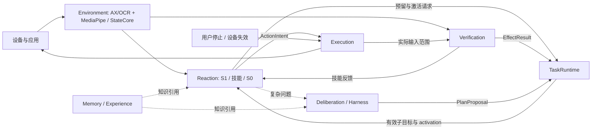

# 一期桌面模块化架构：MediaPipe 感知、Reaction 与 Harness 规划

> **历史补充稿**：内容已完整并入 [完整设计文档 v0.4](../design/complete-design.md)。保留本文件用于 R1/R2 评审追溯，后续设计只维护主文档。

- 日期：2026-09-30
- 状态：架构设计；尚未实施 MediaPipe 集成或真实设备验收。
- 范围：独立 Electron 产品；一期 macOS / Apple Silicon / 通用应用操作。
- 历史关系：本文件曾冻结一期桌面边界，v0.3 曾承载通用契约；两者的当前口径已统一到新主文档。
- 用户已确认：截图结合界面结构；Electron + Rust；本地 S1、云端 S2；MediaPipe 用于环境感知和后续 S0 神经控制，Laya S1 与 Harness S2 保持独立后端。

## 1. 设计决策

先冻结功能职责、消息和权威状态，再将它们映射为 crate、worker 和进程。一个功能模块可以跨进程实现，多个模块也可以共享一个 Rust 宿主。

MediaPipe 是本项目专用神经感知及未来 S0 神经控制管线的默认技术。MediaPipe Framework 负责计算图、时间戳和节点调度；MediaPipe Tasks / 随固定版本提供的 TFLite 推理组件用于兼容模型。LiteRT 独立 SDK 及其加速能力是后续可验证适配，不能默认等同于 MediaPipe graph 已支持的 delegate。

Laya 继续通过独立 S1 后端提供类型化语义选择；Harness Runtime 继续承载 S2。一期不要求将 Laya、LLM 或所有神经权重转换为 MediaPipe 模型。

参考架构及采纳内容：

| 来源 | 采纳的职责边界 | 本项目调整 |
|---|---|---|
| Agent S2 | 高层子目标、低层行为、专用 grounding | 日常语义选择采用 S1；复杂规划采用 Harness S2 |
| UFO | 环境采集与动作服务分开，跨应用/应用内任务分层 | 来源采集与神经感知分开；模型不能直接调用实际输入 |
| OpenHands SDK | 生命周期 owner、追加事件与只读状态投影 | 不将事件日志或上下文压缩放在停止路径 |
| OpenAdapt | 技能契约、动作后条件、效果证据 | Verification 独立发布三值效果结论 |
| Nav2 | 多速率控制、可中断技能、反应式条件、有界恢复 | 普通应用事件驱动；不引入机器人部署栈 |

## 2. 七个功能模块与状态所有权

| 模块 | 负责 | 唯一写入状态 | 接口输出 |
|---|---|---|---|
| Environment | 来源采集调度、感知、融合、对象关系、当前绑定与变化 | 环境事实、证据索引、对象实例、binding | EnvironmentSnapshot / EnvironmentDelta / PerceptionHealth |
| TaskRuntime | 根任务、工作流、范围、完成标准、预算、取消、计划安装 | GoalSpec、计划版本、根进度和根预算 | ActiveSubgoal / TaskControlContext / PlanningRequest |
| Reaction | 当前状态投影、候选、S1、技能生命周期、S0、局部恢复 | 决策生命周期、skill attempt、局部控制上下文 | PolicyProposal / ActionIntent / PerceptionRequest / SkillOutcome |
| Deliberation | 复杂目标、未知机制、复杂恢复、阶段复核 | 当前根任务的 Harness 规划会话与在途请求 | PlanProposal / ReviewProposal / EvidenceRequest |
| Execution | 实际输入仲裁、许可、持续 Guard、提交、撤销、释放 | device session、permit、输入去重和 held-input 账本 | ActionReceipt / RevokeReceipt / ReleaseResult |
| Verification | 冻结效果谓词、动作后证据、读回与重访验证 | EffectResult 和证据引用 | satisfied / unsatisfied / unknown |
| Memory / Experience | 版本化结构与技能、检索、候选经验、发布与隔离 | knowledge revisions、release、隔离记录 | KnowledgeRefs / CandidateExperience |

Operator 为 Electron 控制台。Contracts、模型适配、存储、Trace、注册表和调度器属于共享基础设施。

组合视图是不可变引用集合：EnvironmentSnapshot + TaskContext + SkillContext + ExecutionStateView + KnowledgeRefs。它携带各 owner 的 revision，不能成为第二个可修改的全局状态库。

决策生命周期和 `(decision_id, generation) -> skill_attempt_id` 映射由 Reaction 单写并持久记录；预算预留由 TaskRuntime 单写。跨 owner 的接纳使用以下协议，不能只检查不可变 TaskControlContext：

1. Reaction 为当前 pending 决策固定唯一 skill_attempt_id，向 TaskRuntime 发 ReserveAttempt，带 root cancellation epoch、task/plan revision、子目标、申请额度和期限。同一 attempt 重试使用同一 ID。
2. TaskRuntime 的根任务 actor 串行检查当前取消/期限、版本、子目标及剩余预算，幂等预留并持久记录 reservation。重复请求返回既有结果，不重复扣账。
3. Reaction 在自己的事务中原子消费 pending 决策，写入唯一映射和 reservation 引用。映射写失败则释放未激活预留；取消或进程退出后由恢复协调器查询两份账本，不重新分配 ID。
4. Reaction 请求 ActivateAttempt；TaskRuntime 再串行检查当前 root epoch、版本及 reservation，将预留变为 active。只有有效 activation 才能产生正常输入意图；过期/取消 reservation 不能激活。
5. Execution 以 activation 所属 root epoch 和自身 permit generation 独立准入。TaskRuntime 的取消更新 root epoch 并直接发送撤销；设备接纳撤销后不能提交旧代次输入。跨进程撤销未确认时保留已提交范围或 unknown，不声称撤回 OS 已接收的输入。

未发出输入的确定未激活预留可幂等回收；已激活或执行结果未知的额度保守保留，先查询/核对实际范围，不因重启重新获得额度。根预算、deadline 和 cancellation epoch 不随恢复重置。普通确定性技能也使用同一接纳协议；其他模块不通过新 ID 重放已消费决策。



## 3. Environment：来源、神经感知、事实与绑定

```text
DeviceAdapter
  -> FramePacket / StructurePacket / DeviceEvent
  -> PerceptionScheduler
      -> AX 解析 / Apple Vision OCR 适配
      -> MediaPipe worker：预处理、神经特征、兼容检测/跟踪
  -> ObservationBatch
  -> StateCore：来源、时效、身份、版本与冲突检查
  -> BindingReducer：当前对象、窗口、活动层与几何绑定
  -> EnvironmentSnapshot + DependencyChanged
```

设备提供真实源帧、采集时刻、显示器/窗口几何和权限/焦点事件。Perception 产生带来源的候选；StateCore 接纳事实；BindingReducer 位于 Environment 内，是当前 binding 的唯一写入路径。

worker 的框、类别、相似度和 track ID 不自动成为语义目标，不证明目标可见、未遮挡或可点击。多个模型由同一帧派生的结果共享 evidence group。缓存或新计算不能刷新源帧年龄。

MediaPipe 并不自动提供通用 GUI 控件模型或桌面 OCR。一期文字/控件来源以 AX 和 Apple Vision OCR 为基线；MediaPipe 第一条真实神经分支采用官方 ImageEmbedder 的兼容 MobileNetV3 small 模型，对新鲜 ROI 产生特征，供锚点候选检索和视觉相似性使用。优先复用现成 ImageEmbedderGraph 的预处理、推理和后处理；按模型契约校验 RGB、batch=1、224×224 FP32 及 normalization metadata。该分支的贡献单独评测，不能以通用图像模型加载成功宣称 GUI 识别已验收。

自定义 GUI detector、分割、跟踪和未来 S0 模型经 ModelManifest 登记：先验证任务、格式、张量、预处理、输出语义和模型许可，随后增加明确 output contract。通用 COCO detector 不被默认为 GUI detector。

## 4. MediaPipe 接入与进程边界

一期选择独立 C++ 可执行程序 `cu-perception`，采用 MediaPipe Framework / Tasks CPU 基线。Bazel/Clang 为构建依赖；终端用户不安装 Bazel、Python 或模型训练工具。Rust 与 C++ 通过本地 IPC 通信，一期不依赖第三方 Rust MediaPipe binding，也不在 Rust 宿主内新增 C++ ABI/生命周期共享。

| 进程 | 承载 | 不拥有 |
|---|---|---|
| Electron main / renderer / preload | 控制台、受控 IPC、后台进程监控、托盘 | 根任务事实和实际输入许可 |
| Rust `cu-host` | 七模块宿主部分、S1 接纳、Harness 规划适配、知识与轨迹 | OS 输入最终提交 |
| Rust `cu-device` | 设备采集与实际 Execution、焦点/几何事件、独立看门狗 | 神经推理或业务效果成功判断 |
| C++ `cu-perception` | MediaPipe 图、模型、ROI 特征和感知结果 | 当前 binding、任务目标、输入、EffectResult |
| Electron utility process `cu-decision` | Laya multilingual 的 ONNX CPU 推理 | 技能执行、授权和任务完成 |

macOS 的 C++ MediaPipe CPU 路径为初始集成目标。iOS Metal、Web GPU 和独立 LiteRT macOS Metal 的资料不直接证明该 MediaPipe graph 已有 macOS GPU 加速。当前已有官方 InferenceCalculatorLiteRt，后续优先核验该实现及 delegate 在所选 graph、模型和签名安装包中的质量、兼容性和共同负载，无须预设自研推理 calculator。GPU 回退如被配置允许，必须报告真实执行设备，不得静默宣称加速。

每个 worker 独立拥有计算队列；CPU 线程与模型并发在 ModelManifest / RuntimeProfile 中显式限额。资源验证同时运行截图、OCR、MediaPipe、Laya、S2 和 UI，避免多个默认线程池耗尽设备停止线程的执行资源。

图像/结果通道与停止通道分开。帧及缓冲引用不可修改，明确释放所有权；一期使用有界复制缓冲，跨进程图像引用在结果接纳/丢弃后释放。不承诺未验证的零拷贝。

## 5. 感知消息、坐标、时间与背压

FramePacket 至少携带 source/device session、surface epoch、frame ID、source sequence、源采集时间和时钟域、geometry revision、source policy、pixel format 与尺寸。

ObservationBatch 的公共信封至少包含：

```text
request_id, request_generation, worker_epoch, producer_sequence
device_session_epoch, surface_ref, frame_refs
source_clock_domain, observed_time, available_time
dependency_refs, result_deadline
evidence_group_ref, source_policy_ref
graph_revision, model_manifest_revision, preprocessing_revision
output_contract_revision, coordinate_space_ref, transform_revision
typed observations + observed/estimated/predicted/unknown/invalid
```

host 补 received time 并检查当前请求。每条结果继续保留源采集时间；推理完成时间仅表示 available time。定向 ROI 请求另绑定 task revision 和当前 binding generation；普通全局感知不伪造绑定。返回元数据必须与 host 保存的输入上下文对应，结果是否仍可用取决于请求期限、相关依赖、surface/session/worker epoch 和版本，不能仅因收到新回调认定新鲜。

MediaPipe packet timestamp 是 graph 调度时序标识，不直接当作系统采集时间或可信执行时钟。host 为每条 graph 输入建立单调映射到源帧/时钟域；不同采集频率的 AX、OCR 与神经输出按有界年龄、共同来源和显式缺失融合，不强行等时 join。可选流无输出时发缺失或 timestamp bound，避免无限等待。

所有框/点保留从 ROI、resize、letterbox/旋转到屏幕像素、逻辑点和显示器 origin 的变换链及 revision。过期变换不可重用；模型坐标不能直接成为 ActionIntent。跟踪 ID 的作用域为 worker epoch + stream + continuity epoch；布局变化、图重置、跳帧或虚拟列表复用可失效旧 binding，即使数值 track ID 相同。

起始负载配置：每条无状态检测/特征流最多 1 个运行帧和 1 个待处理最新帧；被替换帧显式记录 drop。状态跟踪流采用独立有序有界队列，gap/overrun 触发明确连续性重置。队列容量不定义帧率；实际刷新周期与证据最大年龄由技能 Profile 和共同负载验收冻结。

worker 独立输入线程使用 ADD_IF_NOT_FULL，有界宿主队列在 graph 外限制帧数及缓冲字节数，不能依赖 max_queue_size 单独提供严格内存上限。使用 FlowLimiter 时 max_in_flight=1、max_in_queue=1，并确保 FINISHED 路径覆盖已处理帧的成功/失败结果。没有后续帧时 host 仍按真实时钟处理 deadline；FlowLimiter 的 in_flight_timeout 不替代 watchdog。外部发布不能保留只在 Task 回调期间有效的 image 引用：返回前复制所需数据或持有明确独立的引用对象。

取消请求后先令宿主 pending generation / worker epoch 无效，隔离全部迟到结果，再请求 graph 停止并回收进程。MediaPipe Cancel / WaitUntilDone 不作为“没有后续回调”或“输入已释放”的证明。必要感知缺失时撤销相关动作，不能延长证据 TTL 保持运行。

## 6. Reaction 与执行/验证闭环

Reaction 在当前有效子目标内处理普通语义选择和技能反馈：

```text
StateCompiler -> CandidateFactory -> S1 DecisionRouter
   -> ProposalAdmission -> SkillRuntime -> S0 / short UI skills
   -> ActionIntent -> Execution
```

输入为不可变环境快照、当前子目标、知识引用、可信范围/预算及回执/效果事件。输出为 StartSkill、ContinueSkill、ObserveMore、RequestPlanning、Yield/Stop。已确定工作流直接推进，不将规则命中和输入拆分算作 S1 语义选择。

一期 S0 为确定性短点击/输入/滚动反馈；没有学习型 S0 实现。未来 S0 神经模型通过 MediaPipe 管线产生受限控制提议，仍由 Reaction 接纳及 Execution 准入，不在 calculator 中直接写设备。

用户停止和关键设备失效直接到达 Execution：原子关闭提交门、标记许可撤销、取消剩余队列、释放本系统持有输入、返回实际范围或 unknown。主机/UI 控制租约到期走同一路径。设备进程死亡后由外部监控启动 recovery-only 清理；清理结果未知则隔离输入，不自动恢复任务。

设备崩溃清理采用 supervisor 可读取的私有预记账：在每个 key/button down 之前写入 device epoch、进程启动身份、输入身份、操作序号及 may-be-held 状态，并在持久化确认后才允许正常提交。up/释放得到明确结果后更新清理状态。记录明确拒绝、未知和成功范围；预记账不能仅位于将被 SIGKILL 的设备内存中。写盘通过独立队列，只阻止新正常输入的准入，不阻塞关闭输入门和已有输入的释放。

外部 supervisor 确认旧进程身份已退出、封闭旧代次后，启动 recovery-only helper，发给绑定该 device epoch 和账本的专用 cleanup authorization。helper 只允许释放账本中本系统记录的键/按钮，不接受 down、移动、滚动或业务动作，不依赖旧业务 permit 有效。账本损坏、旧进程未确认退出或释放结果不明时继续隔离；不释放所有系统按键、不恢复旧任务。新设备 epoch 必须等清理核验、新观察和明确重新授权后才能正常接纳动作。

Verification 结合 ActionReceipt 的实际输入范围、冻结的 expected effect 和 source-observed-after 证据，产生唯一三值 EffectResult。动作前采集、动作后才完成推理的帧不能证明效果。Receipt.Completed、模型标签或 S2 ReviewProposal 均不能覆盖 EffectResult。根完成状态由 TaskRuntime 在证据满足冻结 GoalSpec 后推进。

## 7. Harness S2：先采用现有受控装配

优先复用已有 `desktop::build_with_credential_stack`，保留 `Arc<DesktopRuntime>` 的 validated `structured_output_slot`，再由 `HarnessBuilder::new(runtime.clone(), runtime).build()` 包装 SessionService / LifecycleService。一期使用结构化 PlanProposal / ReviewProposal / EvidenceRequest 联合 Schema；无需先增加新的通用 embedded factory。

每个 root 实际创建独立 DesktopRuntime + Harness + 输出 slot + OutputStream recorder，并固定 session identity、独占 writer lease 及会话持久目录；只共享宿主 credential stack，不能共享 orchestrator、transcript、累计 cost 或 slot。Harness::session() 只是当前已挂载会话的访问句柄，不能用于创建新的根任务会话。一期只接纳一个 active root；其他任务排队。根任务结束时停止新 S2 准入、取消并 await 在途回合、调用 shutdown；report.complete=false 时串行处理/重试并保持清理状态，完成后释放 runtime。M0 同时评估每 root 装配的启动耗时、驻留资源和退出回收。

适配器持有可信 request、task revision、generation 和期限。模型只提交提议；host 校验计划范围、已注册技能、完成条件和预算后，由 TaskRuntime 安装。每个 root 的 S2 回合锁覆盖清空 slot、建立 recorder scope、运行、收尾屏障、取值和最终接纳全过程。scope 绑定 request/generation；按不同 tool-use ID 统计执行路径发布的成功 StructuredOutput tool-result，模型文本、未验证 tool-call 和 slot 值变化不参与计数。重复投递的同一 tool-use ID 去重，不掩盖两个不同 ID 的有效提交。

只接纳本回合恰好 1 次有效提交且存在 schema-validated slot 的结果。0 次为缺失，超过 1 次为冲突并拒绝，即使内容相同或最终 slot 只剩一个值。Recorder 的回调归属、成功状态或收尾屏障无法核实时隔离回合；有界重试使用新 request generation 并遵守根预算。取消回合完成收尾后清空 slot、封闭 scope；迟到或无归属事件只入轨迹，不能计入下一回合，也不能安装取消后的 slot。

严格配置：独立 cwd/home；safe_mode 和 bare；关闭 user/project setting sources；MCP 路径、CLI MCP/agents、插件目录和 add-dir 全空；关闭 slash commands 与 automation；restricted tool 集合仅 StructuredOutput。宿主 permission gate 必须实际注入并对未知调用拒绝。工具列表与底层调用都测试精确白名单；仅 restricted_tools 不能被当作动态工具隔离保证。

规划所需证据由 host 从声明来源传入。EvidenceRequest 由 host 校验并调度 Environment，再在预算内发起后续 S2 回合，不为模型开放直接采集或输入工具。

根取消向 S2 传 child token，触发后 await 回合收尾；不丢弃 streaming future。TaskRuntime 记录 Harness cost delta，避免重复计费；无法取得完整 usage 时保留未知/估算状态。现有费用 cap 为回合边界检查，不能声称是对在途请求的精确硬额度。媒体、S1 和实际输入停止独立运行。

源码核验入口：`harness-runtime/crates/runtime/src/desktop/assembly.rs` 的 build_with_credential_stack；`desktop/mod.rs` 的 structured_output_slot；`api.rs` 的 HarnessBuilder；`orchestrator/src/structured_output.rs` 的 validate_output 与捕获顺序。使用时固定所有相关 package 的同一 canonical Git URL 和完整 SHA。

## 8. Memory、适配轴与工程布局

一期 Memory 支持不可变知识 revision、人工维护 release、任务固定 release、隔离记录和候选经验索引。Episode 与原始 Trace 独立保留。检索输出仅作为候选知识，当前控件值/坐标/句柄必须重新绑定；新 release 不替换正在运行任务的依赖。

三个适配轴：DeviceAdapter 提供来源与输入；Capability 提供通用技能、候选工厂、状态投影和效果契约；EnvironmentPack 提供应用识别/版本/领域规则。模型与 graph 为第四类技术适配，不能新增状态写入或输入权限。

```text
computer-user/
├── apps/desktop/                      # Electron main/preload/renderer
├── packages/
│   ├── desktop-api/                   # 类型与受控 IPC
│   └── decision-worker/               # Laya S1
├── crates/
│   ├── interaction-contracts/         # DTO、Schema、端口
│   ├── interaction-engine/src/
│   │   ├── environment/               # PerceptionScheduler / StateCore / binding
│   │   ├── tasks/
│   │   ├── reaction/
│   │   ├── deliberation/              # 提议与规划端口
│   │   ├── execution/                 # 监督契约 / reference simulator
│   │   ├── verification/
│   │   └── memory/
│   ├── harness-adapter/               # 已有 Harness 严格装配
│   ├── device-macos/                  # 实际来源/Execution/watchdog
│   └── desktop-host/                  # composition root / IPC
├── native/mediapipe-worker/
│   ├── graphs/                        # 版本化计算图
│   ├── calculators/                   # 受控预处理/模型/输出适配
│   ├── src/                           # C++ worker、协议与资源生命周期
│   └── BUILD                          # Bazel 构建目标
├── assets/model-manifests/            # 代码/权重/graph/preprocessing 哈希和许可
├── fixtures/apps/
├── tests/
├── scripts/                          # 构建、模型校验、类型生成、打包
└── docs/                             # 设计、技术资料、评审
```

MediaPipe 原生 worker、依赖库、图与固定模型作为签名安装包资源；原生库不放入 ASAR 的压缩执行路径。源码、graph 和 manifest 入库；权重与构建产物不入源码。每个模型资源单独记录许可证和来源；签名测试包含 C++ worker、Rust sidecar 与 ONNX 原生库。

## 9. 实施与验收门

1. 保存 R1 并冻结七模块接口；原样迁入 I0 与 36 项测试，再扩展桌面消息，不静默改变现有 wire Schema。
2. 并行完成 M0 spike：C++ MediaPipe CPU graph / ImageEmbedder 的真实 Mac 与签名资源验证；Laya 中英候选质量与 CPU 延迟；现有 Harness 精确工具隔离、结构化结果及取消验证。
3. 接入 AX/OCR/MediaPipe 的来源与坐标契约；StateCore、binding 和 health projection 建立单写接纳。
4. 接入真实设备、Reaction/UI 技能与 Verification；测试保存/重开、模态、虚拟列表、人工干预和 LLM 断开。
5. 加入知识 release、恢复、轨迹与完整安装包验收；夹具、真实应用与神经分支的结果分别报告。

必须覆盖：

- 同一缓存帧重复推理不刷新年龄；同源多模型不增加独立证据数量。
- MediaPipe 输出乱序、推理迟到、graph 停止后的回调、worker 重启和重复 track ID。
- graph/model/preprocessing 版本切换、ROI/letterbox/旋转/DPI/窗口位置变更及虚拟列表实例复用。
- 异步 AX/OCR/神经流有缺失时不会永久阻塞图或把 unknown 转成否定。
- detector 最新帧替换有可见 drop；跟踪跳帧导致连续性重置而不是假连续。
- 推理/CPU/媒体/写盘负载期间焦点失效或停止，设备关闭提交门并释放输入，不等待神经计算。
- 动作前帧迟到不用于动作后效果验证；回执未知不重放；旧 generation 不产生第二次技能。
- 在 ReserveAttempt、映射持久化、ActivateAttempt 和输入提交之间分别取消或崩溃；确认预留幂等、无重复扣账、无新 ID 重放、旧 root/permit epoch 失效和未知额度不被重新获得。
- 在预记账前后、down 提交前后、up 提交前后执行 SIGKILL；外部 helper 能核对 device 身份，只以 cleanup authorization 释放已登记输入，账本损坏或释放未知时隔离。
- S2 实际模型工具列表精确为允许集；被隐藏工具按名称调用仍拒绝；取消后的已验证 slot 不安装。
- 两个 root 先后装配不能共享 transcript/cost/slot；同回合两个有效 tool-use ID 的 StructuredOutput、旧回合迟到结果、取消后重试和不完整 shutdown 均按冻结规则处理。
- 知识新版本不改变在途任务，旧绑定和被隔离知识不能继续执行。

### 9.1 冻结的首轮任务与分母

硬件基线为本会话核验的 Apple M2 Max / 64 GB。运行前记录并固定 macOS build、显示器分辨率/DPI、功耗模式，以及应用、模型、graph、预处理、程序、知识 release 和全部 artifact 哈希。首轮为 20 个可复位任务，每项 seed=1..5 重复，共 100 次；语言/主题/布局变体按 fixture manifest 预先分配，不在结果出来后更换。

| 清单 | 数量 | 任务条件 |
|---|---|---|
| SET-01..06 | 6 | 已关闭跳过、开启改关闭、显式保存、自动保存等待、重访读回、同名开关按分组消歧 |
| FORM-01..07 | 7 | 单行文本、多行文本、下拉、单选组、复选目标值、校验后纠正、滚动到字段 |
| LIST-01..04 | 4 | 按标签定位、同名行按上下文消歧、虚拟列表滚动、排序/更新后新绑定 |
| MODAL-01..03 | 3 | 已知干扰弹窗关闭、模态内目标操作、保持背景禁止输入并完成模态目标 |

原生 TextEdit 独立执行 20 次：指定任务输出目录、唯一文件名、纯文本格式和预期内容，写入/保存、只读产物核验、关闭并重新打开读回。版本和初始状态固定，含中文/英文及保存对话框/既有文件变体。夹具、原生、故障注入三套报告分开；故障矩阵每个指定注入点至少运行一次并验证预期的拒绝/撤销/unknown/清理结果，不用其协议通过率替代业务完成率。

每套业务完成率分母为全部已接纳任务；失败、超时、unknown、已接纳后发现 unsupported 均保留，unknown 不计成功。接纳前拒绝单列范围和拒绝率，不能删除困难案例。质量目标为夹具和 TextEdit 各自完成率 >=95%；S1 语义承担率 >=90%，规则、Guard、重复 tick 和输入拆分不计作语义选择。取消、恢复和未知动作按故障矩阵严格断言，不能以平均完成率掩盖契约失败。

### 9.2 时延与停止门禁

冷启动（图/模型加载及首次推理）与热运行分别报告。静态支持场景和共同负载各记录至少 100 条有来源的动作 trace，报告 p50/p95、最大观察值、超时/丢帧数及样本量。热 S1 p95 目标 <=500 ms，支持场景观察到输入提交 p95 目标 <=1 s；MediaPipe 分支另报源采集到结果可用的耗时和候选质量。同一 trace 计算完整耗时，不相加各环节的分位数。

停止测试在正常、模型/媒体/写盘共同负载下各至少 100 次，分别记录可信停止事件/设备失效被观察的时刻、提交门关闭、最后一次新增正常输入提交、释放请求/回执及实际界面停止证据：提交门关闭和最后新增输入的 p95 目标 <=150 ms，held-input 释放 p95 目标 <=250 ms，host death / 控制租约失效后停止与清理的观察目标 <=1 s。后端不提供 OS 实际接收时刻时只报告真实 API 语义；回执未知或清理不明不能作为已停止样本。记录失败、隔离与最大观察值，实测最大值不当作保证上界。

这些是未来可重复实验的门禁，不是已测性能。运行前 fixture manifest、Profile、版本和阈值冻结；能力不满足必要证据或停止预算时不准入对应动作，而不延长许可/TTL 或静默切换后端。

## 10. 官方资料与验证边界

- [MediaPipe Framework 概念](https://developers.google.com/edge/mediapipe/framework/framework_concepts/overview)
- [MediaPipe 同步与调度](https://developers.google.com/edge/mediapipe/framework/framework_concepts/synchronization)
- [MediaPipe 实时流](https://developers.google.com/edge/mediapipe/framework/framework_concepts/realtime_streams)
- [MediaPipe C++](https://developers.google.com/edge/mediapipe/framework/getting_started/cpp)
- [MediaPipe GPU 支持](https://developers.google.com/edge/mediapipe/framework/getting_started/gpu_support)
- [ImageEmbedder](https://developers.google.com/edge/mediapipe/solutions/vision/image_embedder)
- [ImageEmbedder C++ 契约](https://github.com/google-ai-edge/mediapipe/blob/master/mediapipe/tasks/cc/vision/image_embedder/image_embedder.h)
- [ImageEmbedderGraph](https://github.com/google-ai-edge/mediapipe/blob/master/mediapipe/tasks/cc/vision/image_embedder/image_embedder_graph.cc)
- [CalculatorGraph 源码](https://github.com/google-ai-edge/mediapipe/blob/master/mediapipe/framework/calculator_graph.h)
- [FlowLimiter](https://github.com/google-ai-edge/mediapipe/blob/master/mediapipe/calculators/core/flow_limiter_calculator.cc)
- [LiteRT C++ SDK](https://developers.google.com/edge/litert/next/cpp_sdk)
- [官方 LiteRT inference calculator](https://github.com/google-ai-edge/mediapipe/blob/master/mediapipe/calculators/tensor/inference_calculator_litert.cc)
- [Agent S2 架构](https://arxiv.org/html/2504.00906v1#S3)
- [UFO 采集/执行](https://microsoft.github.io/UFO/mcp/overview/)
- [OpenHands Conversation](https://docs.openhands.dev/sdk/arch/conversation)
- [OpenAdapt 效果验证](https://github.com/OpenAdaptAI/openadapt-flow/blob/main/docs/design/EFFECT_VERIFIER.md)
- [Nav2 反应控制](https://docs.nav2.org/rolling/getting_started/nav2_behavior_trees/detailed_behavior_tree_walkthrough/detailed_behavior_tree_walkthrough/)

本轮验证官方资料、当前本地源码和文档契约；未下载模型、构建 MediaPipe、调用真实模型 API 或签名安装包。MediaPipe、模型和 graph 的最终完整 revision、模型哈希及加速方式在 M0 实测后固定。第二轮独立评审已批准设计修订，问题与关闭记录见 [R2](../reviews/2026-09-30-architecture-review-r2.md)；该结论不代替实现或实测门禁。
