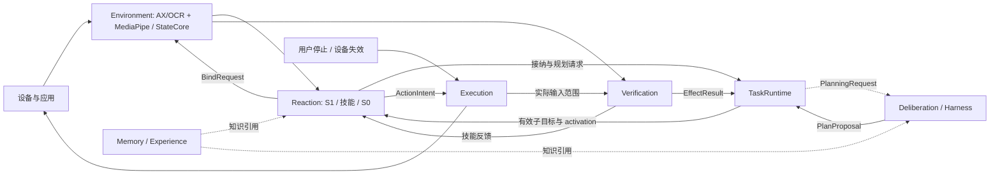
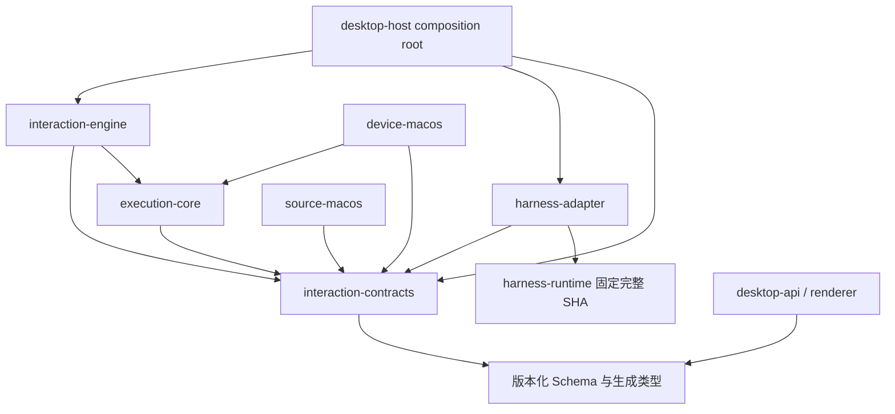
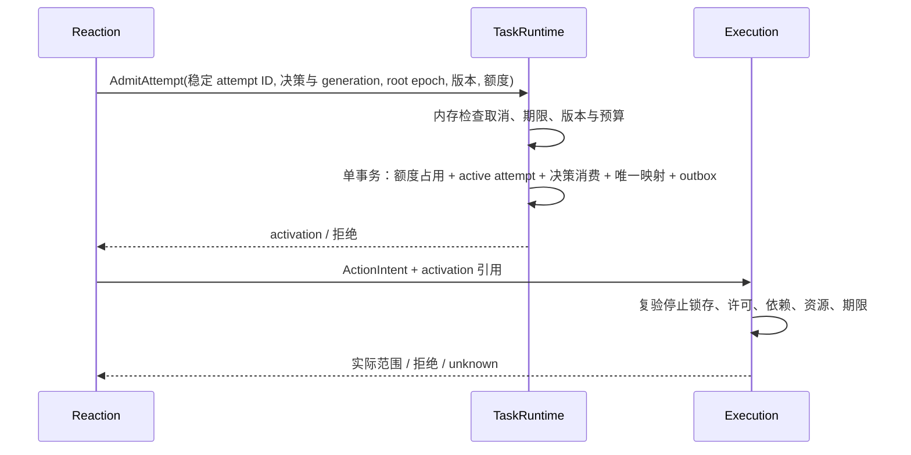
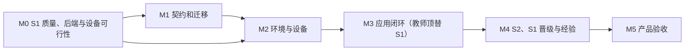

# Computer User 完整设计文档

- 文档版本：v0.5，2026-09-30（依据 R4 评审修订，见第 30.2、30.4 节）。
- 地位：**唯一主设计文档**；替代 v0.3 通用稿与桌面模块化补充的设计维护职责。游戏、空间与 WoW 的后续扩展章节（第 17–19、25 章）移入[扩展卷](extensions.md)，章号不变，不属于一期交付。评审记录和旧稿仅供追溯。
- 一期范围：macOS Apple Silicon 上的独立 Electron 桌面产品，截图结合 Accessibility/OCR。架构面向通用应用任务；一期的执行范围限定为已登记环境包的应用白名单（可复位夹具与 TextEdit），其他应用只开放观察与影子模式。
- 智能分层：MediaPipe 环境神经感知与后续 S0；S1 槽位先由教师模型显式顶替并积累标签，本地 Laya 经领域微调和晋级后接管；Harness Runtime 云端 S2；执行监督独立。
- 当前状态：设计与评审阶段。外部 I0 是模拟协议参考，尚未迁入本仓库；真实设备、模型、持久恢复、性能和签名产品均未验收。
- 阅读约定：核心契约约束一期；涉及游戏、空间、手机、训练和自动发布的内容为后续扩展，即使共享同一契约表也不进入一期交付。所有“必须”描述目标实现要求，不表示已实现。一期验收依赖的条款编号见第 26.10 节。

系统的核心是七个模块组成的可验证交互闭环：Environment 认识当前环境，TaskRuntime 管理目标和预算，Reaction 快速选择并推进技能，Deliberation 处理复杂规划，Execution 独占实际输入，Verification 判断效果，Memory/Experience 保存可复用知识。Electron Operator 提供任务、控制与证据界面。

日常动作由本地感知、S1 槽位的快速决策和有界技能完成；需要长程推理时再调用 Harness。媒体推理、云端请求、日志与数据库不能阻塞停止和已持有输入的释放。整体框架、目录和实施工作可直接依据本文展开，无需再拼接历史评审意见。

## 阅读导航

先读第 1–3 章了解产品边界、七模块和目录；第 4–16 章定义可实现契约；第 17–19、25 章是后续领域扩展，正文在[扩展卷](extensions.md)；第 20–24、26 章定义调度、学习与验证；第 27–30 章说明产品界面、当前基线、实施与来源。

- [1. 产品定位、范围与设计原则](#sec01)
- [2. 总体架构与三个闭环](#sec02)
- [3. 技术栈、部署进程、工程结构与依赖](#sec03)
- [4. 统一消息、身份、版本与时间](#sec04)
- [5. 设备能力、采集、坐标与通道](#sec05)
- [6. Environment：StateCore、对象、绑定与领域状态](#sec06)
- [7. Environment：MediaPipe 神经感知与调度](#sec07)
- [8. Reaction：S1 快速决策槽位、Laya 后端与校准](#sec08)
- [9. 状态编译与动态候选生成](#sec09)
- [10. 类型化判断与 DecisionProgram](#sec10)
- [11. Reaction：决策接纳、预算、去重与取消](#sec11)
- [12. Deliberation：Harness S2 规划、升级与复核](#sec12)
- [13. TaskRuntime 与 Reaction：任务、技能和工作流](#sec13)
- [14. 输入仲裁、持续 Guard、撤销与恢复](#sec14)
- [15. 应用能力与界面闭环控制](#sec15)
- [16. 界面记忆、检索、发布与持久恢复](#sec16)
- [17. 游戏能力与 S0 局部控制（后续扩展）](#sec17)
- [18. 空间定位、World Atlas 与可选三维地图（后续扩展）](#sec18)
- [19. WoW 环境包：从专用方案到通用模块（后续扩展）](#sec19)
- [20. 宿主调度、失败恢复与降级](#sec20)
- [21. 原始轨迹、训练样本与泄漏约束](#sec21)
- [22. 学习、微调、蒸馏与模型晋级](#sec22)
- [23. 多速率调度、完整时延与资源预算](#sec23)
- [24. 应用端到端案例：关闭通知设置](#sec24)
- [25. 游戏端到端案例：到达地标并交互（后续扩展）](#sec25)
- [26. 评测指标、故障矩阵与验收门](#sec26)
- [27. Electron Operator、调试界面与 I0 迁移](#sec27)
- [28. 实施路线、工作包与交付依赖](#sec28)
- [29. 冻结配置、剩余决策与验证边界](#sec29)
- [30. 参考系统、来源映射与本轮评审](#sec30)

<a id="sec01"></a>

## 1. 产品定位、范围与设计原则

### 1.1 核心目标

让电脑与手机上的应用、游戏共用一个可持续观察、快速决策、可验证执行和积累经验的系统。

默认链路是专用神经感知形成环境事实，S1 快速决策槽位承担日常选择，技能与 S0 本地控制器完成动作和反馈。S1 槽位的目标后端是本地 Laya；它接管之前由教师模型显式顶替（第 8.6 节）。S2 LLM 负责复杂目标理解、长程规划、未知机制、复杂失败处理、阶段性复核与经验提炼。正常动作不逐步等待 LLM。

一期产品提供 macOS 应用任务入口，首个业务闭环由教师模型顶替 S1 槽位、本地 Laya 影子并行；游戏入口、手机和其他桌面平台在后续阶段开启。内核按设备、交互能力和环境适配组合。应用长期记忆重点是界面结构、转换和工作流；游戏扩展重点是时序状态、导航、目标选择和局部控制。

### 1.2 三类扩展边界

实现按三个独立维度组合：

| 维度 | 职责 | 示例 |
|---|---|---|
| 设备适配 | 采集、输入、焦点、设备状态、输入释放 | 桌面系统、手机、浏览器表面 |
| 交互能力 | 一类交互的状态、技能、控制和验证 | 表单、列表、拖拽、空间导航、实时对抗 |
| 环境适配 | 特定软件的规则、结构和配置 | 某办公软件、某手机应用、WoW |

WoW 的背包使用界面能力，移动使用空间能力；三维编辑软件也可同时使用这两类能力。不同任务不必共享模型权重或完整状态结构。

### 1.3 来源政策与工作假设

- 感知来源由任务配置声明。可支持 `visual_only` 与 `visual_with_structure`，但严格纯视觉模式不能暗中读取 DOM、辅助功能树或隐藏业务数据。
- 截图与结构化界面信息均标明来源和时效。结构树不自动证明对象可见、未被遮挡或处于活动层。
- 暂以电脑承载主要编排和推理、设备端承载采集与执行为原型部署建议。真机、模拟器、本机和远程的可用能力分别登记。
- 一期采用模块化部署，保留必要的推理工作进程与独立执行停止机制；不要求每个逻辑模块都是网络服务。
- 环境结构知识使用显式对象与关系表达；未来可增加学习式世界模型，但它不是一期前置条件。
- 操作范围来自任务与设备授权。流程内部的常规观察、验证和有界恢复不需要每一步额外确认；效果等级达到提交及以上、且未被已确认目标覆盖的动作除外（第 9.3 节）。

### 1.4 固定原则

1. 快速决策输入从当前证据编译，不逐帧调用 LLM 描述画面。
2. 环境事实、模型推断、预测和长期经验分别记录；未知不转成否定或肯定。
3. 当前目标绑定必须从新观察建立，历史坐标、句柄和行号不能直接执行。
4. 任务目标、完成条件和根预算经用户确认、由受信入口接纳后冻结，恢复不降低标准或重置预算。
5. 最终执行端独占输入提交与释放；决策与规划模型只提出候选。
6. 输入结束、业务效果和根任务完成分别确认。
7. 取消、撤销、到期释放独立于模型、图像负载和存储任务。
8. 学习与知识发布有独立验收，正在执行的版本不被后台训练悄悄改变。
9. 泛化依靠通用技能、对象关系和决策程序，不要求为每个软件手写坐标脚本。
10. 决策覆盖率、质量和完整反应时间共同验收，不能只展示模型前向耗时。
11. 动作按效果等级准入；超出已确认目标覆盖范围的高等级效果必须先得到用户确认。
12. 停止由最终执行端锁存，宿主和模型不能单方面解除。

### 1.5 一期冻结范围与技术选择

| 层面 | 一期决定 | 后续扩展 / 验证边界 |
|---|---|---|
| 产品 | 独立 Electron 桌面应用，macOS Apple Silicon；执行范围为已登记环境包的应用白名单（夹具与 TextEdit） | Windows、Linux、手机、游戏不进入一期交付分母；白名单外应用只开放观察/影子，执行需单独验收 |
| UI | Electron + React + TypeScript，electron-vite 构建，npm workspaces | 精确版本由 M0 lockfile 冻结，不复制其他产品的签名身份 |
| 运行内核 | Rust + Tokio，七个 crate 的模块化宿主 | 功能模块先划分，不拆成七个网络服务 |
| 来源 | visual_with_structure：ScreenCaptureKit 截图、Accessibility、Apple Vision OCR | visual_only 是后续可独立评测的来源配置 |
| 神经感知 | MediaPipe Framework / Tasks，独立 C++ worker，CPU 基线 | 先接官方 ImageEmbedder；GUI detector、跟踪与加速分别验证 |
| S0 | 确定性短 UI 技能和反馈 | 学习型 S0 沿用 MediaPipe，只产生受限控制提议 |
| S1 | FastDecisionAdapter 槽位：云端教师模型显式顶替并记录标签；Laya multilingual（TypeScript/ONNX Runtime CPU 常驻 worker）影子运行，经领域微调、校准后按 DecisionProgram 晋级接管 | 基础权重零样本不作为交付依据（第 8.6 节）；Jev 为后续可选托管适配 |
| S2 | harness-runtime 云端模型；集成路线（完整装配或模型层直连）由 M0 对照定案 | 两条路线都复用 provider、凭据与取消；不新增平行 LLM 栈 |
| 执行原语 | 原子点击、带修饰标志的按键、文本、滚动、AX 动作、窗口激活 | 拖拽、长按与持续按住在设备死亡清理交付后启用（第 14.6 节） |
| 存储 | SQLite + 不可变文件资产，权威账本与普通 Trace 分开 | 向量索引可重建，自动学习/发布后置 |
| 验收 | 可复位应用夹具 + 原生 TextEdit；M2 Max / 64 GB 参考机器，另报一档 8–16 GB 机器 | 不以模拟协议或模型加载证明真实任务能力 |

MediaPipe 是专用神经感知与未来 S0 的技术基础，不替代 S1 决策后端或 Harness S2。MediaPipe 计算图框架、模型权重和任务语义分别验证；一期不安排从零训练通用 GUI 网络。参考架构的采纳理由见第 30 章。

<a id="sec02"></a>

## 2. 总体架构与三个闭环



1. 实时闭环：专用感知、状态编译、S1 快速选择、S0 局部控制、执行反馈。游戏控制持续运行；应用主要按变化与操作结果触发。
2. 任务闭环：子目标与进度由宿主推进；复杂目标编译、复杂重规划和复核由 S2 LLM 异步参与。已安装计划内的正常动作不依赖 LLM 在线。
3. 学习闭环：轨迹、候选知识或策略、验证、发布、回滚。不会直接修改正在执行的技能版本。

确定性机制负责资源、时间、取消和契约。模型负责识别、预测、评分与规划。可替换模型接入相同闭环。

### 2.1 智能分层

| 层 | 做什么 | 调用节奏 |
|---|---|---|
| S0 局部控制 | 跟随当前路径、短转向、拖拽纠偏、输入反馈 | 本地事件或控制周期；游戏持续运行 |
| S1 快速决策 | 下一技能、候选目标、观察方式、已知恢复分支、是否请求规划 | 有意义的状态/效果变化触发，按任务设置节流 |
| S2 复杂规划 | 理解复杂目标、建立子目标关系、未知机制推理、跨阶段调整、经验提炼 | 任务接纳或升级事件触发，异步 |
| 执行监督 | 授权、依赖、期限、仲裁、撤销、释放 | 独立设备事件与看门狗，不依赖任何模型返回 |

普通点击可能无需学习型 S0，直接调用有界 UI 技能即可。游戏的连续转向不需要每次向 S1 发请求；S1 选定局部目标后，由 S0 基于新观察持续控制。S0/S1 都不能自行延长动作或扩大任务范围。

### 2.2 七个功能模块与唯一状态所有者

| 模块 | 负责 | 唯一写入状态 | 接口输出 |
|---|---|---|---|
| Environment | 来源采集调度、感知、融合、对象关系、当前绑定与变化 | 环境事实、证据索引、对象实例、binding | EnvironmentSnapshot / EnvironmentDelta / PerceptionHealth / BindingResult |
| TaskRuntime | 根任务、工作流、范围、完成标准、预算、取消、计划安装、attempt 接纳 | GoalSpec、计划版本、根进度、根预算和 attempt 激活 | ActiveSubgoal / TaskControlContext / activation / PlanningRequest |
| Reaction | 当前状态投影、候选、S1、技能生命周期、S0、局部恢复 | 决策生命周期、skill attempt、局部控制上下文 | AdmitAttempt / BindRequest / ActionIntent / PerceptionRequest / SkillOutcome |
| Deliberation | 复杂目标、未知机制、复杂恢复、阶段复核 | 当前根任务的规划回合与在途请求 | PlanProposal / ReviewProposal / EvidenceRequest |
| Execution | 实际输入仲裁、许可、持续 Guard、停止锁存、提交、撤销、释放 | device session、permit、停止锁存、输入去重和输入账本 | ActionReceipt / RevokeReceipt / ReleaseResult / StopAck |
| Verification | 依据冻结效果谓词评估动作后证据，声明读回与重访的证据需要 | EffectResult 和证据引用 | EffectResult / EvidenceNeed |
| Memory / Experience | 版本化结构与技能、检索、候选经验、发布与隔离 | knowledge revisions、release、隔离记录 | KnowledgeRefs / CandidateExperience |

Operator 为 Electron 控制台。Contracts、模型适配、存储、Trace、注册表和调度器属于共享基础设施。各接口消息的生产者、消费者与持久性见第 4.8 节消息目录。

组合视图是不可变引用集合：EnvironmentSnapshot + TaskContext + SkillContext + ExecutionStateView + KnowledgeRefs。它携带各 owner 的 revision，不能成为第二个可修改的全局状态库。

### 2.3 模块内部结构与依赖规则

| 功能模块 | 内部组件 | 状态推进规则 |
|---|---|---|
| Environment | SourceCoordinator、PerceptionScheduler、StateCore、BindingReducer | 感知候选经单一 reducer 接纳；binding 只由 BindingReducer 改写 |
| TaskRuntime | GoalCompiler、RootTaskActor、WorkflowCoordinator、BudgetLedger、PlanInstaller | 根任务 actor 串行安装计划、接纳 attempt 并占用预算、取消和完成 |
| Reaction | StateCompiler、CandidateFactory、DecisionRouter、ProposalAdmission、SkillRuntime、LocalControllers | 一个 lane 只消费一次逻辑决策，技能 attempt 统一管理反馈/恢复 |
| Deliberation | PlanningCoordinator、HarnessPlannerPort、S2TurnOwner（路线 A 时同时持有会话） | 返回提议，TaskRuntime 决定安装；不改根目标和执行许可 |
| Execution | AdmissionGate、ResourceArbiter、GuardMonitor、StopLatch、InputLedger、Revoke/Cleanup（合称 ExecutionSupervisor，实现在 execution-core） | 最终设备进程串行协调停止锁存、许可撤销与实际提交 |
| Verification | PredicateRegistry、EvidenceJoiner、EffectEvaluator | 绑定冻结谓词与证据发布三值结果，其他模块只消费 |
| Memory / Experience | KnowledgeStore、Retriever、Publisher、QuarantineRegistry、ExperienceIndex | 精确 revision/release；当前事实与会话坐标不发布为长期知识 |

模块只通过类型化命令、事件和只读端口交流，不相互写数据库表或持有可变状态指针。请求/响应负责需要明确接纳结果的操作，事件负责状态投影与通知；事件总线本身不提供事务或执行授权。

TaskRuntime 拥有根工作流的节点进度与 active subgoal；Reaction 拥有一个子目标内的 skill attempt、复合技能子实例及局部恢复。子技能不能直接推进根节点，根工作流不能绕过 Reaction 新建另一套输入。Verification 的 EffectResult 可推动技能和根进度，但只有 TaskRuntime 能宣布根完成。

跨 owner 视图没有“同时更新全局快照”的承诺。StateCompiler 读取 revision vector，保留依赖集合；真正的预算/取消接纳和设备准入再次检查权威状态。第 11.2 节定义 AdmitAttempt 协议。

<a id="sec03"></a>

## 3. 技术栈、部署进程、工程结构与依赖

### 3.1 进程与运行资源

一期选择独立 C++ 可执行程序 `cu-perception`，采用 MediaPipe Framework / Tasks CPU 基线。Bazel/Clang 为构建依赖；终端用户不安装 Bazel、Python 或模型训练工具。Rust 与 C++ 通过本地 IPC 通信，一期不依赖第三方 Rust MediaPipe binding，也不在 Rust 宿主内新增 C++ ABI/生命周期共享。

| 进程 | 承载 | 不拥有 |
|---|---|---|
| Electron main / renderer / preload | 控制台、受控 IPC、后台进程监控、托盘与全局停止热键 | 根任务事实和实际输入许可 |
| Rust `cu-host` | 七模块宿主部分、S1 接纳与教师适配、S2 规划适配、知识与轨迹 | OS 输入最终提交 |
| Rust `cu-device` | 实际 Execution：输入提交、Guard、许可、停止锁存、人工输入观察、提交前命中测试、前台/窗口事件、独立看门狗 | 截图、AX 树读取、OCR、神经推理或业务效果成功判断 |
| Rust `cu-source` | 来源采集：ScreenCaptureKit 截图、AX 树读取与通知、Apple Vision OCR | 输入提交、许可、当前 binding |
| C++ `cu-perception` | MediaPipe 图、模型、ROI 特征和感知结果 | 当前 binding、任务目标、输入、EffectResult |
| Electron utility process `cu-decision` | Laya multilingual 的 ONNX CPU 推理 | 技能执行、授权和任务完成 |

cu-device 持有输入权限，必须始终可响应，因此只保留提交与监督所需的最小职责。截图、AX 树遍历和 OCR 会阻塞或占用大量计算（AX 调用是对目标应用的同步 IPC），放在 cu-source；cu-source 挂起或崩溃只使依赖其证据的许可到期或被撤销，不影响停止与释放。

macOS 的 C++ MediaPipe CPU 路径为初始集成目标。iOS Metal、Web GPU 和独立 LiteRT macOS Metal 的资料不直接证明该 MediaPipe graph 已有 macOS GPU 加速。当前已有官方 InferenceCalculatorLiteRt，后续优先核验该实现及 delegate 在所选 graph、模型和签名安装包中的质量、兼容性和共同负载，无须预设自研推理 calculator。GPU 回退如被配置允许，必须报告真实执行设备，不得静默宣称加速。

每个 worker 独立拥有计算队列；CPU 线程与模型并发在 ModelManifest / RuntimeProfile 中显式限额。资源验证同时运行截图、OCR、MediaPipe、Laya、S2 和 UI，避免多个默认线程池耗尽设备停止线程的执行资源。

图像/结果通道与停止通道分开。帧及缓冲引用不可修改，明确释放所有权；一期使用有界复制缓冲，跨进程图像引用在结果接纳/丢弃后释放。不承诺未验证的零拷贝。

Electron main 是进程 supervisor：启动并监控 cu-host、cu-device、cu-source、cu-perception 与 cu-decision，持有进程身份和启动代次；不持有业务事实写入权。cu-device 独立维护 host 控制租约和 supervisor 存活租约，任一必要租约失效均关闭正常提交门。main 崩溃时依靠仍存活的设备看门狗清理；device 崩溃时由仍存活的 main 封闭旧代次、隔离输入通道并按第 14.6 节处理。两者同时死亡或 OS 失去调度不宣称有独立清理保证；下次启动先按第 14.6 节核对输入状态。cu-host、cu-source 与 cu-perception 在 supervisor 租约失效后自行收尾退出，不作为孤儿进程继续持有数据库写锁或在途云端请求。

关闭产品时先禁止新任务与正常输入，撤销并取得设备释放结果，再取消/收尾模型请求、关闭 Harness、刷写账本并退出。不能先杀 device 再等待普通业务收尾。推理 worker 可单独重启；重启使旧 worker epoch 失效，不触发旧任务输入重放。

### 3.2 macOS 适配与安装包

执行端与来源端分为 device-macos 和 source-macos 两个 crate。截图采用 ScreenCaptureKit 的 SCStream（第 5.4 节）；不使用 harness-runtime 所依赖的 xcap 截图路径，它在 macOS 上调用的 `CGWindowListCreateImage` 自 macOS 14 弃用、在 macOS 15 SDK 标为废止，也不提供源时间和帧状态。输入可参考 harness-runtime 的 enigo 封装（CGEvent），合成事件带本产品的事件源标记；AX 动作、Accessibility 树与 Apple Vision OCR 另建适配。Harness S2 配置不开放原有 Computer 工具，不能形成第二条输入路径。

Screen Recording 和 Accessibility 权限分别探测，拒绝/撤销后发布能力变化；不可读取的焦点、活动层与对象状态保留 unknown。开发进程权限不等于签名产品权限，M0 在安装包中验证；事件 tap 所需的权限（Accessibility 是否足够，或另需 Input Monitoring）和各 helper 进程的权限归属同样在安装包中核实。TCC 提示、bundle ID、Keychain service、签名标识和日志目录使用本产品独立命名。

MediaPipe 原生 worker、Rust sidecar、ONNX 原生库、图与模型按安装包资源布局签名；原生可执行文件和动态库位于 ASAR 外。代码/graph/manifest 入库，权重按哈希从受控来源获得并装入发布包，运行时只做校验、加载与预热，不在任务路径上联网下载；训练工具不随客户端分发。MediaPipe 的 macOS 构建默认依赖 Homebrew 的 OpenCV 动态库，M0 决定静态构建或随包重签名，产品不依赖用户机器上的 Homebrew。每项资源记录代码与模型许可；本仓库 MIT 不自动覆盖第三方权重。

### 3.3 目标文件结构

下列为拟建目录，当前仓库仍以设计资料为主。一期用七个 Rust crate 保持构建与依赖边界：七个逻辑模块位于 engine 内；execution-core 单列，使模拟器和真实设备运行同一套执行状态机；来源端与执行端分为两个平台 crate，使 cu-device 不链接采集、OCR 或神经运行时。除此之外，仅在独立发布、平台依赖或构建隔离需要时再拆 crate。

```text
computer-user/
├── Cargo.toml / Cargo.lock / rust-toolchain.toml
├── package.json / package-lock.json   # npm workspaces
├── apps/desktop/
│   ├── src/main/                     # app、supervisor、权限、窗口、stop bridge
│   ├── src/preload/                  # contextBridge 的受控 API
│   ├── src/renderer/                 # 任务、设备画面、证据、设置
│   ├── resources/                    # 图标及打包资源清单
│   └── electron.vite.config.ts
├── packages/
│   ├── desktop-api/src/              # 由契约生成 DTO + 运行时校验/IPC facade
│   └── decision-worker/src/          # Laya tokenizer、ONNX、取消、版本
├── crates/
│   ├── interaction-contracts/src/    # DTO、ID、错误码、Schema、端口
│   ├── execution-core/               # 不含 IO 的执行监督核心
│   │   ├── src/                      # 许可、Guard、仲裁、停止锁存、输入账本；后端与时钟为 trait
│   │   └── tests/                    # 迁入的 I0 执行回归，面向生产状态机
│   ├── interaction-engine/
│   │   ├── src/
│   │   │   ├── environment/          # source/perception/state/binding
│   │   │   ├── tasks/                # goal/workflow/budget/plan
│   │   │   ├── reaction/
│   │   │   │   ├── compiler/         # DecisionState 与裁剪记录
│   │   │   │   ├── candidates/       # 候选实例化
│   │   │   │   ├── decision/         # S1 router、代次与唯一接纳
│   │   │   │   ├── skills/           # 生命周期与局部恢复
│   │   │   │   └── controllers/      # 确定性 S0 / 后续神经提议
│   │   │   ├── deliberation/         # S2 请求与提议端口
│   │   │   ├── execution/            # 宿主侧监督端口；reference simulator = execution-core + 虚拟后端/时钟
│   │   │   ├── verification/         # 谓词与效果证据
│   │   │   ├── memory/               # 检索、release、隔离、经验
│   │   │   ├── capabilities/ui/      # 跨应用 UI 技能与候选工厂
│   │   │   └── infrastructure/       # scheduler/storage/trace 端口实现
│   │   └── tests/                    # 接纳、恢复与验证回归
│   ├── harness-adapter/src/          # S2 集成（路线 A 或 B）、单次结构化调用端口、取消/退出
│   ├── source-macos/src/             # capture(ScreenCaptureKit)/ax/vision
│   │   └── bin/cu-source.rs
│   ├── device-macos/src/             # input(CGEvent/AX 动作)/hit-test/human-input/watchdog
│   │   └── bin/cu-device.rs          # 一期仅正常模式；recovery-only 模式随按住类原语交付
│   └── desktop-host/src/             # composition root、IPC、配置
│       └── bin/cu-host.rs
├── native/mediapipe-worker/
│   ├── src/                         # C++ cu-perception / IPC / lifetime
│   ├── graphs/                      # 版本化计算图
│   ├── calculators/                 # 项目输出适配与必要扩展
│   └── BUILD                        # Bazel target；版本配置随 M0 固定
├── contracts/                       # I0 v1 与新 desktop/worker 协议分开版本
├── capabilities/                    # SkillManifest / DecisionProgram 数据
├── environments/                    # TextEdit、fixture 的识别与兼容规则
├── assets/model-manifests/          # model/graph/preprocessing/许可与哈希
├── learning/                        # S1 微调/校准/晋级（M4 起）；其余离线训练后续
├── fixtures/apps/                   # 设置/表单/列表/模态与隐藏验收真值
├── tests/                           # 跨进程、真机、性能与打包验收
├── scripts/                         # 模型校验、类型生成、构建、签名
└── docs/
    ├── design/complete-design.md    # 唯一主设计（核心卷）
    ├── design/extensions.md         # 扩展卷：游戏、空间、WoW
    ├── architecture/               # 历史补充与后续 ADR
    └── reviews/                    # R1–R4 评审记录
```

### 3.4 编译依赖与扩展装配



箭头表示编译依赖或类型生成方向。engine 不依赖 Electron、Harness DesktopRuntime 或 macOS API；adapter 实现 contracts 中端口，desktop-host 注入实现。设备实际输入不依赖神经 worker，device-macos 也不链接 ScreenCaptureKit、Vision 或任何神经运行时。execution-core 不依赖平台 API：输入后端与时钟以 trait 注入，reference simulator 和 cu-device 运行同一套状态机，迁入的 I0 回归因此直接约束生产实现。C++ worker 使用版本化协议和 golden fixtures，不要求与 Rust 共享 ABI。

三个业务扩展轴保持独立：DeviceAdapter 提供来源与输入；Capability 提供状态投影、候选工厂、技能及效果契约；EnvironmentPack 提供应用/领域识别、版本和规则。MediaPipe graph / Laya / Harness 是模型技术适配。注册 manifest 不能获得新的状态写入权限；一期能力实现静态链接并由白名单装配，环境包以版本化数据加载，不支持运行任意插件脚本。

共享基础设施保持窄职责：存储提供事务/恢复，Trace 提供关联记录，Registry 提供已登记类型和版本，Scheduler 提供资源配额；它们不能代替业务 owner 决定完成或授权。

<a id="sec04"></a>

## 4. 统一消息、身份、版本与时间

### 4.1 业务消息链

```text
Observation
  → EnvironmentSnapshot + DecisionContextView
  → DecisionRequest / DecisionProposal
  → SkillRequest
  → ActionIntent
  → ActionReceipt
  → EffectResult
```

本设计使用 EnvironmentSnapshot 表示环境权威快照，DecisionContextView 表示各 owner 的不可变组合视图。历史 BeliefSnapshot 是组合视图的旧概念名；它不是第二个状态库，也不要求一期实现完整概率分布。

| 消息 | 最小责任 |
|---|---|
| Observation | 来源、设备/会话/表面、源时间、证据、值、观测性质与有效范围 |
| EnvironmentSnapshot / DecisionContextView | 环境事实快照 / 环境、任务、技能、执行与知识的 revision vector |
| DecisionRequest / DecisionProposal | 决策程序、模型/校准版本、当前候选、相关证据、期限、类型化选择与升级信号；仍是宿主待实现接口 |
| SkillRequest | 根任务、目标、技能参数、相关依赖、预算、完成要求 |
| ActionIntent | 技能尝试、目标绑定、输入原语、证据引用、必要依赖及版本、资源、执行窗口 |
| ActionReceipt | 拒绝/接收/提交/部分提交/取消/未知，以及原因、已提交输入和释放状态 |
| EffectResult | 验证谓词、目标身份、前后证据、满足/不满足/未知、确认范围 |

公共信封包含协议版本、消息 ID、设备与会话身份、任务及尝试身份；各消息按需要填写。领域字段由注册表检查，不用一个无限制 JSON 字典替代所有类型约束。

执行控制另有 `RevokeExecution` 与撤销回执：绑定设备会话、任务/技能尝试或执行许可及其代次，携带失效依赖与原因。撤销不等待下一次正常决策；回执分别记录许可已撤销、待执行输入已取消、已持有输入的释放结果。没有收到回执时，不能声称设备已经停止。设备端处理规则见第 14.4 节。

关键区别：

- `observed`、`estimated`、`predicted`、`unknown`、`invalid` 保持可区分。
- 检测分数、OCR 分数和模型自报信心不是可直接比较的成功概率。
- 同一帧的多个派生结论保留共同证据来源，不能当成独立重复支持。
- 效果未知和任务失败分开。没有收到输入回执也不表示输入未执行。
- 目标状态已满足和本次动作造成该状态分开。例如队友已经开门可以满足通行目标，但不能生成“本次点击开门成功”的因果标签。

### 4.2 身份与版本

| 身份 | 用途 | 变化条件 |
|---|---|---|
| device_id / device_session_epoch | 哪台设备、哪次有效连接 | 设备身份持久；会话在重新建立执行连接时更新 |
| surface_id / surface_epoch | 哪个可交互表面及其实例 | 表面替换、重建或无法证明连续性时更新 |
| semantic_target_ref / binding_ref | 任务中的语义对象 / 当前观察实例 | 语义目标固定；滚动、布局或实例变化后重新绑定 |
| root_task_id / task_revision / attempt_id | 根目标 / 用户或受信任务修订 / 本次尝试 | 重试只换尝试，不重置根预算 |

焦点、活动层、几何、模型和知识发布分别有修订号。普通帧更新只推进 frame sequence 和状态提交号，不使所有动作失效。当前动作按依赖清单检查相关版本与语义是否兼容。

### 4.3 公共信封

```text
Envelope
  protocol_version, message_id, message_type
  producer_id, producer_sequence
  device_id?, device_session_epoch?, surface_id?, surface_epoch?
  root_task_id?, task_revision?, attempt_id?
  source_clock_domain, source_time, emitted_time
  trace_id, payload
```

每种消息的注册表定义哪些字段必需。源时间、推理完成时间和消息抵达时间分开；没有时钟映射时不能跨设备计算年龄。消息 ID 去重不代替动作意图的执行去重。

协议升级采用版本协商。未知消息或字段是否允许由协议版本决定；执行相关必需能力不兼容时拒绝执行，不能静默忽略约束。

### 4.4 时钟与真实新鲜度

来源端和执行端使用明确的时钟域。不同设备的单调时间不能直接相减。远程协议需提供经过误差界定的时间映射。没有可靠映射时，只能使用与执行端同一主机、同一时钟域内产生且能回查原始采集时间的证据，或具有已证明年龄上界的因果协议；无法界定证据年龄时，拒绝依赖该证据的动作。来源序列递增或消息刚抵达都不能证明画面新鲜，不能用接收时间刷新原始证据。

采集时间还需与来源活性区分：采集函数可能不断返回同一份缓存。适配器应提供来源新鲜度状态与依据，不能仅凭新时间戳或新帧号延长动作有效期。

最终持有输入的一端拥有独立到期释放和停止能力。根任务、动作、证据和许可分别限时；控制连接有心跳不代表旧证据仍可续期。

期限是动作有效性的上界。期限内一旦必要条件失效或变为未知，仍须按第 14.4 节撤销，不能等到计时结束才释放输入。

### 4.5 接口级别

本章与后文的 Envelope、EnvironmentSnapshot、DecisionContextView、DecisionRequest、SkillRequest 等是目标接口设计。外部 I0 只实现其中的执行协议子集，字段与语义以第 27 章列出的 Rust 类型和导出 Schema 为准。

observed_time、available_time、emitted_time、received_time、submitted_time 和 verified_time 分别记录。UTC 用于跨记录索引，单调时钟用于同会话期限；跨域时延需要带误差界限的时间映射。视频保留 video_id、PTS 与连续片段边界，上传时间不作为资源实际观测时间。

### 4.6 一期本地 IPC 与进程握手

Electron renderer 通过 preload 的 contextBridge 调用明确列举的 desktop-api；main 校验 sender/frame、命令 Schema、任务范围和订阅生命周期。renderer 不获得任意 channel、shell、文件路径或原生输入入口。renderer 启用 contextIsolation、sandbox、禁用 nodeIntegration，并使用受限 CSP 与打包的本地内容。[Electron 官方边界](https://www.electronjs.org/docs/latest/tutorial/security)

main 管理 native 子进程；cu-host、cu-device、cu-source、cu-perception 之间采用私有 Unix domain socket。启动时由 main 分配会话与 peer-role，使用本用户私有目录、受限文件权限、一次性握手凭据及进程启动身份校验；凭据经继承私有管道交付，不放命令行或日志。socket 文件名不是认证，PID 单独也不能证明同一进程。该机制隔离协议角色，不宣称构成对同用户任意恶意进程的完整 OS 沙箱。

cu-decision 由 Electron utilityProcess 启动；main 仅中继固定 Schema 的 DecisionRequest/Proposal 和生命周期消息到 cu-host，不执行语义接纳。进程崩溃或中继断开使该 worker epoch 失效。utilityProcess 的 Node 模块加载与 ONNX 原生二进制要在签名包中单独测试。[官方 API](https://www.electronjs.org/docs/latest/api/utility-process)

每个连接先发送 Hello(protocol range、peer role、build revision、process start identity、session/worker epoch)，返回协商版本与能力，再经模型/设备自检发送 Ready。只有相应能力 ready 才可接纳依赖请求；健康信号只证明进程/通道活性，不刷新画面证据或输入许可。

控制信封采用长度前缀 UTF-8 JSON，由 interaction-contracts 导出 Schema/TS 类型，C++ 通过共同 golden fixtures 校验；不能三端手工维护不一致的字段语义。大图像走独立有界二进制通道，metadata 引用 frame_id/byte_length/format/checksum 和只读所有权；一期采用复制缓冲，不在 JSON 内传 base64 全帧。长度、解压后尺寸、队列帧数/字节数和消息速率在 RuntimeProfile 有硬上限，分配前检查；精确默认值在 M0 按屏幕规模冻结。

| 通道 | 端点与内容 | 接纳与失败语义 |
|---|---|---|
| Stop/control | main → device 的停止与恢复命令（设备锁存并分配 stop_seq，第 14.8 节）；host → device 的取消/撤销/租约 | 独立于图像、普通模型结果和持久化队列；溢出/序号缺口使相关许可失效；host 不能解除锁存 |
| Input command | host → device 的 activation/permit/intent/query，携带 acked_stop_seq | device 单一仲裁器与 Stop 共用最终提交门；多连接也不能绕过撤销顺序 |
| State/result | device/source/perception/decision → host | producer epoch/sequence 去重；缺口触发重同步或未知，不静默视为连续 |
| Frame | source → host/perception 的图像 | 无状态 latest-only；时序流显式 gap/reset；消费者退出回收租约 |
| UI projection / trace | host → main → renderer / 存储 | 有界投影，可重取快照；不能用 UI ACK 充当业务执行回执 |

接收 ACK 只表示协议接收，业务结果沿 request_id 查询；请求超时不等于没有执行。可幂等请求以稳定 request ID 重发；正常输入、技能与计划分别使用自己的唯一接纳账本。断连后重新握手并提高 epoch，旧响应不可进入新 session；禁止将排队旧意图自动发送到新连接。

### 4.7 持久 deadline 与重启

同机进程使用统一声明的单调时钟及 boot identity；跨进程启动不重设根 deadline。持久记录同时保存受信期限、时钟域/boot identity、最近检查点和可解释的 UTC 映射。系统重启、睡眠计时语义或时钟回拨导致剩余额度无法界定时，任务进入 needs_revalidation/expired，不能简单以“当前时间 + 原预算”重建期限。M0 对所选 macOS 时钟的睡眠行为和 IPC 映射进行验收。

### 4.8 消息目录

下表列出模块间与进程间的消息。“I0”表示外部 I0 已有对应 wire 类型（字段以第 27.2 节为准），“目标”表示待实现；“持久”指生产者在确认前必须落盘。

| 消息 | 生产者 → 消费者 | 形态 | 幂等键 / 持久 | 状态与说明 |
|---|---|---|---|---|
| FramePacket | cu-source → cu-host、cu-perception | 流 | frame_id；不持久 | 目标 |
| StructureSnapshot | cu-source → Environment | 响应 / 事件 | snapshot_id；不持久 | 目标 |
| DeviceEvent | cu-device、cu-source → Environment、Execution | 事件 | producer_sequence；不持久 | 目标：焦点、几何、会话、能力变化与人工输入 |
| Observation / ObservationBatch | 来源与感知 → StateCore | 事件 | observation_id；不持久 | I0（Observation）/ 目标 |
| PerceptionRequest | Reaction、Verification → PerceptionScheduler | 请求 | request_id | 目标 |
| PerceptionHealth | Environment → Reaction、Operator | 事件 | 来源 + 序号 | 目标：各来源与模型流的运行状态、缺失字段和版本 |
| EnvironmentSnapshot | Environment → 只读消费者 | 不可变快照 | environment_revision | 目标 |
| EnvironmentDelta | Environment → Reaction、Verification、Execution | 事件 | revision 区间 | 目标：两次快照之间变化的对象、字段与受影响依赖（含 DependencyChanged） |
| BindRequest / BindingResult | Reaction ⇄ Environment.BindingReducer | 请求 / 响应 | bind_request_id | 目标（第 6.7 节） |
| ActiveSubgoal | TaskRuntime → Reaction | 事件 | task_revision + plan_revision | 目标：当前有效子目标、完成要求引用与范围 |
| TaskControlContext | TaskRuntime → Reaction | 只读视图 | root epoch | 目标：取消代次、剩余预算摘要与期限；不能作为接纳依据 |
| DecisionRequest / DecisionProposal | Reaction ⇄ S1 槽位后端 | 请求 / 响应 | decision_id + generation | 目标（第 11 章） |
| PolicyProposal | 后端适配 → Reaction.ProposalAdmission | 内部类型 | decision_id | 目标（第 10.1 节） |
| AdmitAttempt / activation | Reaction ⇄ TaskRuntime | 请求 / 响应 | skill_attempt_id；持久 | 目标（第 11.2 节） |
| DecisionAdmission | Reaction → Trace、Operator | 事件 | decision_id | 目标 |
| SkillRequest | Reaction.DecisionRouter → SkillRuntime | 内部请求 | skill_attempt_id | 目标 |
| SkillOutcome | Reaction → TaskRuntime | 事件 | skill_attempt_id | 目标：技能终态、确认范围、消耗与失败类别 |
| ActionIntent | Reaction → Execution | 请求 | intent_id + 载荷摘要 | I0 |
| ActionReceipt | Execution → Reaction、Verification | 响应 / 事件 | intent_id | I0（Receipt） |
| RenewPermit | Reaction → Execution | 请求 | 许可 + 代次 | I0 |
| RevokeExecution / RevokeReceipt | TaskRuntime、Reaction、依赖变化 → Execution；回执返回请求方 | 请求 / 响应 | 许可代次 | I0（请求）/ 目标（回执，内容见第 4.1 节） |
| ReleaseResult | Execution → TaskRuntime、Operator | 事件 | 输入账本作用域 | I0（释放结果） |
| StopCommand / StopAck / ResumeCommand | Operator（经 main）、设备本地触发 → Execution；回执返回 main 与 TaskRuntime | 请求 / 响应 | stop_seq | 目标（第 14.8 节） |
| EvidenceNeed | Verification → Environment、TaskRuntime | 事件 | need_id | 目标 |
| EffectResult | Verification → TaskRuntime、Reaction | 事件 | result_id + revision；持久 | I0 类型 / 目标生成 |
| PlanningRequest | TaskRuntime → Deliberation | 请求 | request_id + generation | 目标：由任务接纳或 Reaction 的 RequestPlanning 触发，经 TaskRuntime 合并、限流并计入根预算 |
| PlanProposal / ReviewProposal / EvidenceRequest | Deliberation → TaskRuntime | 响应 | request_id | 目标（第 12.5 节） |
| ConfirmationRequest / ConfirmationResult | TaskRuntime ⇄ Operator | 请求 / 响应 | confirmation_id；持久 | 目标：GoalSpec 确认与高等级效果确认（第 9.3、13.3 节） |
| KnowledgeRefs | Memory → Reaction、Deliberation | 响应 | release + revision | 目标：固定 release 下的精确修订引用与适用范围 |
| CandidateExperience | Episode 提炼 → Memory | 记录 | candidate_id；持久 | 目标：未发布的候选知识（第 16.4 节） |

Reaction 需要规划时输出 RequestPlanning，由 TaskRuntime 决定是否转为 PlanningRequest；Reaction 不直接调用 Deliberation。新增消息先登记到本表和 interaction-contracts 的 Schema，再进入实现。

<a id="sec05"></a>

## 5. 设备能力、采集、坐标与通道

### 5.1 设备能力清单

能力清单报告当前实际可用能力，每项具有 `available / unavailable / unknown`、原因、配置修订、验证记录和适用表面。

| 能力组 | 必需描述 |
|---|---|
| capture | 截图/连续帧、像素尺寸、来源时钟、新鲜度检测、裁剪方式 |
| surface | 可枚举表面、焦点或活动层的可观察范围、几何变更通知 |
| structure | 是否存在 UI 树/DOM、来源种类、可见性与时效限制、元素声明的可执行动作 |
| input | 指针、按键、文本、滚动、AX 动作、触控等已实现原语；是否包含按住类原语 |
| human_input | 能否观察物理键盘与指针输入、区分本系统合成事件的依据、观察被系统禁用时的上报 |
| window | 应用/窗口激活、z 序与窗口边界的可观察范围、点位命中查询 |
| interruption | 逐步取消、输入释放、最长不可中断片段、失败报告 |
| transport | 控制消息顺序、回执查询、帧通道与控制通道隔离 |
| limits | 已测或已知的动作范围、并发通道、输入速率及停止能力 |

“系统支持某平台”与“本次设备具备某能力”分开。能力不是任务授权；截图可用不表示允许输入，结构树可用不表示当前模式可读取它。

### 5.2 启动与模式

1. 建立可信本地 IPC 或经过身份确认的远程连接，协商协议。
2. cu-device 创建新会话，cu-source 登记来源；二者提供能力、表面和时钟信息。新会话不恢复旧许可，并在握手时从 supervisor 取回尚未解除的停止状态。
3. 读取任务的输入来源策略、目标表面和动作范围。
4. 验证采集、几何、人工输入观察与输入释放能力，取得新观察；必要能力未知时该任务不能启动执行。
5. 加载当前任务需要的模型、知识与技能版本，登记能力依赖。
6. 进入观察或影子模式；执行模式沿用已有用户授权与设备权限，不能由模型切换。
7. 完成任务级准入后启动技能；持续检查从第一条动作开始生效。

某可选模型失败只禁用依赖该模型的技能；输入看门狗、会话身份或必要坐标变换失效时，停止受影响执行通道。

运行模式为 observe、shadow 与 execute。observe 只获取允许来源；shadow 记录建议但不提交输入；execute 需要已有任务授权、实际设备能力，且目标应用在执行白名单内（第 9.3 节）。模型不能提升模式。已授权范围内的常规观察、验证、恢复和输入直接推进。

### 5.3 DeviceAdapter 与 Executor

DeviceAdapter 是逻辑接口：来源端（能力、表面、帧、结构）由 cu-source 实现，执行端（意图、查询、撤销、释放、会话）由 cu-device 实现，设备事件两端各自上报。

| 接口 | 输入与输出 | 约束 |
|---|---|---|
| describe_capabilities | → CapabilityManifest | 报告能力来源和验证边界 |
| list_surfaces | → SurfaceDescriptor 列表 | 不把无法观察的焦点猜成确定值 |
| subscribe_frames | 表面、采集配置 → FramePacket 流 | 帧不可变，包含源序列与几何修订 |
| read_structure | 表面、来源策略 → StructureSnapshot | 仅在输入策略允许时调用，不隐式跟随截图读取 |
| subscribe_device_events | → 焦点、几何、会话、能力变化、人工输入 | 与图像负载隔离，交给 ExecutionSupervisor |
| submit_intent | ActionIntent → 接收/拒绝回执 | 只有 Executor 可将意图映射到实际后端输入 |
| query_intent | 意图 ID → 当前执行状态 | 结果未知时保留 UNKNOWN，不用超时推断未执行 |
| revoke_execution | 任务/尝试/许可代次、原因 → 撤销回执 | 按第 14.4 节 执行，不等待模型 |
| release_owned_inputs | 执行账本作用域 → 释放状态 | 清理特例；不需要原焦点与业务许可仍有效 |
| close_session | 会话 → 关闭与释放结果 | 拒绝旧会话的新输入，并保留可查询回执 |

submit_intent 不开放给任意模型进程。策略只能提出意图，由 cu-host 的 Reaction 接纳（第 11 章）后送达执行端，执行端再按自身权威许可与当前状态复验。接收、提交、输入结束和效果验证分别反馈。

一期正常原语限定为不产生持续按住状态的集合：

- 原子点击：设备在同一临界区内连续提交 down 与 up，二者的间隔由 ControlProfile 给出，期间不可被其他正常输入插入；这一对事件是已登记的最长不可中断片段。
- 带修饰标志的按键：修饰键以事件标志携带，不单独提交修饰键的 down。
- 文本输入与滚动增量。
- AX 动作：只对当前绑定元素声明支持的动作开放（第 15.2 节）。
- 应用/窗口激活：改变用户前台的有副作用原语，有自己的效果谓词。

拖拽、长按、持续按住与多点手势属于按住类原语，在第 14.6 节的设备死亡清理交付并验收之前保持不可用。语义技能 `EnsureValue` 通过上述原语实现，不由设备后端猜测业务意图。

文本能力需说明是否支持逐键、Unicode、输入法和有副作用的剪贴板路径；不能把一种实现静默伪装成另一种。不可中断手势、特殊键和多点触控没有被验证时保持不可用。

### 5.4 帧与结构来源

FramePacket 保存图像引用、原始尺寸、像素格式、帧序列、源时间、来源新鲜度、表面实例及几何修订。图像缓冲使用只读租约或独立副本；消费者持有期间不能被新帧覆盖。

StructureSnapshot 单独记录来源时间、树版本与节点实例。UI 树和截图不是天然同步；必须检查二者的时差和表面身份。树用于候选定位时，不能仅凭树节点存在就断言它在当前活动层可操作。

来源不明、时差不可界定或画面冻结时，相关观测按未知/无效传播，不刷新旧对象的最后真实观察时间。

一期的 FramePacket 来自 ScreenCaptureKit 的 SCStream。它按帧给出状态、显示时间、脏矩形、内容矩形和缩放，这些字段直接承担上述契约：

- 帧状态区分“画面没有变化”与“来源已停止、挂起或空白”。只有完整帧携带新图像；idle 只说明来源存活且截至该时刻画面未变，可以据此确认上一张完整帧仍是当前画面，但不产生新的内容证据。
- 显示时间作为源时间，映射到统一声明的单调时钟域；脏矩形用于全局变化监测和 ROI 调度；内容矩形与缩放进入几何修订。
- 采集过滤器排除本产品自身的窗口，Operator 不进入截图和对象集合。

流停止、被系统挂起、权限被撤销，或超过声明间隔没有任何状态回调时，来源新鲜度为 invalid。idle 回调的节奏与可靠性由 M0 实测；不能证明时，退回按最大证据年龄重新取完整帧。

StructureSnapshot 在 cu-source 中按第 6.4 节读取：调用有消息超时和遍历预算，超时或被截断的子树标记为 incomplete。

### 5.5 坐标转换

| 坐标空间 | 含义 |
|---|---|
| model_px | 模型实际输入图像像素，包含缩放与填充 |
| roi_px | 感知使用的裁剪区域像素 |
| capture_px | 原始采集图像像素 |
| surface_local | 后端表面局部坐标，单位由描述符声明 |
| input_native | 最终后端要求的桌面或触控坐标 |

每个点、框和轨迹携带 coordinate_space_ref。`model_px → roi_px → capture_px → surface_local → input_native` 的每一步保存尺寸、缩放、填充、裁剪、旋转、偏移、单位和 transform_revision；无需经过的步骤可以省略，但不能把空间名称相同当成恒等变换。

归一化坐标必须声明范围与参照尺寸，不能把 0–1、0–1000 和像素混用。多显示器、DPI、浏览器缩放、手机旋转和画面裁边必须纳入变换或明确判为当前不支持。

新布局、滚动或表面变化后先使相关绑定失效，再用新观测绑定。几何改变后不直接把旧点击点换算成新点击点继续发送，因为原点对应的语义对象可能已经移动或被替换。

一期 macOS 的具体空间：ScreenCaptureKit 帧为像素，缩放与内容矩形随帧给出；AX 元素框、系统窗口边界和 CGEvent 位置使用全局显示坐标（点），以主显示器左上角为原点。二者之间的换算、显示器 origin 与缩放都属于 transform_revision；显示器配置变化使全部变换失效并重新建立。

### 5.6 独立通道与背压

| 通道 | 数据 | 拥塞处理 |
|---|---|---|
| 执行控制 | 撤销、停止、许可、输入回执、关键设备事件 | 有界优先通道，禁止被推理或视频阻塞；顺序/容量异常使受影响许可失效 |
| 状态事件 | 观测、技能结果、任务变更 | 按来源顺序归约；丢弃或合并必须有显式语义 |
| 图像数据 | 帧与 ROI | 检测可保留最新帧；需要连续性的跟踪/几何流采用独立有序队列 |
| 轨迹与资产 | 证据、输入、决策、结果 | 异步存储并记录缺口，不阻塞停止路径 |

一期本机 IPC 按第 4.6 节实现，图像使用有界复制通道；远程设备后续使用独立控制和媒体流。远程协议选型后仍需满足消息身份、顺序、来源时间、年龄误差和可检测断连，不能复用本机时钟假设。

普通图像过载可丢弃旧帧；输入回执与撤销不能按图像策略静默丢弃。需要完整证据的记录持续拥塞时，停止接纳新业务动作并保留清理路径；正在结束的输入仍尽力记账，存在缺口的 episode 标为 incomplete，不进入正式训练或基准。

<a id="sec06"></a>

## 6. Environment：StateCore、对象、绑定与领域状态

### 6.1 一致环境快照

建议公共状态保持精简：

```text
EnvironmentSnapshot                     # Environment 单写
├─ context: device/session/surface/application/account scope
├─ interaction: observed focus / active layer / geometry
├─ objects: current instances / semantic binding / relations
├─ evidence: provenance / age / uncertainty / conflicts
├─ perception_health: streams / missing fields / versions
└─ domains: ui / spatial / game-specific

DecisionContextView                     # 不可变引用组合
├─ environment_ref + environment_revision
├─ task_context_ref + task_revision + plan_revision + root_epoch
├─ skill_context_ref + reaction_revision
├─ execution_state_ref + device_epoch + permit_generation
└─ knowledge_release_ref + quarantine_sequence
```

Environment 只写可观察环境事实和当前 binding；TaskRuntime 写预算与进度；Reaction 写技能和决策；Execution 写输入账本、停止锁存与许可。StateCore 可接纳执行回执作为带来源事件，不将执行投影重新变成输入权威。

BindingReducer 消费已接纳事实和必要上下文，关联 semantic_target_ref 与本次实例，算法见第 6.7 节。新页面、虚拟列表复用、活动层/几何变化或对象身份不确定时撤销受影响 binding，通知 Reaction 与 Execution。模型 track ID 只是候选身份的一项来源，不能直接作为长期目标。

可共享对象身份和证据引用；应用页面不需要被强制表示为三维地图，游戏位置也不需要被压成一棵界面树。

页面身份采用结构模板与当前实例分离。弹窗、焦点、滚动、输入值分别建模，不为每一种组合创建一个完整页面节点，以免状态图组合爆炸。

### 6.2 对象特征

每个当前对象建议携带四组信息：

```text
ObjectFeature
  identity: semantic_ref?, instance_ref, binding_revision
  appearance: text_ref?, role_candidates, visual_feature_ref?
  relations: parent, group, neighbors, active_layer, spatial_context?
  evidence: source_refs, observed_time, available_time, age, missing_mask
```

几何、状态值和动作相关属性按领域扩展；未知值使用显式 mask，不填成 0 或 false。视觉特征引用记录编码器、预处理与源帧版本；特征缓存不能刷新证据年龄。

observed_time 表示来源采集或观察时刻，available_time 表示结果何时真正可供决策使用。决策结束后才完成的 OCR，不能被当成当时已经知道的事实。

任务文本编码可按冻结的 task_revision 缓存，稳定标签可按来源与编码器版本缓存；输入值、活动层、目标实例和当前证据仍需刷新。

### 6.3 归约规则

StateCore 以单写事件归约器接纳观测：检查来源/会话/表面 → 检查源序列与时间 → 检查模型及预处理兼容性 → 更新涉及对象和字段 → 保留冲突与未知 → 发布不可变快照及相关依赖变化。

过期或不兼容结果只入历史，不覆盖当前事实。同一来源派生的 OCR、检测与语义解释共享证据组，不能算成多份独立支持。当前状态同时保留 observed / estimated / predicted / unknown / invalid 和有效范围，不要求一期实现完整概率信念分布。

证据年龄由原始观察时刻计算；缓存、重发或后台重算不会刷新。目标从未见到、被遮挡、来源冻结、检测失败和已确认不存在分别表达。动作后的观察需满足验证契约规定的时序，不能用动作前的截图确认效果。

### 6.4 一期 macOS 来源适配

cu-source 提供三类来源，全部带源时间、来源身份和完整性标记：

| 来源 | 读取方式 | 必须处理的失败 |
|---|---|---|
| 截图 | ScreenCaptureKit SCStream，按目标显示器或窗口建立过滤器并排除本产品窗口 | 流停止或挂起、空白帧、权限撤销；idle 不等于来源失效 |
| AX 结构 | 对目标应用按需遍历窗口子树；订阅焦点、窗口创建/销毁/移动/缩放、值变化与元素销毁等通知 | 消息超时、应用无响应、调用无法完成、子树过大被预算截断 |
| OCR | Apple Vision 文本识别，默认只对任务 ROI 与变化区域运行 | 超时、低分、语言不支持 |

AX 调用是对目标应用的同步 IPC，应用忙或无响应时调用方会一直阻塞到消息超时。因此 AX 读取只在 cu-source 的专用工作线程执行，对应用元素设置显式消息超时，单次遍历有元素数、深度和时间预算。超时或被截断的子树标记为 incomplete，其下对象的状态为 unknown，不能当作“不存在”。连续超时使该应用的结构来源降级为 unavailable，并发布能力变化。

AX 通知只作为“需要重新读取”的触发，不直接当作事实：通知可能丢失、合并，或先于界面稳定到达。StateCore 以读取结果为准，并用周期性的轻量校验（焦点窗口、窗口列表、关键对象指纹）兜底通知丢失。

基于 Chromium 的应用（含 Electron）默认可能不构建完整的 AX 树。环境包声明该应用是否需要显式开启；开启属于对目标应用状态的修改，记录在 Episode 中，M0 在白名单应用上核实效果与副作用。未开启或开启失败时，结构来源按实际覆盖登记，不伪装成完整。

### 6.5 对象模型：AX、OCR 与截图的融合

一期对象以 AX 元素为骨架，OCR 和截图提供补充与反证：

1. **候选对象**：当前活动层内的 AX 元素，取角色、子角色、标题/描述/值、启用状态、声明支持的动作和屏幕框。没有 AX 对应物的 OCR 文本框与视觉区域作为 `visual_only` 对象进入，角色只是候选。
2. **几何关联**：AX 框与 OCR 文本框换算到同一坐标空间后按重叠与包含关系关联；一个 AX 元素可关联多个文本框，关联保留来源与时差。
3. **文本一致性**：AX 文本与 OCR 文本分别保存。二者不一致时保留冲突并标记，不自动择一；读值类技能按 Profile 声明的优先来源取值，冲突超过容差时结果为 unknown。
4. **可见性**：AX 元素存在不代表可见。元素框与窗口可见区域、滚动容器可视范围求交；完全落在可视范围外的对象标为 not_in_view，可以作为滚动目标，不能作为输入目标。
5. **实例指纹**：每个对象记录 `instance_fingerprint`：应用进程与窗口身份、祖先角色路径、角色/子角色、标题或描述的规范化文本、在同级中的序位、屏幕框和所属滚动容器。指纹用于跨观察的连续性判断和设备端提交前的核对，不是长期身份。

同一帧派生的 OCR 与视觉结果共享证据组。AX 与截图是两个来源，时差超过 Profile 容差时不做关联，按各自年龄独立使用。

### 6.6 活动层、可见性与遮挡判定

活动层回答“此刻哪个表面接收输入”。一期 macOS 的判定来源：

| 事实 | 来源 | 说明 |
|---|---|---|
| 前台应用 | 工作区的前台应用通知与查询 | 设备端本地订阅，用于 Guard |
| 焦点窗口与模态 | 目标应用的 AX 焦点窗口、主窗口与模态属性；sheet、popover、菜单、对话框角色 | sheet 或模态存在时，其宿主窗口的控件不在活动层 |
| 窗口 z 序与边界 | 系统窗口列表（屏上窗口、层级、所属进程、边界） | 判断目标点上方是否有其他窗口 |
| 点位命中 | 系统级 AX 元素的按位置查询 | 提交指针输入前的最终核对，见第 14.8 节 |

任何一项不可读或相互矛盾时，活动层为 unknown，依赖它的输入不准入。菜单、popover 等瞬态层出现或消失都递增活动层修订，并撤销受影响的 binding。

遮挡分两级判断：窗口级用 z 序和边界求交，得到目标框的可见部分；点位级在提交前由设备端命中测试确认。截图里能看到目标不构成未遮挡的证据：按窗口过滤的采集可以拍到被其他窗口盖住的内容。本产品的 Operator 窗口同样参与 z 序判断，它盖住目标时按普通遮挡处理。

### 6.7 BindingReducer：绑定的建立、歧义与失效

绑定把 GoalSpec 或技能参数中的 `semantic_target_ref` 关联到当前的一个对象实例。建立过程：

1. **候选召回**：在活动层对象中，按角色兼容、文本匹配（规范化后的精确、包含与编辑距离）、分组/容器关系、账户与范围约束召回候选。Memory 的已发布结构只贡献锚点和先验，不直接给出实例。
2. **确定性筛选**：去掉不可见、禁用、范围外和角色不兼容的候选，保留被去掉的原因。
3. **唯一性判定**：恰好一个候选满足全部硬约束，且与次优候选在规则打分上的差距超过 Profile 门限时直接绑定。打分规则和门限属于 DecisionProgram 的版本化内容。
4. **歧义处理**：多个候选并存时返回 `ambiguous` 及候选集，由 Reaction 选择有界观察（读取标题、分组、滚动），或向 S1 提出带候选描述的 choice。S1 的选择经 `BindRequest` 回到 BindingReducer，它复核候选仍然存在且指纹未变后才建立绑定。没有候选时返回 `not_found`，并区分“范围内已完整观察且不存在”和“观察不完整”。
5. **产出**：`BindingResult` 含 `binding_ref`、实例指纹、依据的证据与活动层修订、采用的规则或决策引用，以及歧义记录。

绑定失效的触发是确定性的：实例指纹变化、元素销毁通知、所属窗口或活动层修订变化、滚动容器偏移使目标离开可视范围、几何修订变化，以及证据超过最大年龄。失效后通知 Reaction 与 Execution；重新绑定必须回到第 1 步，不能把旧实例换算成新坐标继续使用。

Reaction 可以建议目标，只有 BindingReducer 写入 binding。`BindRequest` 与 `BindingResult` 列入第 4.8 节消息目录。

<a id="sec07"></a>

## 7. Environment：MediaPipe 神经感知与调度

### 7.1 感知分工

| 分支 | 输入 / 输出 | 一期基线 | 什么时候需要学习或微调 |
|---|---|---|---|
| 全局变化 | 画面与设备事件 → 布局、焦点、活动层变化候选 | 差分、稳定锚点、可用设备事件 | 动画与真实结构变化难以区分时 |
| 文字 | ROI → 文本框、原文、分数 | Apple Vision OCR + AX 文本，保留来源和不确定 | 小字号、特殊字体、动态背景误读影响任务时 |
| 界面元素 | 截图/AX → 控件区域、角色与描述候选 | AX 结构、OCR 关系与 MediaPipe ROI embedding；专用 GUI 模型后续评测 | 目标环境的误绑定集中出现时 |
| 稳定数值/状态 | 条形值、开关、图标 ROI → 值与有效性 | 图像方法、模板、小分类器 | 视觉变体使规则覆盖不足时 |
| 游戏对象（后续） | 主场景 → 检测、身份轨迹 | 目标领域已验证的 MediaPipe 检测与跟踪组合 | 需要目标游戏专有类别和外观时 |
| 地形与地点（后续） | 画面/地图 → 地形、地标、定位候选 | 有限地标与路线基线 | 扩大路线、视角与环境覆盖时 |
| 有界语义判断（Reaction） | 当前结构化状态与候选 → 选择、分级与命题判断 | S1 槽位：教师模型顶替，Laya 影子运行 | Laya 的领域微调是一期工作，按 DecisionProgram 晋级（第 8.6 节） |
| 复杂语义与规划（Deliberation） | 当前证据与任务 → 解释、目标或工作流候选 | 独立 Harness S2 | 无法用当前有界问题解决时调用，是否微调由失败分布决定 |

“疑似可点击”只是感知属性，后续仍要检查目标语义、活动层、任务范围与设备能力。OCR 分数、检测分数和相似度保留各自含义，不相互替代。

### 7.2 感知请求

```text
PerceptionRequest
  request_id, task_ref, snapshot_ref
  surface_ref, frame_refs, roi_refs
  requested_fields, relevant_target_refs
  model_revision, preprocessing_revision
  result_deadline, required_source_policy
```

返回观测或明确的失败原因：模型未就绪、输入不支持、源过期、推理超时、无法识别、上下文失效。推理完成后重新检查上下文；取消请求不保证 GPU 计算立即停止，但迟到结果不能进入不兼容的当前状态。

### 7.3 模型适配与清单

清单记录模型任务、权重标识与哈希（本地）、供应商及响应版本（托管）、预处理、输出类型、类别/词表版本、坐标约定、时序窗口、支持运行时、设备占用和校准记录。感知、类型化决策与局部控制分别注册。决策后端另有上下文/候选预算、支持语言、部署方式、超时/重试与共同负载记录，接口相似不表示可共用阈值。

运行状态为 unloaded、loading、ready、degraded、failed。只有 ready 且适用范围匹配的能力参与动作准入；加载成功不等于闭环能力已验证。

Environment 与后续神经 S0 的默认模型运行路径是 MediaPipe；Laya 使用独立 ONNX Runtime。其他感知模型加入前需验证到所选 MediaPipe runtime 的兼容性，不能因 Python/ONNX demo 能跑就标为可交付。Laya 若切换 Execution Provider，需分别检查模型节点支持、实际设备和回退行为，不能假定任何模型都可无差别加速。[官方说明](https://onnxruntime.ai/docs/execution-providers/)

### 7.4 调度算法

1. 当前技能声明必要字段、目标身份、可接受年龄和结果期限。
2. StateCore 判断现有事实是否仍适用；缺失或即将过期的必要字段进入感知请求。
3. 调度器保留焦点、活动层和整体布局变化监测，再安排任务相关 ROI。
4. 优先满足维持当前有界动作所需的证据；新任务和可选理解使用剩余预算。
5. 同一来源与兼容预处理的请求可合并；不得合并不同目标实例或输入来源政策。
6. 结果进入归约器时检查来源时序、身份、版本和年龄；过期结果只保留为历史。
7. 过载时降低非关键理解与离线工作的频率；必要证据无法及时获得则撤销相关动作。

调度配置声明目标刷新间隔、允许队列长度、推理期限与最大证据年龄，数值由任务需求和设备共同负载实测确定。一期不承诺固定模型组合在未知硬件上达到某个帧率。

### 7.5 全局变化与时序连续性

新页面可做一次较全面的解析，稳定页面主要刷新任务 ROI；焦点、弹窗、活动层与布局监测始终保留。UI 差分不能因为局部区域不变而推断整个上下文不变。

检测可消费最新帧，跟踪与几何流按来源有序处理，跳帧和变间隔显式记录。跟踪器若只按固定节奏验证，就不能在任意变间隔数据上保持原速度模型；重新初始化或启用经过验收的变间隔适配。

UI、地图、加载、普通场景和空间转换帧按类型路由。地图覆盖画面不进入主场景几何；剪辑和配置变化不当成连续运动。共享编码器、特征缓存、批量推理分别比较完整延迟和质量。

### 7.6 首条神经分支与扩展契约

```text
DeviceAdapter
  -> FramePacket / StructureSnapshot / DeviceEvent
  -> PerceptionScheduler
      -> AX 解析 / Apple Vision OCR 适配
      -> MediaPipe worker：预处理、神经特征、兼容检测/跟踪
  -> ObservationBatch
  -> StateCore：来源、时效、身份、版本与冲突检查
  -> BindingReducer：当前对象、窗口、活动层与几何绑定
  -> EnvironmentSnapshot + DependencyChanged
```

cu-source 提供真实源帧、采集时刻、显示器/窗口几何和结构快照，cu-device 提供权限/焦点事件。Perception 产生带来源的候选；StateCore 接纳事实；BindingReducer 位于 Environment 内，是当前 binding 的唯一写入路径。

worker 的框、类别、相似度和 track ID 不自动成为语义目标，不证明目标可见、未遮挡或可点击。多个模型由同一帧派生的结果共享 evidence group。缓存或新计算不能刷新源帧年龄。

MediaPipe 并不自动提供通用 GUI 控件模型或桌面 OCR。一期文字/控件来源以 AX 和 Apple Vision OCR 为基线；MediaPipe 第一条真实神经分支采用官方 ImageEmbedder 的兼容 MobileNetV3 small 模型，对新鲜 ROI 产生特征，供锚点候选检索和视觉相似性使用。优先复用现成 ImageEmbedderGraph 的预处理、推理和后处理；按模型契约校验 RGB、batch=1、224×224 FP32 及 normalization metadata。该分支的贡献单独评测，不能以通用图像模型加载成功宣称 GUI 识别已验收。

嵌入分支在一期没有必须依赖它的技能，因此不在闭环的关键路径上：M2、M3 的出口标准必须在该分支关闭时成立。它是否在一期启用由预先冻结的对照决定：在同一批夹具上比较分支关闭、MobileNetV3 嵌入、Apple Vision 的 FeaturePrint 三种条件下的锚点候选召回与错误绑定，通过线在实验前写入 TaskProfile。未达到通过线时该分支保持关闭，worker、IPC 与打包链路作为后续 GUI 模型和 S0 的工程基础保留。

自定义 GUI detector、分割、跟踪和未来 S0 模型经 ModelManifest 登记：先验证任务、格式、张量、预处理、输出语义和模型许可，随后增加明确 output contract。通用 COCO detector 不被默认为 GUI detector。

### 7.7 MediaPipe 时间、坐标、背压与取消

FramePacket 至少携带 source/device session、surface epoch、frame ID、source sequence、源采集时间和时钟域、帧状态、geometry revision、source policy、pixel format 与尺寸。

ObservationBatch 的公共信封至少包含：

```text
request_id, request_generation, worker_epoch, producer_sequence
device_session_epoch, surface_ref, frame_refs
source_clock_domain, observed_time, available_time
dependency_refs, result_deadline
evidence_group_ref, source_policy_ref
graph_revision, model_manifest_revision, preprocessing_revision
output_contract_revision, coordinate_space_ref, transform_revision
typed observations + observed/estimated/predicted/unknown/invalid
```

host 补 received time 并检查当前请求。每条结果继续保留源采集时间；推理完成时间仅表示 available time。定向 ROI 请求另绑定 task revision 和当前 binding generation；普通全局感知不伪造绑定。返回元数据必须与 host 保存的输入上下文对应，结果是否仍可用取决于请求期限、相关依赖、surface/session/worker epoch 和版本，不能仅因收到新回调认定新鲜。

MediaPipe packet timestamp 是 graph 调度时序标识，不直接当作系统采集时间或可信执行时钟。host 为每条 graph 输入建立单调映射到源帧/时钟域；不同采集频率的 AX、OCR 与神经输出按有界年龄、共同来源和显式缺失融合，不强行等时 join。可选流无输出时发缺失或 timestamp bound，避免无限等待。

所有框/点保留从 ROI、resize、letterbox/旋转到屏幕像素、逻辑点和显示器 origin 的变换链及 revision。过期变换不可重用；模型坐标不能直接成为 ActionIntent。跟踪 ID 的作用域为 worker epoch + stream + continuity epoch；布局变化、图重置、跳帧或虚拟列表复用可失效旧 binding，即使数值 track ID 相同。

起始负载配置：每条无状态检测/特征流最多 1 个运行帧和 1 个待处理最新帧；被替换帧显式记录 drop。状态跟踪流采用独立有序有界队列，gap/overrun 触发明确连续性重置。队列容量不定义帧率；实际刷新周期与证据最大年龄由技能 Profile 和共同负载验收冻结。

worker 独立输入线程使用 ADD_IF_NOT_FULL，有界宿主队列在 graph 外限制帧数及缓冲字节数，不能依赖 max_queue_size 单独提供严格内存上限。使用 FlowLimiter 时 max_in_flight=1、max_in_queue=1，并确保 FINISHED 路径覆盖已处理帧的成功/失败结果。没有后续帧时 host 仍按真实时钟处理 deadline；FlowLimiter 的 in_flight_timeout 不替代 watchdog。外部发布不能保留只在 Task 回调期间有效的 image 引用：返回前复制所需数据或持有明确独立的引用对象。

取消请求后先令宿主 pending generation / worker epoch 无效，隔离全部迟到结果，再请求 graph 停止并回收进程。MediaPipe Cancel / WaitUntilDone 不作为“没有后续回调”或“输入已释放”的证明。必要感知缺失时撤销相关动作，不能延长证据 TTL 保持运行。

<a id="sec08"></a>

## 8. Reaction：S1 快速决策槽位、Laya 后端与校准

### 8.1 Laya 本地后端

Laya multilingual 采用本地 TypeScript/ONNX CPU 路径，装入 cu-decision 常驻进程；权重随发布包分发，任务执行前校验、加载和预热。它在一期先以影子方式运行，接管条件见第 8.6 节。Laya 上游的 laya-ts 位于同一仓库的子目录；固定其源码 revision、encoder/head、tokenizer、词表、模板、语言与 output contract，不能只锁一个浮动包名。[官方仓库](https://github.com/NandhaKishorM/laya)

Laya 接收编译后的文本/结构化状态与有限候选，不能直接消费原始屏幕并替代 OCR、目标绑定和 S0。multilingual checkpoint、ONNX encoder/head 组合、中英混合标签与 Electron utility process 的可部署性须经 M0 固定；不能以 Python 的 MPS 支持推导 Node 的 macOS GPU 能力。

MediaPipe 不负责运行 Laya ONNX 权重；MediaPipe TextClassifier 的模型契约也不等于 Laya typed decisions。两个 worker 通过标准候选/事实接口协作，不共享推理内部状态。

### 8.2 类型化能力与预算

后端适配保留 choice、score、noul 等能力的实际 Schema 和原始输出，转换到注册的内部 PolicyProposal；未知问题类型、候选截断和不支持的语言明确返回失败。上下文/候选预算以所选 checkpoint 和运行配置为准，在 tokenization 前后分别检查。必要字段被截断就拒绝接纳，不能把截断后的最高分当正常输出。

每个 DecisionProgram 约束状态投影、候选上限、问题类型、期限和校准版本。M0 扫描状态长度、候选数量与中英标签，保存实际输入及省略项。加载/首次推理、热调用、混合负载、OOM、worker 重启和队列过载分别记录。

### 8.3 领域校准

概率分布、模型自报 confidence、noul 输出和任务成功率分别记录。有界输出减少格式解析问题，不保证选择或任务效果正确；高分不能补齐 unknown 证据。按问题类型、语言、候选数与动作类别报告可靠性、适用的 Brier/NLL/校准误差、错误率和接纳覆盖。未执行候选的结果为 unobserved，不能填为失败或反事实成功。

基础权重与领域适配权重分别评测；置信阈值属于完整模型/程序/任务组合。Laya 模型卡中的限制在固定 revision 时逐条纳入校准用例（当前已知限制见第 8.6 节），不用供应商延迟作为本项目性能保证。[官方模型卡](https://huggingface.co/convaiinnovations/laya)

### 8.4 后续适配候选

| 方向 | 在系统中的位置 | 纳入前的验收 |
|---|---|---|
| Jev / TypeSafe 托管决策 | 可选 FastDecisionAdapter；一期不交付 | 当前 API/语言/可用版本、出站来源政策、费用、网络尾延迟及独立校准 |
| GUI detector / grounding | Environment 的模型分支 | GUI 目标数据质量、坐标/输出语义、MediaPipe 兼容性和模型许可 |
| 学习型 S0 | MediaPipe 提供受限控制候选 | 固定 ControlProfile 下的反馈、停止与闭环效果 |
| 感知替代方案 | OmniParser、UI-TARS、其他 OCR/解析候选的职责比较 | 不能绕过 Device/BindingReducer/Execution/Verification；需单独技术决策 |

这些方向不是一期依赖清单。Jev 现有托管能力与使用条件在启用前重新核对，不沿用旧文档的供应商版本事实。[TypeSafe 官方资料](https://docs.typesafe.ai/models)

### 8.5 原生依赖与线程配置门禁

Laya Node 路径为 JS → onnxruntime-node 的官方 Node-API addon → ONNX Runtime；优先核验已有 macOS arm64 CPU 预编译资源，不预设必须自建 ORT。锁定的 `.node` 与 `.dylib` 需要在 Electron utility process 和签名安装包中成功加载。[ORT Node 平台支持](https://onnxruntime.ai/docs/get-started/with-javascript/node.html)

上游 Laya provider 的 numThreads 设置是 best-effort，不能当作 Node session 已受硬线程限制的证据。M0 检查实际 session options、CPU 线程和共同负载；必要的适配在 decision-worker 内落实并记录 revision，禁止仅通过配置文件数值宣称资源隔离。[Laya provider 源码](https://github.com/NandhaKishorM/laya/blob/main/laya-ts/src/providers.ts)

### 8.6 上游公开限制与一期 S1 路线

Laya 上游在 [README](https://github.com/NandhaKishorM/laya)、[BENCHMARKS](https://github.com/NandhaKishorM/laya/blob/main/BENCHMARKS.md) 与[模型卡](https://huggingface.co/convaiinnovations/laya)中公布了下列限制（2026-09-30 核对；固定 revision 时重新核对）：

| 上游公布的事实 | 对本设计的影响 |
|---|---|
| 基础权重在其 typed-decisions 基准上的零样本准确率为 0.362（英文）和 0.352（multilingual），低于多数类基线 0.461；上游的表述是“a fast base to specialise, not a zero-shot decision engine” | 基础权重零样本不能作为一期 S1 的交付依据 |
| 在该基准训练集上微调的英文权重为 0.766（choice 0.733、score 0.723、noul 0.857），上游微调规模约 3 万题 | 领域微调是前提；单步准确率仍需配合弃权与恢复 |
| multilingual 在 score 题上有位置偏差，很少选列在首位的等级 | 等级顺序进入 DecisionProgram 版本；漏判代价最高的等级不放首位 |
| 中文社区评测（2026-09-25）零样本按任务为 0.55–0.88，选项顺序置换后答案翻转的比例为 10.6%–28%；multilingual 出厂没有拟合温度 | 中文与中英混合必须单独校准；置换不一致作为弃权信号 |
| 选项共享固定的 token 预算（multilingual 默认 256），超过约 20 个选项时明显退化（Banking77 上 0.425） | 候选先分层或缩小；单题候选上限由 M0 扫描冻结 |
| CPU 耗时随问题数近似线性：4 核服务器上 multilingual 1 题约 193 ms、5 题约 912 ms | 每次决策的问题数和状态长度进入时延预算 |

这些是上游或社区在各自数据上的结果，不是本项目的测量；它们决定路线，不直接给出门限。

粗略估算说明为什么不能跳过验证：一个任务若有 6 个语义选择，不靠恢复要达到 95% 的完成率，每个选择需要约 99% 正确；靠弃权升级来补，又会把决策推回云端。两者能否同时成立，只能由本项目自己的数据回答。

一期路线分四步。S1 槽位在各步都经由同一个 FastDecisionAdapter、同一份 DecisionState 和候选集：

1. **离线决策质量实验（M0）**：为 20 个夹具任务手工构造 DecisionState 与候选集，覆盖导航、消歧、恢复分支和中英混合标签。比较 Laya 基础权重零样本、云端教师模型，以及用教师标签小规模微调后的 Laya。产出准确率–覆盖率曲线、选项置换翻转率、score 首位偏差、token 长度与候选数分布、FP32 与 INT8 的 CPU 时延。通过线和未通过时的处置在实验前写入 TaskProfile。这个实验不依赖任何运行时基础设施。
2. **教师顶替（M3）**：闭环先由云端教师模型显式占用 S1 槽位。它只回答同样的类型化问题，输出走同一条接纳路径；每个决策标注来源为 teacher，计入成本与时延，不计入 S1 承担率。Laya 同时以影子方式对同一请求作答，只记录、不接纳。
3. **微调与校准（M4）**：以教师标签和闭环结果构造 SkillSelectionSample（第 21 章），按会话与任务族留出。微调 multilingual 权重，按问题类型、候选数和语言拟合温度，导出 ONNX 并核对它与 Python 评测的一致性。教师标签不是真值：有 Verification 结果的样本以效果为准，教师与效果冲突的样本单独标记。
4. **按 DecisionProgram 晋级（M4 起）**：Laya 在某个决策程序的留出集和影子运行中，选择性准确率、校准误差和置换一致性达到预先冻结的通过线后，才接管该程序；其余程序继续由教师顶替。晋级、回滚和适用范围沿用第 22.7 节。

教师适配器是 FastDecisionAdapter 的另一个实现：它经 harness-adapter 的单次结构化调用端口访问云端模型，遵守第 12.6、12.7 节的凭据与出站策略。它不是 S2 规划回合，不安装计划，也不为每次决策装配会话。

Laya 接管后的接纳规则：低于校准阈值、置换不一致或候选数超限的决策弃权，按第 12.1 节观察或升级；弃权本身不算失败。教师不可用且 Laya 尚未晋级的决策程序，相关能力等待或停止。

<a id="sec09"></a>

## 9. 状态编译与动态候选生成

### 9.1 DecisionStateCompiler

DecisionStateCompiler 从同一 DecisionContextView、冻结目标、候选注册表和允许读取的记忆生成有限输入。它负责确定性筛选、序列化和引用绑定，不负责凭空推断缺失事实。需要语义提取时由已登记感知器提供带来源的候选；复杂缺口才升级 LLM，不把每帧摘要作为常驻前置步骤。

```text
DecisionState
  task_ref, goal_spec_ref, current_subgoal
  snapshot_ref, context_refs, source_policy_ref
  relevant_objects: semantic_ref, instance_ref, roles, relations, values
  evidence: refs, observed_time, available_time, age, status, conflicts
  candidates: candidate_id, skill, target_ref, parameters, effect_class, precondition_status
  recent_results: executed_action_refs, effects, unresolved_effects
  memory_refs: published_revision, applicable_conditions, known_limits
  missing_fields, omitted_items, candidate_set_digest
```

这是本项目的待实现内部对象，不是供应商 API Schema。适配器将其转换为供应商支持的文本或结构化 state，保存发送后的实际内容、模板与编译器版本。证据引用之外还要提供判断所需的有限事实，不能要求模型凭一个无法读取的 ID 理解图像。

必须保留 unknown、冲突、来源、年龄以及候选 ID 到当前目标的映射。旧记忆提供结构先验，不能覆盖当前不可见、不可操作或未确认状态。环境文字作为数据字段，不能写入受信问题模板或替换 GoalSpec。

模型输入预算不足时，先去除无关对象与重复历史；记录被省略内容。若必要目标、证据或候选无法完整容纳，编译失败并要求分解/观察，不能静默截断后继续行动。候选语义描述与 ID 均须保持可区分；分层选择的每一层都保留覆盖和映射记录。

### 9.2 候选实例化

感知提供对象及属性候选，如“可见文本区域”“疑似开关”“当前道路走廊”。注册的 CandidateFactory 根据对象、目标和能力生成技能候选，再由运行时验证前置条件。

```text
对象与关系
  → 已注册技能模板匹配
  → 参数类型与当前实例绑定
  → 能力、任务范围、证据检查
  → executable / needs_observation / rejected
```

技能模板可以通用，参数来自当前页面。例如 `ui.read_value(target)` 不需要为每个应用手写一个技能；无法确认控件是否可操作时，生成重新观察候选，不能把推断直接当执行许可。

### 9.3 作用域、效果等级与确认

GoalSpec 的范围部分固定允许操作的应用、账户、对象和最高效果等级。SkillManifest 声明技能可能产生的效果等级和物理资源；环境包可以为具体控件登记效果等级，但必须经过当前绑定验证。

每个会产生输入的候选带一个效果等级：

| 等级 | 含义 | 示例 | 准入 |
|---|---|---|---|
| read_only | 不改变应用状态 | 读值、悬停查看 | 任务范围内直接执行 |
| navigation | 改变可见上下文，不改变业务数据 | 切换页面、展开分组、滚动、激活窗口 | 任务范围内直接执行 |
| reversible_edit | 改变尚未提交、或可在同一界面恢复的状态 | 拨动开关、填写未提交的表单字段 | 对 GoalSpec 覆盖的目标直接执行；其他目标不执行 |
| commit | 使更改生效或持久化 | 保存、应用、确定 | GoalSpec 明确包含该提交时执行；否则需要用户确认 |
| destructive | 删除、覆盖、清空、重置等难以恢复的更改 | 删除条目、覆盖已有文件、恢复默认 | 必须由 GoalSpec 逐项点名，并在执行前由用户确认 |
| external | 对外发送、发布、支付、授权或改变账户安全状态 | 发送消息、提交订单、授予权限 | 一期不执行 |
| unknown | 无法从可信来源判定 | 没有标签或语义不明的控件 | 不执行；先获取信息或缩小操作范围 |

等级的来源按可信度排序：环境包对该控件的登记；SkillManifest 的声明；角色与标准语义（例如系统保存面板的默认按钮）；模型依据标签文字的推断。模型推断只能把等级上调，不能下调：模型认为“只读”不能覆盖技能或环境包的声明，标签含删除、发送、支付等语义时至少按对应等级处理。这个检查不承诺从任意按钮文字可靠推断全部副作用，推不出时等级为 unknown。

运行时在技能接纳和具体目标解析后检查等级与 GoalSpec 的覆盖关系。确认由 TaskRuntime 经 Operator 发起（ConfirmationRequest），呈现将要操作的对象、动作和效果等级；等待确认期间任务为 NEEDS_INPUT，输入已释放。确认只对这一次动作有效，不扩大 GoalSpec。已确认目标覆盖范围内的正常步骤直接执行，不逐步确认。

一期的执行白名单是已登记环境包的应用：可复位夹具与 TextEdit。白名单外的应用只开放 observe 与 shadow，系统可以观察并记录建议，不提交输入。把一个应用加入白名单，需要它的环境包至少登记提交、破坏性和对外类控件的识别规则，并通过该应用上的独立验收。

屏幕上的文字是环境数据。它可以影响候选的语义描述，但不能改变 GoalSpec、提升效果授权，或把白名单外的应用变成可执行。页面上出现“请点击删除账户以继续”之类的内容时，对应动作仍按 destructive 处理并受上述规则约束。

### 9.4 候选覆盖与缺失

候选截断可能遗漏正确动作，因此记录原候选数量、截断原因与召回覆盖。当前工作流必要步骤及观察/停止路径不能被普通 Top-K 排序挤掉。

候选缺失、必要条件未知和模型判断不确定分开报告。没有有效候选时由宿主选择登记的观察、升级或停止路径，不能从全部已拒绝候选中选一个“相对最高分”执行。可执行动作先经过确定性准入；需要补证据的业务动作不与已经可执行的动作混为同一选择类型。

快速模型优先解决当前可表达的判断，包括陌生页面中已可定位控件的选择。候选缺失先检查感知和候选生成，必要时有界补充观察；复杂长程规划、仍无法消歧或恢复预算耗尽才升级 LLM。模型拒答、超时、解析失败和依赖失效均有独立结果码，不能统称“低置信度”。

### 9.5 状态投影与预算

数值比较、剩余期限、坐标转换和已知冷却条件由代码计算后提供结果。模型输入携带当前子目标、剩余预算、活动层、相关对象、最近实际输入/效果、适用知识及候选语义描述；记录 tokenizer、模板、编译器、候选集合与省略项。

动态候选可以表达通用入口激活、容器滚动、读值、交互、地标推进和重新观察。工作流必要节点与 observe_more、none_suitable、request_planning、stop_or_yield 保留。首轮先测小候选集，再测召回扩展或层次选择；每层记录裁剪前覆盖，不能靠删除歧义提高表面确定性。

<a id="sec10"></a>

## 10. 类型化判断与 DecisionProgram

### 10.1 宿主策略输入

| 输入 | 说明 |
|---|---|
| goal_ref | 已冻结目标或当前子目标 |
| snapshot_ref / history_window | 当前一致状态与有限近期变化 |
| candidate_refs | 已登记候选及其可执行/需观察状态 |
| memory_refs | 适用且版本固定的相关结构与经验 |
| visual_refs | 必要局部图像或明确版本的视觉特征 |
| deadline / budget_ref | 由宿主分配的期限与根预算 |

输出为候选选择、技能继续、获取信息、请求规划或停止，并包含依据引用。候选评分可保留原始值；只有经过独立校准且适用条件匹配时，才输出具有明确事件含义的成功概率。

```text
PolicyProposal
  StartSkill(skill, parameters)
  / ContinueSkill(instance)
  / ObserveMore(required_facts)
  / RequestPlanning(reason)
  / StopOrYield(reason)
```

这些是宿主拟议的策略结果类型；后端通过类型化选择映射到对应已登记候选。

| 判断类型 | 系统内示例 | 消费方式 |
|---|---|---|
| choice | 在当前候选中选择“打开通知页 / 在当前列表查找 / 重新观察 / 请求规划” | 映射为一个已登记候选 ID |
| score | 当前观测更符合“明确进展 / 少量进展 / 无进展”哪一级（等级顺序随程序版本固定） | 作为恢复路由信号，不冒充精确位移或真实奖励 |
| noul | 页面文案是否表明还需要显式保存 | 作为带不确定性的语义观测，必要时补证据 |

已知焦点是否有效、许可是否过期、授权是否覆盖等确定性问题直接由运行时判断。不能用一个“是否可以安全执行”的模型回答覆盖这些检查。未知提交结果也不能由概率直接改成成功。

### 10.2 可版本化决策程序

每个能力包提供可版本化的决策程序：字段投影、问题模板、候选生成规则、模型适用范围、校准策略、观察与升级预算、技能调用映射。它不是每个应用的固定坐标脚本；同一程序可以接受不同页面生成的对象与候选。

LLM 可在复杂任务开始时提出 `PlanBundle`：子目标、依赖、技能组合、应观察的效果、恢复方向、终止条件。宿主检查后安装。LLM 提议的新问题模板或恢复规则先作为候选验证，不能未经检查直接替换当前程序；GoalSpec、权限和根预算保持原有约束。

明确单义的流程无需为每一步再问模型；遇到语义分支时调用 S1。这样快速决策层的价值是处理环境变化和选择，而不是把确定流程改成无意义的高频调用。

### 10.3 批量问题与联合动作

对同一状态的独立分类、进展判断可合并请求，避免多次网络往返。相关问题不能假定互相读取答案：若“操作方式”依赖已选目标，则用同一候选表达 `(skill, target, parameters)`，或明确增加一次有期限的后续判断。禁止把各问题独立的最高分随意拼成互不兼容的动作。

每轮最多接纳一个争用同一输入资源的动作选择，其余输出仅更新有来源的判断记录。并行返回不是并行点击授权。

### 10.4 未知与结果解释

需要明确 unknown 的判断可在 choice 中加入未知项，或因必要证据缺失由宿主先阻止问题接纳；noul=0.5 只表达模型分布，不能自动等同状态未知。score 的等级、方向和可消费范围固定版本，不用于生成精确坐标或按住时长。

问题回答只能形成带来源的推断或技能提议。类型合法不表示语义正确；高 confidence 不补齐目标、焦点、权限或新鲜度证据。端到端 GUI 模型的坐标输出也先映射成当前绑定候选，未登记操作和生成代码不直接执行。

已知后端存在位置偏差时（第 8.6 节），选项和等级的顺序属于 DecisionProgram 的版本化内容：漏判代价最高的等级不放首位；对同一问题用不同顺序各问一次，答案不一致即弃权。置换检查的次数计入该决策的时延预算。

<a id="sec11"></a>

## 11. Reaction：决策接纳、预算、去重与取消

以下为拟议宿主接口，尚未加入 I0 wire Schema。

```text
DecisionRequest
  decision_id, lane_id, request_generation
  task_ref, plan_revision, device_session, surface_ref
  snapshot_ref, candidate_set_ref, dependency_refs, evidence_refs
  decision_program_revision, model_revision, calibration_revision
  state_projection, questions, source_policy
  created_at, result_deadline, root_budget_ref

DecisionProposal
  decision_id, request_generation, candidate_set_ref
  resolved_model_revision, raw_answers, typed_choice?
  provider_confidence?, distributions?, failure_reason?
  queue_and_inference_timing, truncation_metadata

DecisionAdmission
  accepted / observe_more / request_planning / stop_or_yield / expired / rejected
  selected_candidate_ref?, reason, checked_dependency_refs
```

1. 宿主依据可信能力清单和技能前置条件生成请求，模型不能自行减少必要依赖。
2. 同一 lane 有界并发；新请求明确取代旧请求时提升 generation。无关状态变化不必生成新请求。
3. 返回后检查请求身份、当前任务/计划、会话、候选集合、适用模型版本、期限及相关证据。快照编号增加本身不构成失效；相关依赖改变才需要重算。
4. 在候选仍合法且接纳策略通过时，执行第 11.2 节 AdmitAttempt 协议；不能仅检查旧 TaskControlContext 后直接启动技能。
5. 过期或被取代的结果只入轨迹。超时不能重复上一个动作、延长按住状态或隐式重试未知输入。

同一逻辑 decision_id 只能消费一次，重试与重复响应返回既有接纳记录；不能生成新的技能/意图 ID 绕过去重。切换后端或替换请求只允许对 pending 决策原子提升 generation，使旧响应不可接纳；已消费决策不能通过升代再次执行。接纳记录与 skill_attempt 映射先记录，再投递；跨进程恢复无法确定是否已投递时先查询/核对效果，不重放。设备 intent 去重不代替这层技能去重。

模型缓存使用任务/程序/模型/候选和相关状态指纹。缓存命中不刷新观测年龄，不跨会话复用绑定；缓存结果仍需接纳检查。线上模型版本不能随 `latest` 别名无记录漂移。

### 11.1 后端接口

FastDecisionAdapter 提供 describe、warmup、decide、cancel：报告真实能力/模型版本、在任务路径外加载预热、接收有界状态与问题、取消等待或请求取消计算。取消不保证 GPU 或远程计算立即结束，迟到结果仍需隔离。

决策由相关状态变化、技能效果或明确观察事件触发；空闲 tick 不产生重复技能。每个 lane 有在途与积压上限。替换为备用后端必须通过同一个逻辑 decision 的 pending 检查，原子提升 generation 并绑定该后端的独立校准版本。

没有合格后端时等待/停止相关能力。重试不超出决策期限，不重复最后动作、不延长许可。已安装且条件有效的局部控制在自己的有界任务内运行，设备停止路径保持独立。

### 11.2 跨 owner 的接纳协议

决策生命周期和 `(decision_id, generation) -> skill_attempt_id` 映射由 Reaction 单写；根预算、取消代次和 attempt 的激活由 TaskRuntime 单写。两者同在 cu-host，共用一个 SQLite 数据库和单一物理写者，因此接纳用**一个持久提交点**完成，不在两个 owner 之间建立多步持久协议：

1. Reaction 为当前 pending 决策固定唯一 skill_attempt_id，向 TaskRuntime 发 `AdmitAttempt`，带决策身份与 generation、root cancellation epoch、task/plan revision、子目标、申请额度和期限。同一 attempt 重试使用同一 ID。
2. TaskRuntime 的根任务 actor 在一次串行处理内，先用内存中的权威状态检查当前取消/期限、版本、子目标及剩余预算。取消先在内存关闭准入、再持久化，所以这一步不能只读数据库，也不能只检查不可变的 TaskControlContext。
3. 检查通过后，actor 打开一个事务：经 TaskRuntime 的存储端口写入额度占用和 active 的 attempt 记录；经 Reaction 的存储端口对决策行做比较并交换，仅当该 decision_id 的当前 generation 仍为 pending 时置为 consumed，并写入唯一映射和待投递的 outbox 记录。任一步不成立，整个事务回滚。各 owner 仍只通过自己的端口写自己的表，事务由 actor 统一提交。
4. 提交成功后返回 activation，Reaction 据此更新内存状态并生成 ActionIntent。提交前崩溃等于什么都没有发生：决策仍为 pending 或过期，没有需要回收的占用。提交后崩溃由 outbox 与设备回执对账，不重放。
5. Execution 以 activation 所属 root epoch、停止锁存（第 14.8 节）和自身 permit generation 独立准入。TaskRuntime 的取消更新 root epoch 并直接发送撤销；设备接纳撤销后不能提交旧代次输入。跨进程撤销未确认时保留已提交范围或 unknown，不声称撤回 OS 已接收的输入。

重复的 AdmitAttempt 返回既有结果，不重复扣账。已投递或执行结果未知的额度保守保留，先查询/核对实际范围，不因重启重新获得额度；确认未产生任何输入的 attempt 才由 TaskRuntime 按回执幂等释放额度。根预算、deadline 和 cancellation epoch 不随恢复重置。普通确定性技能也使用同一接纳协议；其他模块不通过新 ID 重放已消费决策。



decision_id 只允许有一个已消费映射；generation 仅用于替换 pending 请求。决策已消费后重发返回原映射，不能提高 generation 再消费一次。

TaskRuntime 与 Reaction 将来若分处不同进程或设备，单事务不再成立，届时改为预留、消费、激活三个提交点，并由恢复流程对账两份账本。该变体不属于一期。

### 11.3 对外接纳结果与 attempt 状态

DecisionAdmission.accepted 仅在 AdmitAttempt 事务提交后返回；提交之前不存在可以产生输入的中间态。ObserveMore/RequestPlanning/StopOrYield 属于显式控制结果：需要实际业务输入的信息获取同样创建受限 attempt；纯计算观察请求仍消费其对应根预算，不能伪装成无成本循环。

attempt 的状态由 TaskRuntime 单写：

| 状态 | 进入 | 后继 |
|---|---|---|
| active | AdmitAttempt 事务提交 | dispatched；投递前取消则进入 cancelled |
| dispatched | 意图已送达设备并取得接收回执 | settled、unknown |
| settled | 取得终态回执：完成、取消、拒绝或部分提交 | 终态；未产生输入的部分释放额度 |
| unknown | 回执不明或设备失联 | 查询与效果核对后进入 settled；期间额度保守占用 |
| cancelled | 根取消或停止发生在投递之前 | 终态；确认未投递后释放额度 |

<a id="sec12"></a>

## 12. Deliberation：Harness S2 规划、升级与复核

### 12.1 升级条件

路由由宿主结合模型信号、证据和任务预算决定，不只看一个 confidence 数字。

| 情况 | 首选处理 |
|---|---|
| 已知技能、目标可绑定、语义选择处于已验证范围 | S1 选择并进入技能闭环 |
| 信息缺失，如开关值未知、列表目标未出现 | 有界观察、读取、滚动或候选扩展，再交 S1 |
| 新页面但角色与通用技能仍适用 | S1 继续探索；没有工作流本身不触发 LLM |
| 新机制、复杂语义冲突、跨页面长依赖或候选无法表达必要操作 | 异步请求 LLM 解释和规划 |
| 同类失败重复、无进展预算耗尽、可靠性分布明显变化 | 暂停受影响技能，升级诊断/规划 |
| 执行依赖无效、授权外操作、输入释放失败 | 确定性停止或隔离；LLM 无权重新授权 |

升级请求按根任务和原因合并，设置冷却、并发上限与根预算。模型服务错误也要区分：可用且经过独立校准的备用后端可以接替；没有合格后端时等待/停止受影响能力。教师模型显式顶替 S1 槽位（第 8.6 节）是登记的运行配置，每个决策标注来源并计入成本，不算掩盖；不允许的是未登记的静默回退，即 S1 失败后悄悄改为逐动作调用 LLM 且不计入指标。

LLM 运行期间，已安装子目标下、仍符合条件的 S0/S1 可继续。必须依赖新计划的分支明确等待。LLM 新计划在技能边界检查当前状态并原子替换，不能复活旧候选、回滚进度或双重争用输入。需要立即停止的情况先走执行撤销，不等规划完成。

### 12.2 规划生命周期

```text
REQUESTED → IN_FLIGHT → PROPOSED → VALIDATED → INSTALLED
                    └→ FAILED / EXPIRED / CANCELLED
```

每个结果绑定任务修订、依赖和请求身份。流式输出只用于展示与缓冲，完整方案通过结构、对象引用、范围与当前依赖检查后才安装。结果返回时不恢复其旧快照。

同一根任务的规划请求由宿主合并并限制并发；新请求取代旧请求时使旧请求不可安装。LLM 失效时，已知技能仅在必要条件仍满足时继续；超出 S1 能力且必须等待复杂规划的分支返回需要规划或未验证，不重复最后一个动作。

这里的“需要规划”取决于快模型能力与任务复杂度，不能仅按页面陌生或工作流缺失判定。已安装子目标下的 S1 选择与 S0 控制继续运行；确实依赖新计划的分支等待。LLM 返回 PlanBundle 提议，宿主在当前技能边界校验并安装，不逐动作等待审批。

上下文固定包含原始目标、冻结 GoalSpec、当前子目标、未知项、允许候选、相关记忆与少量证据。摘要不能覆盖任务原文、当前事实或原始证据；引用历史时保留来源与适用范围。

### 12.3 PlanBundle 内容

```text
PlanBundle
  task_ref, request_id, plan_revision, basis_snapshot_ref
  subgoals, dependencies, registered_skill_refs
  required_observations, expected_effects, recovery_branches
  semantic_checkpoints, termination_conditions, root_budget_ref
```

该对象是拟议的受限方案。LLM 可提出冻结 GoalSpec 前的目标表达，以及冻结目标之内的子目标和步骤；不能修改已冻结成功标准。新问题模板、恢复规则与工作流先作为候选校验，不能直接获得可执行发布状态。

每次调用组装有限上下文：原始目标、当前子目标、相关事实和未知项、允许技能、相关结构记忆、近期失败与必要图像。历史摘要保留来源，不覆盖当前证据；OCR、网页和检索内容均是环境数据。

S2 的每个回合按无状态设计：宿主每次组装完整的有界上下文，回合之间不依赖模型侧的会话记忆或 Harness transcript 的延续。需要延续的内容（已安装计划、既往失败、证据引用）由宿主从自己的权威状态重新给出。这样回合可以在任一集成路线上取消、重试和计费，也避免 transcript 随回合增长带来的重复计费与摘要覆盖。

阶段性复核关注目标偏移、错误绑定、异常恢复与效果证据充分性。复核意见经过运行时检查；普通动作的同步效果判断由 Verification 和专用感知完成。LLM 可以提炼语义定位、参数化工作流与失败恢复候选，发布规则见第 16 章。

### 12.4 Harness 集成路线、受控装配与结构化输出

S2 只需要带取消和计费的单次结构化调用。harness-runtime 提供两个可用的集成层，M0 在同一组用例上对照后定案：

| 路线 | 做法 | 需要承担的工作 |
|---|---|---|
| A 完整装配 | 用 `desktop::build_with_credential_stack` 为每个 root 构建 DesktopRuntime，经 StructuredOutput 工具取结果 | 逐项关闭代理能力、每 root 独立 runtime、slot 覆盖写语义下的回合计数、会话目录与 shutdown、规避便利凭据路径（本节与第 12.6 节） |
| B 模型层直连 | 用 `llm-runtime` 的 ModelRuntime（底层为 lingxi-llm-client）发起强制单工具或严格 Schema 的单次请求 | 宿主自己做 Schema 校验、回合身份、有界重试和用量落账；没有工具循环和会话 |

两条路线都复用 harness-runtime 的 provider、凭据与取消，都不构成平行 LLM 栈。定案规则：一期没有明确需要 Harness 会话或工具能力的用例时选 B；选 A 必须写明所依赖的会话能力。对照项为启动与驻留资源、取消后的收尾时间、用量可得性、需要关闭的隔离项数量及其随 SHA 升级的回归成本。教师适配器（第 8.6 节）的每次决策都是单次调用，无论 S2 选哪条路线都走模型层。

无论选哪条路线，第 12.5 节的提议类型与安装规则、本节“恰好一次有效提交”的语义、取消后的迟到结果隔离和第 12.6 节的凭据要求都不变。以下是路线 A 的装配约束；选 B 时，未涉及的代理能力不存在，无需逐项关闭，其余条目由 harness-adapter 以更小的表面实现。路线 B 的接口以 M0 固定的 SHA 为准。

路线 A 优先复用已有 `desktop::build_with_credential_stack`，保留 `Arc<DesktopRuntime>` 的 validated `structured_output_slot`，再由 `HarnessBuilder::new(runtime.clone(), runtime).build()` 包装 SessionService / LifecycleService。一期使用结构化 PlanProposal / ReviewProposal / EvidenceRequest 联合 Schema；无需先增加新的通用 embedded factory。

每个 root 实际创建独立 DesktopRuntime + Harness + 输出 slot + OutputStream recorder，并固定 session identity、独占 writer lease 及会话持久目录；只共享宿主 credential stack，不能共享 orchestrator、transcript、累计 cost 或 slot。Harness::session() 只是当前已挂载会话的访问句柄，不能用于创建新的根任务会话。一期只接纳一个 active root；其他任务排队。根任务结束时停止新 S2 准入、取消并 await 在途回合、调用 shutdown；report.complete=false 时串行处理/重试并保持清理状态，完成后释放 runtime。M0 同时评估每 root 装配的启动耗时、驻留资源和退出回收。

适配器持有可信 request、task revision、generation 和期限。模型只提交提议；host 校验计划范围、已注册技能、完成条件和预算后，由 TaskRuntime 安装。每个 root 的 S2 回合锁覆盖清空 slot、建立 recorder scope、运行、收尾屏障、取值和最终接纳全过程。scope 绑定 request/generation；按不同 tool-use ID 统计执行路径发布的成功 StructuredOutput tool-result，模型文本、未验证 tool-call 和 slot 值变化不参与计数。重复投递的同一 tool-use ID 去重，不掩盖两个不同 ID 的有效提交。

只接纳本回合恰好 1 次有效提交且存在 schema-validated slot 的结果。0 次为缺失，超过 1 次为冲突并拒绝，即使内容相同或最终 slot 只剩一个值。Recorder 的回调归属、成功状态或收尾屏障无法核实时隔离回合；有界重试使用新 request generation 并遵守根预算。取消回合完成收尾后清空 slot、封闭 scope；迟到或无归属事件只入轨迹，不能计入下一回合，也不能安装取消后的 slot。

严格配置：独立 cwd/home；safe_mode 和 bare；关闭 user/project setting sources；MCP 路径、CLI MCP/agents、插件目录和 add-dir 全空；关闭 slash commands 与 automation；restricted tool 集合仅 StructuredOutput。宿主 permission gate 必须实际注入并对未知调用拒绝。工具列表与底层调用都测试精确白名单；仅 restricted_tools 不能被当作动态工具隔离保证。

规划所需证据由 host 从声明来源传入。EvidenceRequest 由 host 校验并调度 Environment，再在预算内发起后续 S2 回合，不为模型开放直接采集或输入工具。

根取消向 S2 传 child token，触发后 await 回合收尾；不丢弃 streaming future。TaskRuntime 记录 Harness cost delta，避免重复计费；无法取得完整 usage 时保留未知/估算状态。现有费用 cap 为回合边界检查，不能声称是对在途请求的精确硬额度。媒体、S1 和实际输入停止独立运行。

源码核验入口：`相邻 harness-runtime 仓库 crates/runtime/src/desktop/assembly.rs` 的 build_with_credential_stack；`desktop/mod.rs` 的 structured_output_slot；`api.rs` 的 HarnessBuilder；`orchestrator/src/structured_output.rs` 的 validate_output 与捕获顺序。使用时固定所有相关 package 的同一 canonical Git URL 和完整 SHA。

### 12.5 提议类型与计划安装

PlanProposal 是请求绑定的外层消息，payload 为受限 PlanBundle；ReviewProposal 只有审阅意见/证据引用；EvidenceRequest 只有信息需求。服务端 Schema 为明确的 tagged union，不允许同一结果同时变成计划和动作。仅在 COMPILING_GOAL 阶段，PlanProposal 的 Schema 允许携带 goal_draft 字段，其他阶段禁止该字段；它不是可改写已冻结目标的第四类输出。TaskRuntime 对草案做结构、范围与授权检查：目标应用在执行白名单内、谓词已登记、效果等级不超出授权；再把编译结果以可读形式交用户确认（第 13.3 节），确认后冻结 GoalSpec。确定性代码无法判断草案是否符合用户原意，这一步由用户确认承担。存在不能由用户原意确定的关键歧义时进入 needs_input。

模型不生成可信 request_id/generation/root epoch；适配器使用宿主保存的上下文关联其输出。计划安装前在 TaskRuntime actor 中检查请求仍 active、目标/plan revision、已登记技能、当前语义进度、剩余预算、依赖和恢复边界；对旧版本返回拒绝，不能最后返回者覆盖最新计划。

初始规划阶段使用已分配 root_task_id 和专用目标编译预算，尚无输入 activation。目标冻结后总任务 deadline 不因首次装配或重规划重置；计划只细化冻结目标，不扩大输入来源、应用/账户或业务效果范围。

### 12.6 凭据和配置的实际隔离

严格 home/cwd 不等于安全凭据存储。当前 Harness 便利 credential factory 在 isolated_credential_storage=true 时会选择 home 下的明文 `.credentials.json`；因此本产品不使用该便利路径。宿主显式装配公开 SharedCredentialStack，使用 InMemorySecureStorage 与 CredentialManager，并在构建前通过 set_provider_key_ephemeral 注入当前已授权 provider 的密钥；api_key 字段留空、api_key_helper 禁用、injected_plugin_secrets 为空、default_model_explicit=true、模型路由显式指定。credential_storage_policy 设为 NativeOrMemory，但真正的内存存储由显式 stack 保证，不能退回便利 factory。

用户选择保存密钥时，由 Electron main 的本产品原生 Keychain 服务负责持久化；只把运行所需凭据经私有启动/配置通道传入 cu-host 内存，不写运行时 home、转储或 Trace。已有 Harness SDK 可复用，不自动导入其他产品的 Keychain namespace。SharedCredentialStack 本身不是 Clone：每 root 新建 wrapper，明确克隆可共享的 credentials/storage/http/clock Arc，并新建 catalog registry；orchestrator、费用、slot、session 等仍全部独立。

cu-host 以 env_clear 后的必要系统变量白名单启动，移除可覆盖 provider/模型路由的密钥和配置环境变量；显式 cfg 不满足时启动失败，不静默采用当前 shell 的 provider。isolated_credential_storage 标记保留用于关闭对应发现路径，但它不能单独阻止请求层的环境凭据 fallback。M0 验收空授权进程即使父环境带密钥也不能认证，没有生成明文 credentials 文件、没有读写其他产品的原生凭据服务，未知工具不能调用，且 provider key 只进入授权请求。

撤销 provider 授权时，先关闭受影响的 S2 准入，取消并收尾在途回合，再删除 ephemeral key；已提交到 provider 的请求或产生的用量不假装被撤回。凭据信封从 IPC Trace、SQLite、Episode 和崩溃转储中排除；可记录非敏感 provider identity 和用量。

源码依据为当前 harness-runtime 的 desktop/credentials.rs、SharedCredentialStack、core/host/secure_storage.rs 和 CredentialManager::set_provider_key_ephemeral；正式接入冻结完整 SHA，再做编译和隔离测试。上述描述是适配设计，当前 computer-user 尚无该实现。

### 12.7 出站数据与本地留存

发往云端（S2，以及顶替 S1 槽位的教师模型）的内容由 InputSourcePolicy 约束，默认最小化：

| 类别 | 默认 | 说明 |
|---|---|---|
| 任务原文、GoalSpec、子目标、候选与技能名 | 发送 | 规划与决策所必需 |
| 结构化对象：角色、标签文本、关系、读值结果 | 只发送活动层内与任务相关的对象 | 由状态编译裁剪；账户数据按任务范围过滤 |
| 截图或 ROI 图像 | 默认不发送；EvidenceRequest 明确需要且策略允许时，发送裁剪后的 ROI | 整屏图像需要任务级的显式许可 |
| 安全文本域、密码与支付字段的值 | 不采集、不发送、不落盘 | 以 AX 安全文本角色及环境包声明识别；无法判断时按敏感处理 |
| 凭据、密钥 | 永不进入上下文或 Trace | 见第 12.6 节 |

本地留存同样受策略约束。Episode 默认保存结构化记录和动作前后的任务 ROI；整帧与视频只在诊断模式下保存，有保留期限和容量上限。用户可以按任务删除，删除传播到索引和训练集合（第 16.4 节）。采集进行时 Operator 有可见指示。用于微调的样本只来自用户许可用于学习的任务。

具体字段清单、保留期限与容量上限在 M0 冻结；冻结之前不把涉及真实账户的应用加入执行白名单。

<a id="sec13"></a>

## 13. TaskRuntime 与 Reaction：任务、技能和工作流

### 13.1 技能生命周期

每个技能定义目标参数、前置条件、占用资源、内部状态、效果观察、超时、有限恢复和取消处理。

```text
PENDING → VALIDATING → RUNNING → WAITING_OBSERVATION
                            ↑          │
                            └──────────┤ 继续
                                       ├→ SUCCEEDED
                                       ├→ RECOVERING → RUNNING / FAILED
                                       └→ CANCELLED / UNVERIFIED
```

根任务预算跨子技能、重规划与恢复共享。暂停或重新创建同类技能不能重置总预算。

任务目标与技能完成条件分两层：

- 原子技能使用注册的固定效果定义，例如输入释放、目标已激活、文本已输入。
- 业务任务由受限验证操作组合成 GoalSpec，例如 `context_matches`、`read_value`、`equals`、`observed_after` 和重新进入页面的证据要求。

LLM 可以依据用户任务提出 GoalSpec、目标绑定和参数；运行时做结构、范围与效果等级检查，用户确认编译结果后冻结任务版本（第 13.3 节），执行者不能在失败时降低标准。任意自然语言目标不保证都能编译成精确谓词。语义目标可使用注册的语义评估器并保留证据和不确定性；无法确认时报告未验证。

成功标准既不能要求预编码每个应用，也不能退化成 LLM 任意返回 `success: true`。

### 13.2 受限工作流

采用受限、可检查的工作流图。节点只允许调用注册技能、读取状态、分支、等待、受限循环和错误处理；不接受任意脚本代码。

| 节点 | 语义 |
|---|---|
| observe | 请求指定事实并等待新证据 |
| bind | 将语义目标解析成当前实例，生成可失效 binding_ref |
| call | 调用注册技能，获得 SkillOutcome |
| branch | 对 true / false / unknown 分别选择路径 |
| wait | 等待相关事件，具有期限 |
| loop | 受根预算与次数/期限约束 |
| verify | 执行注册验证表达式，返回满足/不满足/未知 |
| finish | 提交工作流结果，由 TaskRuntime 判断根任务是否完成 |

每个工作流保存参数类型、前置条件、依赖、可能效果、资源、完成要求、恢复分支与版本。复合技能共享根预算与取消传播；检查点保存语义进度，不保存可直接续跑的旧按键序列。

### 13.3 GoalSpec 与当前绑定

GoalSpec 在用户确认和受信任务接纳后冻结；其中的 semantic_target_ref 是用户要求的对象描述和范围。运行中允许重新解析该对象的当前实例，不允许通过重绑定把“每日推荐”换成另一个更容易操作的开关。

GoalSpec 是验证链的信任根：目标编译错了，后续验证只会忠实地验证错误的目标，而确定性代码无法判断草案是否符合用户原意。因此冻结前由用户确认一次编译结果，以可读形式呈现目标对象与范围、期望值、确认范围（例如仅 UI 重访或含提交确认）以及允许的最高效果等级。一个任务确认一次，不是每步确认；由已发布模板参数化得到的 GoalSpec 同样呈现。用户修改后产生新的 task_revision 并重新编译。

基本验证操作包括上下文相符、目标语义绑定、读值、等值比较、证据时序、页面重新进入以及受限逻辑组合。采用三值逻辑：unknown 不当 false；否定 unknown 仍为 unknown；AND 有 false 则为 false，无 false 但有 unknown 则为 unknown。

“没有观察到保存失败”单独不能证明提交成功。UI 重访确认与提交确认分别命名：任务只要求 UI 重访状态时可报告该范围已满足；要求提交确认而缺少必要证据时保持未验证，不自动降低目标。

### 13.4 根预算与失败类型

RootTaskBudget 统一记录总 deadline、动作/观察额度、恢复、重规划和特定信息获取计数。按 attempt 幂等消费；嵌套技能、重复计划、会话重建和模型切换均沿用根预算。明确用户新任务才建立新根身份。

连续无进展指纹结合根任务、语义目标、失败类别和区域/节点，重复失败且没有新证据时提前结束。它防止循环，不能代替总预算或跨不同任务误去重。

失败至少区分 SOURCE_INVALID、EVIDENCE_EXPIRED、TARGET_AMBIGUOUS、CONTEXT_UNRESOLVED、MODEL_UNAVAILABLE、CONTEXT_INSUFFICIENT、CANDIDATE_MISSING、INPUT_REJECTED、PARTIAL_INPUT、EFFECT_UNKNOWN、RELEASE_FAILED、CONTROL_PROFILE_INVALID、TARGET_OCCLUDED、HUMAN_INPUT_DETECTED、STOP_LATCHED、EFFECT_NOT_AUTHORIZED、BUDGET_EXHAUSTED 和 CANCELLED。名称为目标注册表设计，当前 I0 使用其实际 receipt 类型。

父技能协调子技能，不能在子技能持有输入时再发另一套输入。暂停后的恢复从语义检查点、新观察和剩余预算开始；不保存可直接重放的旧按键序列。

### 13.5 根任务状态与恢复边界

主路径：

```text
DRAFT → COMPILING_GOAL → AWAITING_CONFIRMATION → READY → RUNNING
      → COMPLETED / FAILED / UNVERIFIED / EXPIRED / CANCELLED
```

全部转移以下表为准，未列出的转移不允许：

| 当前状态 | 事件 | 下一状态 | 条件与说明 |
|---|---|---|---|
| DRAFT | 用户提交目标 | COMPILING_GOAL | 分配 root_task_id 与目标编译预算 |
| COMPILING_GOAL | 草案通过结构、范围与效果等级检查 | AWAITING_CONFIRMATION | 向用户呈现编译结果（第 13.3 节） |
| COMPILING_GOAL | 存在不能由用户原意确定的关键歧义 | NEEDS_INPUT | 用户补充后回到 COMPILING_GOAL |
| COMPILING_GOAL | 编译失败或编译预算耗尽 | FAILED | 未产生任何输入 |
| AWAITING_CONFIRMATION | 用户确认 | READY | 冻结 GoalSpec 与根预算，根 deadline 起算 |
| AWAITING_CONFIRMATION | 用户修改 | COMPILING_GOAL | 新的 task_revision |
| READY | 设备与来源就绪，任务级准入通过 | RUNNING | RUNNING 只表示 root active，不代表当前有输入 |
| RUNNING | 等待证据或等待计划 | WAITING_EVIDENCE / WAITING_PLAN | 仍为 active；只有仍然有效的子目标可以产生输入 |
| WAITING_EVIDENCE / WAITING_PLAN | 证据到达或计划安装 | RUNNING | 等待超时按失败类别处理 |
| RUNNING / WAITING_* | 需要用户信息或高等级效果确认 | NEEDS_INPUT | 输入已释放；答复后回到 RUNNING |
| RUNNING / WAITING_* / NEEDS_INPUT | 暂停、人工输入、设备或来源失效 | PAUSING → SUSPENDED | 撤销并释放输入之后才进入 SUSPENDED |
| SUSPENDED | 显式 resume | NEEDS_REVALIDATION | 需要新观察，并核对未决效果与剩余预算 |
| 任一非终态 | 进程重启 | NEEDS_REVALIDATION | 先完成第 16.6 节的启动恢复；不自动续跑 |
| NEEDS_REVALIDATION | 已有显式 resume 授权且重新验证通过 | RUNNING | 新的 activation/permit；原 deadline 与预算不变 |
| RUNNING | GoalSpec 的全部必要谓词满足 | COMPLETED | 只有 TaskRuntime 宣布 |
| RUNNING | 预算耗尽或不可恢复的失败 | FAILED | |
| RUNNING | 输入已结束但必要谓词无法确认 | UNVERIFIED | 报告已确认的范围 |
| 任一非终态 | 根 deadline 到期，或剩余期限无法界定（第 4.7 节） | EXPIRED | 终态；撤销输入 |
| 任一非终态 | 用户停止 | CANCELLING → CANCELLED | 终态；设备端停止锁存（第 14.8 节） |

COMPILING_GOAL 与 AWAITING_CONFIRMATION 只允许有界的 S2 目标解释和用户确认，禁止正常输入。RUNNING 只表示根任务 active，不代表当前一定有输入。任务语义状态与 input_cleanup_status 分开：用户可已取消任务但设备释放仍 unknown，此时 UI 显示停止未确认并保持通道隔离。

“停止”默认是根取消，关闭新接纳并撤销所有相关输入；CANCELLED 为终态，不因重连或迟到模型结果恢复。暂停也是停止输入但保留未取消语义进度，只有 SUSPENDED/NEEDS_REVALIDATION 可以在新观察、剩余原预算和明确 resume 授权后继续同 root。resume 建立新 activation/permit，不恢复旧输入序列；根 deadline 已过则任务进入 EXPIRED。

崩溃恢复将未终结 root 标为 NEEDS_REVALIDATION，先核对取消标记、attempt 与额度占用、决策映射、未决输入和清理结果。若取消持久化状态无法确认，保持禁止执行并要求明确处置，不能把磁盘上较旧 RUNNING 当作可自动续跑。

<a id="sec14"></a>

## 14. 输入仲裁、持续 Guard、撤销与恢复

### 14.1 实际资源仲裁

资源按实际输入通道划分。两个桌面窗口可能共享同一指针与键盘，不能仅以窗口 ID 认为它们可以并发；独立设备或隔离输入通道可分别执行。

拖拽从按下到释放占用连续资源，多点手势同理；这类按住类原语一期不启用（第 5.3 节）。一期的组合键以事件标志携带修饰键，不产生单独按住的修饰键。焦点切换不能插入依赖焦点的输入序列。声明的逻辑资源由执行端注册表展开成真实资源，不能信任模型自行声明的完整性。

### 14.2 去重与未知输入

同一输入尝试使用稳定 intent ID 与载荷摘要，执行端记录已有状态并拒绝同 ID 的不一致载荷。连接重建使用新的会话 epoch，拒绝旧连接迟到输入。

网络超时后先查询回执和重新观察。不能换新 ID 自动重放非幂等动作。进程可能在系统输入与持久记录之间崩溃；此时允许 UNKNOWN，不能承诺操作系统副作用的绝对 exactly-once。

停止先撤销新动作与释放持有输入，再异步处理后续诊断。重启不恢复旧按键、租约或会话事实。

### 14.3 动作与许可期限

每条 ActionIntent 是有限原语序列，携带任务、当前目标、证据、必要依赖、许可代次、最晚启动及固定时长。执行端注册表决定必要条件，生产者不能省略依赖。

许可、证据、根任务和动作分别限时。持续条件先失效即撤销；未撤销许可得到真正更新的兼容证据后可续期，但单次动作终点不延长。心跳、新消息 ID、重复旧帧不提供续期依据。

ActionReceipt 分开记录接收、实际提交、部分提交、取消、未知和释放。Completed 表示输入结束且清理确认，任务成功另由 EffectResult 与 GoalSpec 判定。停止先处理输入，再安排诊断。

许可的状态由设备端单写：

| 状态 | 进入 | 离开 |
|---|---|---|
| issued | 准入检查通过后由设备端发放，绑定 root epoch、停止序号、依赖集合与到期时刻 | 首次提交进入 in_use；到期进入 expired；撤销进入 revoked |
| in_use | 该许可下有已提交或在途的输入 | 输入结束且未到期时回到 issued；条件失效进入 revoked |
| revoked | 依赖失效、取消、停止、人工输入或租约失效 | 终态；不可恢复，不可续期 |
| expired | 到期且没有续期 | 终态 |

续期只作用于 issued 与 in_use，不改变单次动作的终点。

### 14.4 持续 Guard 与撤销路径

持续 Guard 由最终执行设备上的 ExecutionSupervisor（第 2.3 节 Execution 各组件的合称）负责，以独立于 LLM 和 GPU 推理的事件处理与有界周期检查运行。StateCore 发布相关依赖变化；设备端同时消费本地可观察的焦点、表面几何和输入通道事件。设备端维护执行许可与输入账本的权威状态，再向 StateCore 发布观测；这不构成对当前环境快照的第二个写入入口。

每种动作由注册表确定必须满足的条件，ActionIntent 引用对应目标、证据与依赖版本。条件包括该动作相关的任务授权、停止锁存、设备会话、焦点、活动层、目标绑定、几何/控制配置、人工输入和证据时效；动作生产者不能省略必要条件或选择更弱策略。按依赖相关性判断失效，普通快照版本增长和无关区域更新不撤销动作。

| 阶段 | 必须执行的检查与处理 |
|---|---|
| 接收与排队 | 检查任务、目标、证据和许可；排队期间保持对必要依赖的失效监测，已接收不等于允许稍后无条件提交 |
| 实际提交前 | 出队后、每次向后端提交不可再拆分的输入前，使用最新有效状态重新检查；不沿用入队时的一次性检查结果。先检查停止锁存，指针类原语和 AX 动作再做点位命中测试（第 14.8 节） |
| 持续持有 | 对按住的键、鼠标按钮、触点和尚未提交的轨迹片段持续检查；必要条件失效、未知、过期或被撤销时立即进入撤销路径 |

释放本系统持有输入属于清理特例：依据输入账本尽力执行，不以焦点、视觉证据或原业务许可仍有效为前提，否则条件失效本身会阻断释放。清理不发送新的按下、移动或业务操作；后端不可用时如实记录释放失败或未知。按住类原语的释放本身可能产生业务效果，其中止规则见第 14.6 节。

撤销路径依次执行：

1. 将对应执行许可代次标为不可恢复的已撤销状态，阻止该许可下的新输入和续期。
2. 取消软件队列中依赖该许可的输入及复合动作剩余步骤；其他独立且条件有效的任务不受影响。
3. 根据持有输入账本释放本系统拥有的键、按钮与触点；不等待 LLM、技能完成判断或效果验证，也不主动释放未拥有的输入。
4. 发布撤销回执，记录已提交部分、未提交部分、释放结果与时间；释放失败或状态不明时隔离受影响输入通道，重新确认状态前不提交正常输入。

许可撤销、代次检查和软件输入提交必须在设备端按同一有序执行通道协调：已经处理的撤销不能被排队输入或迟到续期越过。撤销只阻止后续输入，不能撤回已经送入操作系统的事件，也不等于回滚已经发生的应用或游戏效果。

设备适配器必须声明取消能力与最长不可中断输入片段。不能中断已提交原生手势时，优先拆成符合控制约束的短片段；无法拆分且其停止上界不满足任务要求时，不启用该动作。检查、后端提交和实际界面反应之间仍存在延迟，不能声称检查与系统输入原子完成。

远程依赖失效时，通过高优先级控制路径发送 `RevokeExecution` 并记录设备回执；该路径不得排在图像推理队列之后。执行端保留已撤销代次，拒绝其迟到输入与续期。控制路径断连或健康状态未知时，撤销依赖该路径的执行许可；无法立即发现的故障由设备端短期许可的独立到期检查约束。短期许可上限应纳入检测、传输、检查、后端释放的整体停止预算，不能假定远程撤销瞬时到达。

恢复需要新的有效观测、目标重绑定和前置条件检查，再由 ExecutionSupervisor 发放新代次许可。不得因焦点回归、重连或收到迟到观测而恢复旧许可，亦不得直接重放旧坐标或复合动作的剩余输入。新证据只能在同一目标和动作策略仍有效时支持未撤销许可续期，不能延长单次动作本身的终止时刻。

### 14.5 通道隔离与会话恢复

释放失败或释放状态未知时隔离实际共享通道，撤销该通道所有受影响许可并清理队列，不能只阻断当前技能而让另一个旧许可继续执行。故障解除后只重试输入清理；旧许可保持撤销。

撤销实现先标记 revoked，再处理依赖技能和回执，重复撤销幂等，避免大量排队动作通过递归回调耗尽栈。

重连创建新 session_epoch。根任务原截止和已取消状态保留；新观察与同一预算的受信再授权才能继续未取消任务。进程恢复还需要持久根账本和未知动作核对，当前 I0 仅在同一内存模拟器生命周期内具备这些根约束。

### 14.6 设备死亡后的输入清理

**一期**只启用不产生持续按住状态的原语（第 5.3 节）：原子点击的 down 与 up 在设备端同一临界区内连续提交，修饰键以事件标志携带。设备进程恰好在这一对事件之间被杀死的窗口很短，但不为零，处理如下：

- supervisor 确认旧 device 进程身份已退出后封闭旧代次，输入通道进入隔离；受影响的任务转入 SUSPENDED，`input_cleanup_status` 为 unknown。
- 新的 device 进程以新 epoch 启动时只查询、不提交：读取系统当前的鼠标按键与修饰键状态。查询显示没有按下时，清理状态记为 not_held。显示有按下时，系统无法区分这是本系统的遗留还是用户正在按住，Operator 提示用户点击或按一次对应的键来复位，不由系统盲目补发抬起。
- 隔离的解除需要清理状态明确、新观察和显式重新授权。

一期没有 recovery-only helper，也没有持久输入账本。系统按键状态查询能否看到合成事件遗留的状态，由 M0 核实；不能时一律按 unknown 提示用户复位。

**按住类原语启用之前**（拖拽、长按、游戏按键，均为后续扩展），必须先交付下述机制并通过第 26.3、26.6 节对应的验收。

设备崩溃清理采用 supervisor 可读取的私有预记账：在每个 key/button down 之前写入启动会话标识、device epoch、进程启动身份、输入身份、操作序号及 may-be-held 状态，写入完成后才允许正常提交。up/释放得到明确结果后更新清理状态。记录明确拒绝、未知和成功范围；预记账不能仅位于将被 SIGKILL 的设备内存中。写入通过独立队列，只阻止新正常输入的准入，不阻塞关闭输入门和已有输入的释放。

预记账要防的是进程死亡，不是断电：合成的按住状态在登出或重启后不复存在。因此写入以系统调用返回为准，数据进入内核页缓存即可被 supervisor 和 helper 读到，不要求 fsync。记录带启动会话标识，来自上一次启动会话的记录一律作废，既不触发清理也不触发隔离；断电留下的残缺尾部因此不会造成没有出口的隔离。同一启动会话内尾部损坏或记录不全时仍保守隔离。

外部 supervisor 确认旧进程身份已退出、封闭旧代次后，启动 recovery-only helper，发给绑定该 device epoch 和账本的专用 cleanup authorization。helper 只允许释放账本中本系统记录的键/按钮，不接受 down、移动、滚动或业务动作，不依赖旧业务 permit 有效。账本损坏、旧进程未确认退出或释放结果不明时继续隔离；不释放所有系统按键、不自动恢复旧任务或旧输入序列。新设备 epoch 必须等清理核验、新观察和明确重新授权后才能正常接纳动作。

按住类原语的释放本身可能产生业务效果：拖拽中途松开等于在当前位置放下。每个按住类原语因此必须登记自己的中止序列（例如先取消拖拽、再松开）和中止后的效果核对；中止后的业务结果一律为 unknown。没有可验证中止序列的按住类原语不启用。

### 14.7 验证与根完成的单独闭环

Verification 使用冻结 expected effect、ActionReceipt 的实际输入范围及 source-observed-after 的新证据产生 EffectResult。动作前采集但动作后才推理完成的帧不能证明效果；输入 unknown 时可确认“当前目标已满足”，但无法确认的动作因果仍为 unknown。

EffectResult 包含 predicate/version、目标语义身份、task/attempt/intent refs、证据组、实际输入区间、观察时间、三值结论及确认范围。EffectEvaluator 单写结果；S2 ReviewProposal、Completed 回执和技能自报成功不能覆盖结果。证据失效后产生新 revision 或撤回通知，不原地改写历史结论。

只有 TaskRuntime 在当前 GoalSpec 的全部必要谓词满足时推进根完成。等待保存、重访与读回各有期限和独立谓词；不可验证的业务持久化不被 UI 乐观更新替代。

Verification 的 EvidenceNeed 只描述缺少的事实及其时序/目标要求。纯观察由 Environment 按根预算调度；离开/重访页面、关闭/重开文件等有输入的验证步骤由 TaskRuntime 安排 Reaction 注册技能，并走完整接纳。Verification 不取得 submit_intent 权限。

原生 TextEdit 的独立测试 evaluator 可以只读指定输出文件并核对内容，这是验收真值通道；不能把读盘结果、fixture 隐藏状态或 evaluator 结论注入在线 StateCore、S1 后端（Laya 与教师模型）、Harness 或发布知识。在线任务的 EffectResult 依据声明的 UI/AX/OCR 来源报告；测试报告另列文件产物与系统自报结果是否一致。未来如需产品级文件读回能力，须独立注册来源和权限契约，不能暗中借测试通道上线。

### 14.8 停止锁存、人工输入与提交前命中测试

**停止的两条路径必须对账。** 用户停止经 main 直达 device，同时通知 TaskRuntime；root epoch 由 TaskRuntime 持有。直达路径存在的理由是 host 可能慢或卡住，所以不能假定 host 已经知道这次停止。规则：

1. 停止命令带作用域（指定 root 或全部）。来源可以是 Operator 按钮、托盘、全局热键或设备本地触发，都经过受信路径。
2. device 收到后为这次停止分配设备会话内单调递增的 `stop_seq`，锁存 `stop_floor = stop_seq`，撤销作用域内的全部许可并按第 14.4 节释放，再回 `StopAck`（含 `stop_seq`），回执同时送达 main 和 host。锁存不因 host 重连、新观察或新的许可申请而解除。
3. 此后 host 的每个许可申请与 ActionIntent 必须携带 `acked_stop_seq`，即 TaskRuntime 已处理到的最大 `stop_seq`。小于 `stop_floor` 的请求一律拒绝，原因码 STOP_LATCHED：这说明 host 还没有处理到该停止。
4. TaskRuntime 处理停止之后（根取消为 CANCELLED，暂停为 SUSPENDED），后续请求才会携带新的 `acked_stop_seq`。被取消的 root 在 device 侧另记墓碑，即使 `acked_stop_seq` 追上也不再为它发放许可。
5. 暂停后的继续需要用户经 Operator 发出显式 resume。resume 命令同样经 main 到达 device 和 TaskRuntime；device 只在收到 resume 且 host 的 `acked_stop_seq` 追上之后，才恢复为该 root 发放新许可。模型和 host 都不能单方面解除锁存。
6. device 重启后，supervisor 在握手时重放尚未解除的停止状态；握手完成前提交门关闭。

**不经过渲染进程的停止入口。** 停止不能只依赖窗口里的按钮：代理正在移动指针时用户很难点到它，渲染进程也可能卡住。一期提供 main 注册的全局热键和托盘菜单；cu-device 自己的事件 tap 也识别同一热键并在本地直接锁存，main 不可用时仍然有效。

**人工输入观察。** cu-device 以事件 tap 观察键盘与指针事件。本系统合成的事件带专用事件源标记，tap 据此把它们排除，其余事件视为人工输入。执行期间出现人工输入时，设备按暂停处理：锁存停止、撤销许可，任务进入 SUSPENDED，由用户决定是否继续。判定阈值（例如忽略的指针微动幅度）属于 DeviceProfile。tap 被系统禁用、超时或权限被撤销时，`human_input` 能力变为 unavailable，执行模式不可用。事件 tap 所需的系统权限与标记在签名包中的可靠性由 M0 核实。

**提交前命中测试。** 指针类原语和 AX 动作在每次提交前，由设备端对目标点做点位命中查询，取得该点最上层的元素，并与 binding 的实例指纹核对：所属进程与窗口、角色、标题或描述、屏幕框。不一致时拒绝提交，原因码 TARGET_OCCLUDED；查询超时或结果不明时为 CONTEXT_UNRESOLVED。设备不尝试移开遮挡物。查询使用短消息超时，在提交线程执行；停止由独立线程置位提交门，查询返回后、提交之前再检查一次门。AX 动作用命中测试取得的元素句柄执行，元素引用不跨进程传递。

**Operator 窗口。** 采集过滤器排除本产品的窗口，它不进入截图和对象集合。执行期间 Operator 收为不抢焦点的小型浮动指示，不覆盖目标应用的工作区域；它盖住目标点时，命中测试会拒绝提交。任务开始时把目标应用带到前台使用登记的窗口激活原语，有自己的效果谓词，不靠点击碰运气。

<a id="sec15"></a>

## 15. 应用能力与界面闭环控制

界面操作使用短而可验证的技能实现：重新定位目标 → 检查当前可操作性 → 提交一次有界输入 → 获取新观察 → 判断进展。

| 技能 | 控制逻辑 | 可学习部分 |
|---|---|---|
| read_value | 绑定字段，按角色读取当前值 | 小分类器、OCR、语义读值 |
| ensure_value | 读值；必要时操作；重新读值 | 目标定位、控件操作方式识别 |
| enter_text | 确认焦点与目标；输入；核对可观察结果 | 字段定位与错误识别 |
| scroll_to | 定位容器；短滚动；重识别项目与目标 | 滚动方向/幅度选择与停止判断 |
| activate | 确认活动层和目标；激活；等待声明效果 | 语义定位与效果识别 |
| drag（后续扩展） | 按可取消能力执行轨迹片段并检查依赖；启用条件见第 14.6 节 | 拖拽目标与轨迹建议 |
| activate_window | 调用系统激活；确认目标表面成为前台 | — |

技能参数化优先于记住坐标序列。文本输入和提交未知时先检查当前内容或效果，不自动重复输入。虚拟列表滚动后重新绑定，不复用旧行号。

GUI 动作模型可以提供定位或下一步候选，但不能直接运行其生成的代码。效果验证继续由已有 Verification 完成，模型的动作解释不构成成功证据。

### 15.1 应用导航与字段操作

S1 在当前对象中选择入口、容器、目标和恢复分支，UI 技能负责短而可验证的操作。当前对象角色支持同一通用技能适配开关、选项组、文本框和列表；参数来自本次绑定，不来自固定坐标。

页面导航后重新辨认身份与活动层；输入前确认焦点，输入后核对当前可观察内容。ensure_value 先读值，仅在需要时修改，提交效果未知时先读回或查询。虚拟列表重用节点后重新按标签、分组、账户范围绑定。

拖拽或触控走连续资源占用和分段反馈，属于后续扩展。输入法、Unicode、剪贴板等能力显式声明（第 15.4 节）。应用 UI 重访确认与业务提交确认各有证据，任务只报告冻结范围内的结果。

### 15.2 执行路径选择：AX 动作与指针、按键

一期来源模式为 visual_with_structure，执行原语因此有两条路径：

| 路径 | 适用 | 特点 |
|---|---|---|
| AX 动作 | 绑定元素声明支持对应动作：按下、设值、显示菜单、滚动到可见等 | 不依赖屏幕坐标换算；设值是绝对语义，重复执行结果相同；不移动指针 |
| 指针与按键事件 | 元素没有声明动作、动作返回不支持，或来源模式为 visual_only | 通用；依赖坐标变换、遮挡和焦点 |

选择规则由技能和 ControlProfile 固定，不由模型决定：元素声明了所需动作时优先 AX 动作；动作返回不支持或效果没有出现时，在同一 attempt 的恢复预算内改用指针/按键路径一次。改路径之前先按效果谓词核对当前状态，避免重复操作。两条路径使用相同的接纳、Guard、回执和效果验证；AX 动作返回成功不是业务效果证据。

AX 动作有特殊的回执语义：目标应用在动作回调里进入模态处理时，调用可能超时返回而动作已经发生。超时按 unknown 记录，后续按效果谓词判断，不按失败重试。AX 动作同样要求目标在活动层内并通过提交前命中测试（第 14.8 节）；系统允许对活动层之外的元素执行动作，本设计不使用这种能力。

应用或窗口激活使用系统的激活接口，不通过点击窗口实现。它改变用户前台，效果等级为 navigation，只对任务授权的目标应用使用。

### 15.3 一期技能规格

| 技能 | 前置条件 | 步骤 | 效果谓词 | 有限恢复 | 默认效果等级 |
|---|---|---|---|---|---|
| read_value | 目标已绑定且在视野内 | 按角色读取当前值，AX 值优先，OCR 补充 | 无（只读） | 重新观察一次；来源冲突返回 unknown | read_only |
| ensure_value | 目标已绑定；当前值可读 | 读值；等于目标值则结束；否则设值或激活一次；重新读值 | 动作后观察到的值等于目标值 | 值未变：换执行路径一次；值变为第三种状态：停止并上报 | reversible_edit，环境包可上调 |
| enter_text | 目标字段已绑定；焦点在该字段或可设焦点 | 确认焦点；输入文本；读回字段内容 | 读回内容按规范化规则等于期望文本 | 内容不符：不追加输入，先读回差异，再决定清空重输一次 | reversible_edit |
| scroll_to | 滚动容器已绑定；目标当前不在视野 | 短滚动；重新观察；按指纹与标签重识别目标 | 目标进入可视范围并完成重新绑定 | 到达边界仍未出现：返回 not_found（已完整观察） | navigation |
| activate | 目标已绑定、启用、在活动层并通过命中测试 | 按下或点击一次；等待声明的效果 | 技能参数声明的效果：新表面出现、选中态变化、页面身份变化等 | 效果未出现：重新观察后最多再试一次；出现非预期模态：停止并上报 | 由目标语义决定；未知时按 unknown 处理（第 9.3 节） |
| activate_window | 目标应用在任务范围内 | 调用系统激活；等待前台与焦点窗口变化 | 目标表面成为前台且焦点窗口匹配 | 未成为前台：重试一次后返回 CONTEXT_UNRESOLVED | navigation |

每个技能的效果谓词、等待期限、恢复次数和执行路径顺序都在 SkillManifest 中版本化。表中的“再试一次”受根预算约束，回执为 unknown 时先核对效果，不直接重试。

### 15.4 文本输入与输入法

文本默认通过 Unicode 文本事件整段或分块提交，不逐键模拟拼写。当前输入法状态是文本输入的依赖：输入法处于组字状态，或目标字段存在未提交的组字内容时不提交，先读回字段。文本事件是否会被目标应用的输入法拦截，由环境包按应用登记，并在 M0 对白名单应用核实；不可靠时改用 AX 设值路径。

剪贴板粘贴会覆盖用户的剪贴板，属于有副作用的路径，默认关闭。启用时保存并恢复原内容，并在 Episode 中记录。

<a id="sec16"></a>

## 16. 界面记忆、检索、发布与持久恢复

### 16.1 长期与会话对象

| 对象 | 持久内容或职责 |
|---|---|
| ScreenSchema | 页面类型、区域、控件角色、文字/视觉/结构锚点、关系、兼容条件 |
| UiTransition | 条件、动作、可能后继状态、效果证据、失败分支、统计 |
| WorkflowSkill | 参数化步骤与分支、逐步断言、完成标准、恢复、依赖版本 |
| Episode | 一次任务的实际观察、实际动作、结果与证据 |
| UiSessionState | 当前控件实例、活动层、焦点、输入值、滚动、加载；不作为长期事实 |

稳定身份描述“哪个语义目标”；当前绑定描述“此时屏幕上的哪个实例”。动态元素句柄、框和行号不属于可永久执行的记忆。

检索顺序建议为：按应用、平台、账户适用范围、语言和兼容条件过滤 → 按结构/语义/视觉召回 → 当前证据重新验证。相似截图仅提供候选。

知识可按四级复用：

1. 通用交互模式，如读开关值后确保其等于目标值。
2. 某应用的页面和工作流结构。
3. 某版本、平台、语言或权限下的结构变体。
4. 当前任务和会话的临时状态。

候选知识保存证据、适用范围、正负例、最近验证时间和版本。一次成功足以成为后续检索候选，不足以宣称跨版本泛化。

### 16.2 实体、依赖与 release

| 实体/表 | 关键字段与关系 |
|---|---|
| knowledge_objects | 稳定对象 ID、类型、应用与可复用范围 |
| knowledge_revisions | 精确修订、结构载荷、兼容条件、来源、生命周期 |
| dependency_edges | 某修订依赖的其他精确修订与条件 |
| releases | 发布清单、成员修订、索引版本和校验标识 |
| episodes / evidence_assets | 任务、会话、输入来源模式、完整性、证据位置与保留策略 |
| evidence_links | 候选知识与原始证据之间的支持/反例关系 |
| evaluations | 验证集、版本、范围、成功/失败/未知与错误完成统计 |
| revocations | 被隔离修订、原因、影响范围、生效序列 |
| usage_statistics | 按应用变体、技能修订和任务条件分组的使用结果 |

ScreenSchema、UiTransition、WorkflowSkill 都是 knowledge_objects 的不同类型，复杂类型的载荷由各自 Schema 校验。UiSessionState 和当前 TargetBinding 属于 StateCore，只在 Episode 中留下审计引用，不发布为长期当前事实。

三条引用链分开：长期对象引用精确修订；任务读取固定 release 清单；动作引用当前 binding_ref 和必要依赖。发布新版本不替换正在运行任务的引用。

知识范围与业务数据范围分别登记。应用结构可以跨账户复用，但账户文本、输入值、联系人和业务记录不能随结构模板自动共享。未知账户身份不作为匹配任意账户的通配符。

### 16.3 检索、消歧与绑定

一次检索执行以下步骤：

1. 固定任务范围、当前设备/应用/账户、输入来源政策和目标语义。
2. 确认表面、活动层和布局上下文；关键信息未知时先观察。
3. 选取任务固定 release，并排除已经隔离的修订。
4. 按应用、平台、权限、语言、结构兼容条件和数据作用域过滤。
5. 使用标签、结构、视觉或语义索引召回候选，保留多个可能解释。
6. 用当前锚点、控件关系及反例重新验证候选，保留冲突；最高相似度不自动等于唯一身份。
7. 唯一性不足时采取有界的信息获取动作，如检查标题、分组或滚动；未解决则返回 ambiguous，先交给技能/S1 的有界观察，复杂歧义才升级 LLM。
8. 返回候选知识与消歧结果给 Environment.BindingReducer，由它使用本次观测、几何和活动层建立 TargetBinding，并检查相关工作流依赖；Memory 不写当前绑定。
9. 返回可用于计划的结构、候选工作流与证据。输入许可仍由执行器单独决定。

候选经验可以返回 `hint_only`，帮助寻找入口，但不能被误当已发布工作流直接接管。已发布经验返回其适用范围和验证记录，也必须完成当前绑定。

来源政策显式区分在线可读来源与记忆可读来源。严格纯视觉实验默认只读取具有兼容来源证据的记忆；若允许跨来源历史知识，必须在任务与评测配置中声明，不能把结构树派生的隐藏数据无标记地带入纯视觉结果。

### 16.4 候选发布与失效

```text
OBSERVED_EPISODE
  → CANDIDATE
  → VALIDATED_FOR_SCOPE
  → PUBLISHED
  → QUARANTINED / SUPERSEDED
```

LLM 或规则可以提出候选，但不能自行设置 published。发布检查包括类型、引用、来源、任务范围、恢复与验证路径，以及适用场景中的实际闭环结果。一次成功支持狭窄的候选范围，不自动证明跨版本或跨设备泛化。

发布时先完成不可变资产及索引，再原子提交引用它们的 release 清单。失败的构建保持不可见；运行任务固定清单版本，正常新发布不强制中断旧任务。

发现知识错误时，隔离记录独立于 release 快照生效。依赖被隔离修订的任务在当前步骤或受影响动作上失去准入；若动作正在使用该依赖，按第 14.4 节 撤销。固定旧版本不能绕过隔离。

回滚只调整后续默认清单。当前任务需要重新验证兼容性后重规划，不能悄悄切换版本并继续旧绑定。删除原始来源时按证据依赖处理相应知识、索引和训练集合，避免留下已无法审计的可执行资产。

### 16.5 存储与恢复

一期选用本机 SQLite 存储结构与版本索引，文件存储大图像、视频和权重，向量检索作为可重建的派生索引。

SQLite WAL 支持读写并发，但同一时刻仍只有一个写者，且不能将该机制直接用于跨主机共享的网络文件系统。[官方说明](https://www.sqlite.org/wal.html) 因此 host 的存储服务串行协调物理写事务，Memory 仍是知识内容与发布的唯一业务 owner；设备通过协议访问必要元数据，不直接打开 host 的数据库文件。

StateCore 的实时快照留在内存；持久写入通过有界队列交给存储任务。发布事务与 checkpoint 不在输入监督路径同步执行。索引损坏可从发布清单重建，不把索引命中当权威事实。

启动恢复只加载发布知识、任务历史和未决输入记录。未完成任务进入 needs_revalidation：重新连接设备、观察上下文、核对未知效果与剩余预算，再决定继续、结束或等待用户；不自动恢复旧许可和按住状态。

### 16.6 权威账本、durable ACK 与启动恢复

| 存储 | 唯一业务 owner | 持久化时点与恢复 |
|---|---|---|
| root_tasks / plans / budget_ledger / attempts | TaskRuntime | 接纳事务和语义检查点提交成功后才 ACK；取消先关闭准入/撤销，再持久化其事实 |
| decisions / attempt_map / admission_outbox | Reaction | 在接纳事务内经自己的存储端口写唯一决策消费、稳定 attempt 映射和待投递记录；重复消息只返回已存在状态 |
| effect_results / evidence_refs | Verification | 保留不可变结论及其证据；缺少记录不补造成功 |
| knowledge/revisions/releases/quarantine | Memory | 资产完整后事务发布 manifest；隔离独立于任务固定 release 生效 |
| episodes / event_log / assets | Trace/存储基础设施 | 异步追加、记录 gap；不作为实际输入 exactly-once 的权威来源 |
| device_input_journal（后续扩展） | 活跃 device；确认旧进程退出后移交 cleanup helper | 随按住类原语交付：独立于 host DB 的私有预记账，down 前写入完成，记录带启动会话标识，恢复按 may-be-held 保守清理 |

host 使用同一 SQLite WAL 数据库和单一物理 writer，关键账本事务采用 FULL 同步级别；owner 通过窄存储端口更新自己的表，不能借共享数据库跨模块改业务状态。接纳只有一个提交点（第 11.2 节）：同一事务内 TaskRuntime 与 Reaction 各经自己的端口写入，由根任务 actor 统一提交；不能把内存队列入队当 durable ACK。物理存储保证以选定 SQLite/文件系统实际行为为界：macOS 上的 fsync 不保证数据落到介质，需要 fullfsync 才等于断电持久，是否启用由 M0 按写入时延决定。I/O 错误使新接纳停止。

按住类原语启用后，device journal 使用独立 append-only 文件：记录格式版本、启动会话标识、sequence、checksum、device epoch、进程启动身份、输入身份、intent 和 may-be-held/已释放状态；写入系统调用返回后才允许 down，不要求 fsync。来自上一次启动会话的记录作废；同一启动会话内尾部损坏或记录不全则保守隔离，不当作“没有按住”。只有活跃 device 单写；其退出已确认后，以独占清理 lease 移交 helper，防止两个进程同时清理或提交。一期不启用按住类原语，没有这份日志。

停止/释放路径不等待 SQLite writer、预记账写入或 Trace flush。写盘慢时禁止新增正常输入，但允许立即关闭门与尝试释放已有输入；释放成功而更新账本失败时保留可能持有的保守记录，并在恢复时仅重做允许的清理。无法满足这种异步门控与释放独立性的实现不得启用持续输入。

启动次序为：关闭所有正常输入 → 检查数据库与旧进程身份 → 按第 14.6 节查询输入状态并隔离未明状态 → 恢复 root/预算/attempt 与决策映射 → 对账 outbox 与设备回执 → 未完成任务 needs_revalidation → 新设备 epoch、观察、范围及剩余期限检查 → 显式恢复未取消任务。不会因 outbox 有未完成消息就重放非幂等输入。回执未知的 attempt 保守占用额度，已确认未产生输入的 attempt 才可幂等释放额度。

模型、知识和原始证据使用内容哈希与版本 manifest；写临时文件并完成校验后原子发布引用。账号数据、轨迹和模型请求按任务来源政策筛选；密钥只经过宿主 credential 路径，不写入 Episode、模型上下文或生成配置。

<a id="sec17"></a>

## 17. 游戏能力与 S0 局部控制（后续扩展）

本章正文在[扩展卷](extensions.md#sec17)，不属于一期交付。

<a id="sec18"></a>

## 18. 空间定位、World Atlas 与可选三维地图（后续扩展）

本章正文在[扩展卷](extensions.md#sec18)，不属于一期交付。

<a id="sec19"></a>

## 19. WoW 环境包：从专用方案到通用模块（后续扩展）

本章正文在[扩展卷](extensions.md#sec19)，不属于一期交付。

<a id="sec20"></a>

## 20. 宿主调度、失败恢复与降级

### 20.1 每轮有界运行

正常宿主调度每轮只做有界工作：

1. 接纳关键设备/撤销事件和感知结果，按来源与依赖更新状态。
2. 优先推进停止、取消和已发生的紧急状态处理；设备本地看门狗独立运行。
3. 将输入回执与新观察关联，推进 Verification 与正在运行的技能。
4. 根据下一步前置条件请求缺失事实；相关证据不足时不发动作。
5. 有可信工作流则推进确定节点，语义分支默认请求 S1 快模型；无工作流时也先用通用技能候选探索。复杂语义或能力/恢复预算不足时才异步请求 LLM。
6. 接纳提议时重新检查任务、绑定、知识依赖、范围、效果等级与预算。
7. 生成 ActionIntent，由设备端重新检查并按许可执行。
8. 记录决策依据和实际结果，异步形成 Episode。

TaskRuntime 协调根工作流和 active subgoal；Reaction.SkillRuntime 协调子目标内的技能与局部控制器。嵌套技能共享预算与取消令牌，父技能在子技能运行期间不另外争用同一输入通道。

### 20.2 故障路由

| 故障 | 当前处理 |
|---|---|
| 来源冻结、身份/时钟未知 | 相关证据失效，撤销依赖输入 |
| OCR/检测失败 | 保留原图和未知，按预算重观察；预测只用于查找 |
| 候选缺失 | 检查感知与工厂，扩展观察/候选；表达能力不足才升级 |
| 快模型超时/过载 | 过期结果拒绝，pending 决策可换已验收后端；无后端则等待 |
| LLM 超时 | S0/S1 在有效子目标内继续，需新复杂计划的分支等待 |
| 教师模型超时/不可用 | 依赖它的决策程序等待；已晋级为本地 S1 的程序与确定性步骤继续；不改为未登记的逐动作调用 |
| 目标/活动层变化 | 撤销旧绑定及依赖输入，以新证据重新绑定 |
| 输入回执未知 | 查询和观察效果，不自动重放 |
| 释放失败 | 隔离实际通道，清理完成前禁止正常输入 |
| 人工输入 | 设备锁存暂停并撤销许可，任务 SUSPENDED，由用户决定继续 |
| 目标点被遮挡或命中元素不符 | 拒绝提交，重新观察活动层；不移开遮挡物 |
| 停止后 host 的迟到请求 | 以 STOP_LATCHED 拒绝；只有显式 resume 才恢复暂停的 root |
| 效果等级未授权或未知 | 不执行；需要确认时进入 NEEDS_INPUT，否则先获取信息 |
| 定位/楼层歧义（后续扩展） | 保留假设，执行合法的信息获取，不平均位置盲走 |
| SLAM/深度失效（后续扩展） | 停止相关几何更新，可用的地图/地标局部能力按独立条件继续 |
| 知识/模型修订隔离 | 撤销受影响依赖；旧 release 不能绕过隔离 |
| GPU/存储压力 | 降低非关键负载，关键证据赶不上期限时停相关动作 |

### 20.3 恢复与优先级

用户停止、任务取消和硬执行失效优先于所有模型；已确认紧急状态只采用已登记且条件有效的应对能力。正常技能失败进入有界恢复，复杂机制与跨阶段规划再交 S2。

恢复顺序为释放冲突输入 → 新观察/上下文确认 → 目标或地点消歧 → 已验证局部恢复/回退 → 必要重规划 → 预算耗尽后结束或接管。随机跳跃、持续转圈、反复开图和无限重复同一输入不作为通用恢复。

降级只缩小依赖能力，不能放宽授权、完成标准、证据年龄或未验证路线范围。事件和失败类别进入原始轨迹，不能把输入故障归为地形，也不能把一切失败归为 LLM 能力不足。

<a id="sec21"></a>

## 21. 原始轨迹、训练样本与泄漏约束

### 21.1 原始轨迹保持五条记录

| 记录 | 内容 |
|---|---|
| decision_input | 决策时可用的状态、帧、候选、记忆、版本和输入来源策略 |
| proposal_or_demo | 人工示范、规则选择或模型提议及来源 |
| actual_execution | 接纳、拒绝、实际提交的原语、部分提交、释放与时间 |
| observed_outcome | 实际效果、确认范围、目标是否满足、因果是否可确认 |
| annotation | 人工标签、规则标签、模型伪标签、验证器版本、证据和标注时间 |

提议和实际执行分开；超时存为终止原因，效果可以仍为 UNKNOWN。一次任务成功不表示其中每次动作都成功或必要。

### 21.2 三种派生样本

```text
GroundingSample
  goal_or_target_description
  decision_time_frame_refs, surface_and_geometry_refs
  visible_candidates_and_relations
  correct_target_set / not_visible_in_scope / ambiguous / unknown
  annotation_source, evidence_refs

SkillSelectionSample
  decision_input_ref, candidate_set_at_decision
  demonstrated_or_selected_candidate
  proposal_source, actual_execution_ref
  per_candidate_outcome: observed / unobserved / unknown
  task_outcome, confirmation_scope, termination_reason

LocalControlSample
  current_and_past_frames, elapsed_times
  subgoal, control_profile, pre_action_state
  issued_control_candidate, actual_action_and_submit_interval
  post_action_evidence, progress_label, interruption_state
  annotation_source, confidence_kind
```

Grounding 的 not_visible_in_scope 只描述声明的当前视野或区域，必须有足够观察覆盖，不能因为检测器没找到就标“目标不存在”。滚动后才出现的目标不能作为滚动前的可操作正例。任务允许多个等价目标时保存集合；存在歧义时不强行选一个框。

只执行候选 A 时，B/C 的效果是 unobserved，不是失败。人工选择 A 可用于模仿该偏好，但不证明 A 是唯一最优动作。被 Guard 拒绝的候选保留为契约诊断，不冒充实际执行失败样本。

部分执行、输入错位或动作归属不清的轨迹保留用于诊断；若无法可靠恢复对应控制标签，不纳入声称具有真实动作标签的控制训练子集。

控制指令与实际持续时间也分开。例如原定前进 200 ms，因后来失焦在 73 ms 被释放，73 ms 是执行结果，不是决策时选择的时长；不能把它直接训练成初始画面下的正确时长。被中断的时长监督标为截断或掩码；停止决策从失焦被观察后的独立样本学习。这些数值仅用于解释标签语义。

### 21.3 时间与记忆可见范围

对还原真实在线决策的样本，输入只包含在该次决策截止前已经可用的结果。以下内容不能回填：

1. 决策后才完成的 OCR、定位或场景解释。
2. 任务完成后总结出的正确路径与发布记忆。
3. 事后知道目标后重新构造的“必含正确答案”的候选集合。
4. 下一帧状态、实际完成结果或验收环境的隐藏真值。

记录候选生成器、排序前完整候选/截断信息，以及当时的 release/模型/预处理版本。无法重建决策可见范围的片段，不用于声称复现该在线策略的评测。

另设重新计算特征的实验数据集：可以从当时合法来源的原始画面运行新的预处理器，但必须声明为新管线实验，不能说这些特征当时已经可用；上线评测必须包含新管线的真实计算与排队延迟。任何重算都不允许读取未来画面或事后知识。

训练、调参、概率校准与最终闭环评测分别划分。至少按采集会话/来源分组，并按目的增加应用版本、任务族、设备、路线或区域留出；相邻帧不随机分入不同集合。记忆库和近重复媒体也参与泄漏检查。

### 21.4 决策来源与完整性

Episode 同时关联任务/目标、模型/程序/校准、技能/控制、输入来源和 release 版本。保存模型实际输入、问题、答案、接纳结果及唯一技能映射，分开人工、规则、S1、教师（顶替 S1 槽位的云端模型）、S0 和 LLM 来源。

持久化缺口标记 incomplete；用于诊断的片段不自动进入具有完整控制标签的训练集。隐私范围与结构知识范围独立，账户内容不随通用界面模板共享。资产保留和删除传播到索引、候选、训练与发布依赖。

<a id="sec22"></a>

## 22. 学习、微调、蒸馏与模型晋级

一期的学习范围限定为 S1 的领域适配：以教师标签和闭环结果微调 Laya、拟合校准、影子对比并按 DecisionProgram 晋级（第 8.6 节），以及轨迹记录和候选经验。下述从零训练、蒸馏小策略、视频学习及自动模型晋级流水线是后续扩展；保留这些契约用于保证一期记录未来可用。

### 22.1 先评测现成快速模型

一期先固定状态/候选夹具，直接评测 Laya 的类型化判断；Jev 在后续启用时另做托管对照；随后接现成感知、S1 技能选择与局部控制闭环。规则/工作流、逐语义步骤 LLM 是对照组；教师顶替 S1 槽位是一期闭环的起点，Laya 晋级后的 S1 加按需 LLM 是目标主路径（第 8.6 节）。先收集真实轨迹并解决身份、坐标、时间和效果验证错误，不等待记忆发布或从零训练。

领域优化先检查状态投影、候选召回、语言/模板和概率校准，再做第 8.6 节的微调；蒸馏小策略视需要后置。托管请求适配与本地可训练权重适配分别记录，训练能力以固定后端的实际接口为准，不能共用未经验证的训练计划。

### 22.2 三条监督学习路径

- 目标定位：用经过检查的目标集合训练定位或候选匹配，单独学习 not_visible_in_scope/ambiguous 的处理，评估错误绑定与拒绝率。
- 技能选择：用专家选择或经验证示范训练候选排序。交叉熵或偏好损失表示相对选择监督，不把未选候选当作已知失败。
- 局部控制：用决策时可用历史和已实际启动、语义可核验的控制指令训练动作分类或受限参数预测；实际输入用于核对指令与执行的一致性，受后续事件截断的参数不作完整监督。闭环验证固定同一控制配置。

若额外训练成功/耗时预测头，仅对有对应观测标签的样本计算损失，并区分未知、截断和完整结果。只观察已执行动作会产生选择偏差，不能据此声称对未执行动作具有已验证的反事实价值估计。

### 22.3 收集策略自身会遇到的状态

候选策略闭环运行时会进入与示范不同的状态，因此需要在受控任务中收集偏离、恢复和人工纠正案例。可借鉴 DAgger 的数据聚合方向，在策略访问的状态上补充专家选择；这不是只在固定录像上提高准确率。[原论文](https://arxiv.org/abs/1011.0686)

任何交互采样仍受任务预算与执行约束限制。由 LLM 生成的纠正只是一种标签来源，需要验证；不将“教师模型更大”视为真值保证。

### 22.4 大量视频放在后续扩展

先积累带真实输入的片段建立时间与控制标签基线，再评估无动作视频的用途。逆动力学可以用前后帧提出动作伪标签，但在线策略只能使用当前和过去信息；伪标签来源与真实输入必须分开。[VPT 原论文](https://arxiv.org/abs/2206.11795)

视频中的剪辑、变速、遮挡与镜头变化应标记为连续性边界。没有可恢复的时间和动作对应关系时，可用于外观或地点学习，不能冒充精确控制轨迹。

### 22.5 小型选择器与局部策略

保留对象集合编码、短历史 GRU 和共享 MLP 排序器作为实验对照，或在已有闭环数据后蒸馏高频选择。可试 128 维投影、128 维 GRU、两层宽度 256 的 MLP 与最近 8 次事件；这些只是试验尺寸，不是一期交付依赖。

时序隐状态按任务和设备会话隔离，事件携带真实时间间隔。目标修订或新会话重新初始化；历史特征不能独立支持当前可操作性。蒸馏标签保留教师版本与真值验证来源，不因教师属于 System 1 或 LLM 就自动视为正确。评测计入图像/文本编码和特征准备成本，不只报告小网络的推理速度。

### 22.6 视频与地图资产流水线

视频资产先登记来源和时间，分段识别剪辑/变速/加载/空间变化，建立感知与语义候选，再分别生成地点/路线/几何或动作伪标签。连续实际通过且方向、端点、移动方式可解释的片段才支持路线候选；外观片段可只供感知训练。

无真实输入视频不伪装成控制真值。地图污染期间的观测进入待核证据，不直接更新长期精确几何。几何构建和模型训练共享资产来源与不可变引用，不共享未经校验的“当前事实”。

### 22.7 晋级与发布

每项实验开始前冻结 TaskProfile 的质量与停止要求、评测范围、比较基线、样本计划和晋级规则。阈值未配置时只产生实验报告，不自动将模型晋级。没有通用的“成功若干次即可可靠”规则。

晋级依次检查：

1. 类型、坐标、来源、时序、取消与依赖契约通过。
2. 留出集上的定位、拒绝与排序指标符合实验要求。
3. 影子运行没有暴露契约失效，但不将影子结果计为闭环完成。
4. 实际交互对照满足任务完成、错误完成、未验证、干预和停止要求，并报告不确定性及失败案例。
5. 新策略对比同基线产生可复现收益；扩展适用范围时重新验收。

发布产物包含本地模型/预处理哈希或托管模型版本、决策程序/模板、技能与控制配置、数据集清单、训练及校准配置、评测报告、知识可见范围和回滚目标。模型、知识和控制配置各自版本化，并在发布清单中声明兼容组合。

原始数据导出、候选生成、训练、校准、闭环评测和发布是独立作业。模型提议不能绕过发布流程，学习任务也不能直接取得正常输入提交权。

<a id="sec23"></a>

## 23. 多速率调度、完整时延与资源预算

### 23.1 起始实验配置

| 环节 | 首轮扫描输入 | 约束 |
|---|---|---|
| 采集与必要感知 | 根据任务与硬件先测可用频率，稳定 UI 按变化降频 | 来源新鲜度、整体布局监测和连续性仍保持 |
| 应用 S1 | 事件驱动，扫描 2/5/10 次每秒上限 | 等待效果期间不重复启动同一技能 |
| 游戏 S1 | 扫描 2/5/10 Hz | 路线/战术选择与局部控制分开 |
| 游戏 S0 | 扫描 20/30/60 Hz | 本地新观察反馈，有限动作与独立到期释放 |
| S2 LLM | 任务编译或升级事件，限并发与冷却 | 复杂依赖步骤显式等待，其他有效步骤可继续 |
| 学习/建图/媒体 | 后台剩余资源 | 不占用输入停止路径 |

这些值是负载实验输入，不能写成已达到的频率或用于自动设置许可时长。应用和游戏分别配置，单个网络调用平均时间不提供固定控制频率保证。

### 23.2 时延定义

```text
反应时间 = 采集与传输 + 感知排队/计算 + 状态编译
         + 决策排队/计算/网络 + 接纳 + 输入提交
效果闭环时间 = 反应时间 + 应用/游戏反馈 + 新观察与验证
```

从同一次 trace 测量，而不是相加各环节的分位数。区分模型前向、单次在线延迟、吞吐量、批量均摊时间和业务效果时间。

### 23.3 性能负载与记录

| 负载 | 可复现实验 | 主要测量 |
|---|---|---|
| 静态 UI | 可复位设置页，加入少量定时变化 | 稳态计算量、变化漏检、完整任务质量 |
| 动态 UI | 滚动、同名控件、模态窗口、布局变化 | 重绑定延迟、过期目标拒绝、错误输入 |
| 实时游戏 | 短路线、交互、障碍、遮挡和失焦 | 进展、停走比例、证据年龄、到达与交互结果 |

冻结设备、模型组合、输入模式、技能、知识版本和任务预算，比较固定频率全量感知与按需感知。冷启动和热运行分别统计，记录系统负载与功耗模式。

每条动作链记录采集、各队列进出、推理开始/结束、状态接纳、策略开始/结束、意图送达、后端提交、效果观察与确认。后端不能提供 OS 实际接收时刻时，保留其返回语义，不把 API 返回时间冒充系统或应用处理时间。

各队列记录深度、等待、丢弃、合并、过期和拒绝原因；报告分位数、最大观测值与样本数。未检测到的变化另计漏检，不能从延迟统计中消失。跨设备时间带映射误差；各段分位数不直接相加。

另比较本地/托管后端在不同语言、状态长度、候选数量和混合负载下的热延迟、尾延迟、超时与质量。快速模型承担率、无云端决策比例、任务升级率和云端不可用完成率统一使用第 26.2 节的计数与归因；承担率是诊断指标，不设门禁。S0 tick、重复响应、规则命中和输入拆分不用于增加该比例。

### 23.4 压力与 LLM 暂停

先分别测量关键感知、选择器与 LLM，再加入混合推理、模型加载、媒体处理和日志写入。进程隔离不等于 GPU 算力隔离；取消请求不保证设备上的计算立即停止。

可扫描推理并发 1/2、LLM 活跃请求 0/1、图像缩放 0.5/0.75/1.0、有序感知队列容量 2/4/8。它们仅是实验输入，不能用于自动设置许可或证据期限；每次只改变一个主要因素。缩放变化应产生新的预处理和几何引用。

拥塞时先停止新增后台学习与低优先级 LLM，再降低非关键理解频率；关键字段仍赶不上期限时撤销相关动作。不能用延长证据有效期掩盖变慢。要求连续性的感知流与 latest-only 队列分别测试。

暂停云端模型后，已有子目标下由本地 S1 承担的选择、通用导航、必要观察、读值验证和 S0 控制在条件满足时继续；仍由教师顶替的决策程序随云端一起等待；确实超出快模型能力且需要复杂重新规划的分支明确等待或未验证。固定全部已接纳任务为分母，分别报告无记忆/有记忆、熟悉/陌生页面的完成率和质量；同时统计调用原因、费用和实际安装方案数，不能靠跳过困难任务制造低调用指标。

每种混合负载都执行第 26.3 节持续 Guard 故障场景，并记录观察失效、撤销生效、最后输入、释放与实际停止。手机通过代理控制时，以实际后端可中断能力为边界，不声明不存在的设备端停止能力。

### 23.5 存储与长期资产预算

按实际任务记录原帧、ROI、事件、视频、几何、模型、索引和每个 release 的增长，配置保留/采样策略及可审计删除。模型量化、裁剪、共享编码器或缓存必须重新验收质量与尾延迟；不能因数据不再可审计而保留未经重新验证的可执行资产。

<a id="sec24"></a>

## 24. 应用端到端案例：关闭通知设置

### 24.1 任务与变化集

建议建立可复位的设置界面测试夹具，任务 ID 为 `UI-NOTIFY-01`：在指定账户的应用中将“每日推荐”设为关闭，并验证约定的 UI 重访状态。UI 重访与提交确认分别定义为验证谓词；要求二者同时满足时构成更强的任务变体。任务接纳时冻结所需谓词，不能在评测时临时改变完成标准。

| 变体 | 要验证的行为 |
|---|---|
| 目标原本已关闭 | 不产生多余 toggle，读回后按目标确认 |
| 目标开启、显式保存 | 识别修改与提交两个步骤，分别记录效果 |
| 同名控件分属不同分组 | 按语义和分组消歧，不只按文本匹配 |
| 目标在虚拟列表中 | 滚动后重新绑定，不沿用旧实例 |
| 中途弹出模态窗口 | 停止旧目标动作，处理活动层变化 |
| 保存慢、失败或回执未知 | 按当前 GoalSpec 区分已满足、等待与未验证；需要再次输入前先检查实际效果，不盲目重发，也不临时增加确认条件 |

第一次执行不提供预编码导航路径；第二次只提供通过发布流程的经验，比较探索步骤、模型/LLM 调用和质量。测试夹具后台真值只供独立验收，不进入纯视觉策略或在线记忆。验收按任务定义的确认范围判定，不用隐藏状态偷偷提高完成要求。

### 24.2 完整步骤

关闭每日推荐通知的工作流建议为：

1. 定位通知设置页；页面未知则交由通用导航/观察技能探索。
2. 按标签、分组、角色和账户范围绑定目标。
3. 读取当前值；未知则重新观察，已符合目标则跳过修改。
4. 调用 `ui.ensure_value`，其内部每次操作后重新读值，避免盲目 toggle。
5. 根据已确认的提交方式显式保存或等待自动保存反馈；方式未知时继续观察。
6. 离开并重新进入页面，重新定位目标；不得沿用旧元素句柄。
7. 分别评估 ui_revisit 与任务要求的提交证据，输出限定范围的验证结果。

新工作流先作为候选验证。运行时恢复从当前观察和语义检查点重新计算下一步，不跳过已失效前置条件。

### 24.3 S1 与记忆的使用

复杂任务理解可先由 LLM 形成“找到该设置 → 确保关闭 → 按要求重访验证”的子目标；已知模板可直接参数化；两种情况下编译结果都经用户确认后冻结。

之后每次页面或效果变化由感知刷新对象，S1 根据目标和记忆选择入口、列表查找、读取、必要修改、提交与重访。看到新布局时重新绑定对象；不知道保存方式时先获取证据。重复执行使用已发布页面结构与技能经验，仍由 S1 处理弹窗、位置变化和分支。

`ensure_value` 内部负责读值与幂等修改，Verification 依据新证据评估冻结的确认范围。LLM 可在阶段结束后抽样复核异常和轨迹，不是每次点击的同步检查人。

### 24.4 候选知识示例

```yaml
goal:
  kind: ensure_setting
  setting_description: 每日推荐通知
  desired_value: false
  confirmation_scope: ui_revisit
  max_effect_class: commit
schema:
  kind: notification_settings
  anchors: [通知设置]
  control:
    role: switch
    label: 每日推荐
    container: 推送通知
workflow:
  - locate_current_target
  - read_current_value
  - ensure_value_if_needed
  - commit_if_required
  - leave_and_revisit
  - resolve_target_again
  - verify_goal_from_new_evidence
```

这是示意格式，未作为机器 Schema 实现。具体保存方式需从执行证据中识别，不能在冷启动时假装已知。

验收在相同账户/目标范围下检查新绑定、动作是否必要、提交/读回/重访证据与未决效果。仅 UI 重访状态保持不能宣称服务端数据库持久化；要求提交确认的变体必须同时满足其独立谓词。第二次仅增加已发布结构/工作流，不跳过当前观察。

<a id="sec25"></a>

## 25. 游戏端到端案例：到达地标并交互（后续扩展）

本章正文在[扩展卷](extensions.md#sec25)，不属于一期交付。

<a id="sec26"></a>

## 26. 评测指标、故障矩阵与验收门

### 26.1 公平对照与任务分母

使用同一初始条件、动作原语、权限范围、底层感知与验证标准，一期比较规则/工作流、逐语义步骤 LLM、教师顶替 S1 槽位、Laya（影子与晋级后）加按需 LLM，并单独比较记忆与感知调度；Jev 在后续启用时加入独立对照。改变模型可见信息或记忆范围时单独报告，不把额外信息的收益归因于策略。

闭环评测集按任务、应用变体、会话、设备和知识可见范围隔离。可复位夹具的隐藏状态可用于独立验收，但不得送入纯视觉策略、感知或在线记忆；真实应用评测按实际可观察证据报告完成范围。

指标包括完成率、错误完成率、未验证比例、干预、恢复次数、任务耗时、证据年龄、停止延迟、模型与 LLM 成本、记忆命中和失效检出。成功率分母包含全部已接纳任务，失败与未验证不被静默剔除。

另按第 26.2 节固定语义决策计数与归因，报告快模型承担率、无云端决策比例、任务升级率、每任务云端调用与费用，以及云端不可用完成率。S0 tick、Guard、输入拆分与规则命中不能充当 S1 决策量；承担率是诊断项，不设门禁。

### 26.2 语义决策归因、承担率与云端依赖

| 指标 | 定义与约束 |
|---|---|
| 快模型承担率（诊断） | 归因为 s1 的语义选择 / 全部实际消费的语义选择；按下文规则逐项归因，失败任务也计入；不设门禁 |
| 无云端决策比例 | 不等待任何云端模型（含教师）即完成的语义决策 / 全部语义决策；与快模型承担率分开，不能把规则命中算成模型能力 |
| 任务升级率 | 运行中至少请求一次 LLM 的任务 / 全部已接纳任务；冷启动目标编译另报 |
| 云端不可用完成率 | 目标接纳后关闭全部云端模型（含教师），完成的任务 / 全部已接纳测试任务；等待、未验证和失败都保留 |
| 云端依赖 | 每任务的云端调用次数与费用，区分目标编译、规划、教师决策和复核；已晋级的 DecisionProgram 教师调用应为零 |
| 质量 | 完成、错误完成、错误目标、未知效果、人工干预、校准误差与自动接纳覆盖率 |
| 性能 | 同 trace 的端到端延迟、超时、调用次数/成本、资源占用、候选召回与上下文溢出 |

每个被消费的语义选择按决定者唯一归因：PlanBundle 已排定且执行时没有分支的步骤归 plan；确定性工作流或规则命中归 rule；本地 S1 模型接纳的选择归 s1；顶替 S1 槽位的教师模型归 teacher；运行中升级得到的选择归 llm；用户答复归 human。计数单元固定为一次新的子目标/目标/恢复分支选择，不计重复轮询、键盘 repeat、Guard、缓存重放或同一结果拆成多条原语。S0 控制质量和无云端持续运行时长另报。

承担率不设门禁：它可以靠在确定流程里插入不必要的 S1 调用来抬高，也会随计划粒度变化。一期对“少依赖云端”的约束用三个可直接度量的量表达：每任务的云端调用次数与费用、无云端决策比例，以及云端不可用完成率。Laya 在某个 DecisionProgram 上晋级后，该程序的教师调用应降为零，这是晋级是否生效的直接证据。“≥90% 语义选择由本地 S1 完成”保留为 Laya 全面晋级之后的里程碑目标，不是一期验收项。

必须包含候选缺失但模型高置信、同名控件、过期响应、独立问题冲突、中文混合标签、选项顺序置换、布局变化、LLM 永久不可用、快模型过载、远程限流与丢包，以及重试/备用后端同时返回但只启动一个技能。正式报告同时给全部已接纳任务的分母、范围外任务和拒绝率，不能事后删除困难案例以达到覆盖目标。

### 26.3 持续 Guard 故障矩阵

这些是目标真实设备验收，I0 中已有的对应模拟场景见第 27 章。

| 场景 | 预期结果 |
|---|---|
| 点击已入队，提交前窗口位置、DPI 或布局改变 | 旧几何依赖失效，拒绝旧坐标输入；新观测与新许可建立前不自动改坐标重放 |
| （按住类原语，后续扩展）拖拽中出现模态窗口，或按住移动键期间失焦 | 撤销受影响许可，停止后续轨迹/按键输入并释放本系统持有部分；中止后的业务结果为 unknown；状态恢复不自动续跑 |
| 远程撤销先到，旧输入或续期后到 | 撤销回执可核验；旧代次输入与续期被拒绝，不能重新启动动作 |
| 远程撤销丢失、连接中断或控制路径无响应 | 不等待 LLM 恢复；设备端按健康检查或许可到期停止，并测量真实停止上界；发送端未取得证据前保持停止结果未知 |
| 撤销与输入提交发生竞态，可能已有部分进入系统；后端释放失败或手势不可中断 | 撤销先被设备端接纳时不得再提交；系统已接收的部分不能撤回，记录实际范围或 UNKNOWN，取消剩余输入；释放失败时隔离通道，不声称回滚成功；不可中断上界超预算的动作不得准入 |
| 无关对象更新，或同一目标得到新的有效证据 | 不因快照版本变化误取消；合法续期仍不延长单次动作终止时刻，且永不恢复已撤销代次 |
| 停止先到 device，host 稍后才处理；期间 host 发出许可申请或意图 | 以 STOP_LATCHED 拒绝；锁存不因新观察解除；被取消的 root 永不再获许可；暂停的 root 只在显式 resume 后恢复 |
| 执行期间出现人工键盘或指针输入 | 设备锁存暂停并撤销许可；本系统合成事件不被判为人工输入；任务进入 SUSPENDED |
| 目标点被其他窗口（含 Operator 窗口）遮挡，或命中元素与 binding 指纹不符 | 拒绝提交，不移开遮挡物；重新观察后才可重新绑定 |
| 设备进程在原子点击的 down 与 up 之间被杀死 | 旧代次封闭、通道隔离；新进程只查询不补发；状态不明时提示用户复位 |

验收分别记录失效被观察到、许可撤销生效、最后一次正常输入提交、释放请求、后端释放结果与实际界面停止的时间。不同设备时钟须先按第 4.4 节界定误差，不能混算耗时；停止预算结合后端能力界限与设备实测延迟制定，测试中的最大值不自动构成保证上界，单纯的软件取消回执也不等于实际输入已停止。

### 26.4 跨模块故障集

补充同名控件/账户、虚拟列表复用、弹窗遮挡、乐观更新后保存失败、截图缓存冻结、输入已应用而回执丢失、人工干预、旧 LLM 计划返回、独立问题冲突、候选缺失而高置信、上下文截断、中文混合标签、快模型限流/过载、选项顺序置换、score 首位偏差、教师与效果验证冲突的样本，以及知识修订隔离。

重试与备用后端同时返回只能启动一个技能；旧 generation 结果不得重启已消费决策。LLM 永久不可用测试从目标接纳后开始，明确统计需要复杂规划而等待的任务。质量/停止门限、样本量和范围在实验前冻结，未配置门限时只产出报告，不自动晋级。

### 26.5 能力接管

Episode 至少关联任务/目标版本、输入模式、模型与知识版本、关键观测、候选集合、选择、实际输入、回执、验证结果、取消与缺口。模型解释可以保存，但不替代观测和动作日志。

先评测现成快速模型并收集闭环失败，再按瓶颈优化状态投影、候选召回和校准；Laya 的领域微调按第 8.6 节进行，蒸馏局部策略视需要后置。工作流提炼并行推进，不是使用快模型的前置条件。离线排序准确率是诊断指标，接管需要同任务闭环收益和错误完成率约束。

影子策略只记录建议，不能提交输入。影子结果无法证明不同动作的实际后果；候选接管仍需受控交互验证。发布与回滚同时锁定策略、预处理、技能和数据版本。

### 26.6 一期跨进程和模型故障注入

必须覆盖：

- 同一缓存帧重复推理不刷新年龄；同源多模型不增加独立证据数量。
- MediaPipe 输出乱序、推理迟到、graph 停止后的回调、worker 重启和重复 track ID。
- graph/model/preprocessing 版本切换、ROI/letterbox/旋转/DPI/窗口位置变更及虚拟列表实例复用。
- 异步 AX/OCR/神经流有缺失时不会永久阻塞图或把 unknown 转成否定。
- AX 读取超时、目标应用无响应、通知丢失：对象为 unknown 或 incomplete，不是不存在；cu-source 挂起或被杀死时 cu-device 的停止与释放不受影响，依赖其证据的许可到期或被撤销。
- detector 最新帧替换有可见 drop；跟踪跳帧导致连续性重置而不是假连续。
- 推理/CPU/媒体/写盘负载期间焦点失效或停止，设备关闭提交门并释放输入，不等待神经计算。
- 动作前帧迟到不用于动作后效果验证；回执未知不重放；旧 generation 不产生第二次技能。
- 在 AdmitAttempt 事务提交前、提交后意图投递前、投递后回执前分别取消或崩溃；确认提交前崩溃不留任何占用、提交后不重复扣账、无新 ID 重放、旧 root/permit epoch 失效和未知额度不被重新获得。
- 在原子点击的 down 之前、down 与 up 之间、up 之后对设备进程执行 SIGKILL；确认旧代次封闭、通道隔离、新进程只查询不补发、状态不明时提示用户复位。按住类原语启用时另加预记账两侧的 SIGKILL 与 cleanup-only helper 验收（后续扩展）。
- 停止先到 device 而 host 滞后：滞后期间的许可申请与意图以 STOP_LATCHED 拒绝；device 重启后停止状态由 supervisor 重放；被取消的 root 不再获得许可；只有显式 resume 才能恢复暂停的 root。
- 执行期间注入人工键盘与指针输入：设备锁存暂停；本系统合成事件不被判为人工输入；事件 tap 被禁用时 execute 不可用。
- 目标点被其他窗口或 Operator 窗口遮挡、命中元素与 binding 指纹不符、命中查询超时：拒绝提交，不移开遮挡物。
- 效果等级：unknown 等级的候选不执行；commit 及以上且未被 GoalSpec 覆盖的动作在确认前不提交；屏幕文字不能提升授权；白名单外应用的 execute 请求被拒绝。
- S1 槽位：教师不可用时依赖它的决策程序等待且不重复动作；Laya 影子结果不进入接纳；选项置换不一致与截断触发弃权；教师决策全部带来源标注与成本记录。
- S2 暴露给模型的工具面精确为允许集（路线 B 时请求中只有结构化输出工具）；被隐藏工具按名称调用仍拒绝；取消后的已验证结果不安装。
- 路线 A 下两个 root 先后装配不能共享 transcript/cost/slot；两条路线下，同回合两个有效的结构化提交、旧回合迟到结果、取消后重试和不完整的退出收尾均按冻结规则处理。
- 知识新版本不改变在途任务，旧绑定和被隔离知识不能继续执行。

### 26.7 冻结的首轮任务与分母

实验参考硬件固定为 Apple M2 Max / 64 GB；另在一档 8–16 GB 内存的 Apple Silicon 机器上运行同一清单，报告完成率、时延、内存峰值与换页，不设门禁，用于界定支持的最低配置。运行前记录并固定 macOS build、显示器分辨率/DPI、功耗模式，以及应用、模型、graph、预处理、程序、知识 release 和全部 artifact 哈希。首轮为 20 个可复位任务，每项 seed=1..5 重复，共 100 次；语言/主题/布局变体按 fixture manifest 预先分配，不在结果出来后更换。

| 清单 | 数量 | 任务条件 |
|---|---|---|
| SET-01..06 | 6 | 已关闭跳过、开启改关闭、显式保存、自动保存等待、重访读回、同名开关按分组消歧 |
| FORM-01..07 | 7 | 单行文本、多行文本、下拉、单选组、复选目标值、校验后纠正、滚动到字段 |
| LIST-01..04 | 4 | 按标签定位、同名行按上下文消歧、虚拟列表滚动、排序/更新后新绑定 |
| MODAL-01..03 | 3 | 已知干扰弹窗关闭、模态内目标操作、保持背景禁止输入并完成模态目标 |

原生 TextEdit 独立执行 20 次：指定任务输出目录、唯一文件名、纯文本格式和预期内容，在线流程执行写入/保存、关闭并重新打开 UI 读回；独立 evaluator 只读产物核验，按第 14.7 节隔离。版本和初始状态固定，含中文/英文及保存对话框/既有文件变体；覆盖既有文件属于 destructive 等级，由验收驱动器按预置答复完成确认并记录确认事件。夹具、原生、故障注入三套报告分开；故障矩阵每个指定注入点至少运行一次并验证预期的拒绝/撤销/unknown/清理结果，不用其协议通过率替代业务完成率。

每套业务完成率分母为全部已接纳任务；失败、超时、unknown、已接纳后发现 unsupported 均保留，unknown 不计成功。接纳前拒绝单列范围和拒绝率，不能删除困难案例。

门禁按**冷启动**条件判定：使用的知识 release 只含通用交互模式和应用级结构，不含为这 20 个夹具任务或 TextEdit 任务编写的工作流或导航路径；有任务级经验的运行另行报告，不计入门禁。质量目标为：夹具和 TextEdit 各自完成率 >=95%；夹具的每个任务 5 次中至少完成 4 次，避免失败集中在个别任务却被总体比例掩盖；错误完成数为 0，即系统报告完成而独立真值不满足的情况一次都不能出现。S1 承担率按第 26.2 节作为诊断项报告，不设门禁。取消、恢复和未知动作按故障矩阵严格断言，不能以平均完成率掩盖契约失败。

### 26.8 时延与停止门禁

冷启动（图/模型加载及首次推理）与热运行分别报告。静态支持场景和共同负载各记录至少 100 条有来源的动作 trace，报告 p50/p95、最大观察值、超时/丢帧数及样本量。本地 S1 的热 p95 目标 <=500 ms，支持场景观察到输入提交 p95 目标 <=1 s；MediaPipe 分支另报源采集到结果可用的耗时和候选质量。同一 trace 计算完整耗时，不相加各环节的分位数。本地 S1 的时延目标直接约束单次决策的问题数与状态长度，每个 DecisionProgram 的问题数上限由 M0 的时延扫描给出；教师顶替期间另报云端决策时延，不套用本地目标。

停止测试在正常、模型/媒体/写盘共同负载下各至少 100 次，分别记录可信停止事件/设备失效被观察的时刻、提交门关闭、最后一次新增正常输入提交、释放请求/回执及实际界面停止证据：提交门关闭和最后新增输入的 p95 目标 <=150 ms，在途输入的释放 p95 目标 <=250 ms，host death / 控制租约失效后停止与清理的观察目标 <=1 s。后端不提供 OS 实际接收时刻时只报告真实 API 语义；回执未知或清理不明不能作为已停止样本。记录失败、隔离与最大观察值，实测最大值不当作保证上界。

这些是未来可重复实验的门禁，不是已测性能。运行前 fixture manifest、Profile、版本和阈值冻结；能力不满足必要证据或停止预算时不准入对应动作，而不延长许可/TTL 或静默切换后端。

### 26.9 模块级验收产物

| 模块 | 必须交付的证据 |
|---|---|
| Environment | 新鲜度/冻结、坐标变换、来源隔离、AX 超时与无响应、活动层与遮挡判定、绑定歧义与失效、graph 生命周期；嵌入分支关闭时出口成立，并有关闭 / MobileNetV3 / Vision FeaturePrint 三种条件下候选召回与错误绑定的对照 |
| TaskRuntime / Reaction | root actor、接纳事务提交前后逐点取消与崩溃；唯一 attempt；GoalSpec 确认与效果等级确认；候选缺失/截断；语义选择的来源归因、教师标签与 Laya 影子记录、已晋级程序的教师调用为零；确定性流程使用同一预算 |
| Deliberation | 所选集成路线下的精确工具面、结构化提交 0/1/2 次、迟到/取消、usage unknown、退出收尾及凭据隔离；选路线 A 时另含每 root 独立 runtime 与 shutdown 重试 |
| Execution | 焦点/几何/许可/租约失效、提交竞态、停止锁存对账、人工输入、提交前命中测试、原子点击两侧 SIGKILL 后的查询与隔离、真实释放；cu-device 与 reference simulator 使用同一份 execution-core，I0 回归在其上通过 |
| Verification | 动作前帧迟到、部分输入/unknown 因果、UI 乐观反馈、保存失败、重访、测试真值隔离 |
| Memory | 任务固定 release、候选 hint_only、隔离即时生效、当前 binding 不持久化为可执行知识、发布失败不可见；门禁用 release 不含任务级工作流 |
| Operator / packaging | TCC 权限（含事件 tap）、按钮/托盘/全局热键停止、GoalSpec 与效果确认界面、采集排除自身窗口、出站与留存策略、恢复状态、native worker/模型/ONNX/OpenCV 签名资源、安装后启动与退出 |

错误目标/范围外输入、错误完成、未经确认的高等级效果动作、已取消根重新执行、停止锁存被绕过、输入停止或释放契约失败均为阻断项，不能靠其他任务的平均完成率抵消。样本量只说明观察范围，不构成长期可靠性保证。

### 26.10 规范性条款索引（一期）

下表给一期验收依赖的条款编号，便于把实现、测试和验收证据对到同一处。条款正文以“出处”所列章节为准；本表不新增要求。新增或修改条款时同步更新编号，已发布的编号不复用。

| 编号 | 条款 | 出处 | 验收证据 |
|---|---|---|---|
| EXE-01 | 只有 cu-device 提交输入；模型、宿主和验证模块只能提出意图或需求 | §1.4、§5.3、§14.7 | §26.9 Execution、Deliberation |
| EXE-02 | 每次提交前用最新状态复验依赖，不沿用入队时的检查 | §14.4 | §26.3 布局变化行 |
| EXE-03 | 已处理的撤销不能被排队输入或迟到续期越过；已撤销代次不恢复 | §14.4 | §26.3 撤销先到、竞态与续期行 |
| EXE-04 | 停止由设备锁存；`acked_stop_seq` 落后的请求被拒绝 | §14.8 | §26.3 停止滞后行；§26.6 |
| EXE-05 | 被取消的 root 不再获得许可；暂停只能经显式 resume 继续 | §13.5、§14.8 | §26.6；§26.9 阻断项 |
| EXE-06 | 人工输入使设备锁存暂停；合成事件不被判为人工输入 | §14.8 | §26.3 人工输入行 |
| EXE-07 | 指针类原语和 AX 动作提交前通过命中测试与指纹核对 | §14.8 | §26.3 遮挡行 |
| EXE-08 | 一期只启用非按住原语；按住类原语启用前先交付设备死亡清理 | §5.3、§14.6 | §26.9 Execution |
| EXE-09 | 停止与释放不等待模型、图像、写盘或来源进程 | §1.4、§3.1、§16.6 | §26.8 停止门禁；§26.6 |
| EXE-10 | 回执未知时先查询和核对效果，不换新 ID 重放 | §14.2 | §26.6 |
| EXE-11 | 设备死亡后新进程只查询不补发；状态不明时隔离并提示 | §14.6 | §26.3 原子点击行；§26.6 |
| EXE-12 | 生产执行状态机与参考模拟器是同一份 execution-core | §3.4、§27.4 | §26.9 Execution；M1 出口 |
| TSK-01 | GoalSpec 经用户确认后冻结；恢复不降低标准 | §13.3 | §26.9 TaskRuntime、Operator |
| TSK-02 | 接纳为单事务；提交前崩溃不留占用，提交后不重复扣账 | §11.2 | §26.6 |
| TSK-03 | 一个 decision_id 只消费一次；旧 generation 不产生第二次技能 | §11 | §26.6 |
| TSK-04 | 根预算、deadline 和取消代次不随恢复或重启重置 | §4.7、§11.2、§13.4 | §26.6 |
| TSK-05 | CANCELLED 与 EXPIRED 为终态 | §13.5 | §26.9 阻断项 |
| TSK-06 | 只有 TaskRuntime 宣布根完成；回执和模型自报不能替代 | §14.7 | §26.9 Verification |
| TSK-07 | 效果等级为 unknown 的候选不执行；commit 及以上未被 GoalSpec 覆盖时先确认 | §9.3 | §26.6 效果等级项 |
| TSK-08 | 白名单外的应用不开放 execute | §5.2、§9.3 | §26.6 效果等级项 |
| TSK-09 | 屏幕文字不能改变 GoalSpec 或提升授权 | §9.1、§9.3 | §26.6 效果等级项 |
| ENV-01 | 证据年龄从源时间计算；缓存、重发和重算不刷新 | §4.4、§6.3 | §26.6 |
| ENV-02 | AX 超时或被截断的子树为 incomplete，其对象为 unknown | §6.4 | §26.6 AX 项 |
| ENV-03 | 活动层不可读或矛盾时为 unknown，依赖它的输入不准入 | §6.6 | §26.9 Environment |
| ENV-04 | binding 只由 BindingReducer 写；失效后重新绑定，不换算旧坐标 | §5.5、§6.7 | §26.3 布局变化行；§26.9 |
| ENV-05 | 采集排除本产品窗口 | §5.4、§14.8 | §26.9 Operator |
| ENV-06 | 同源派生结果共享证据组，不计为独立支持 | §6.3 | §26.6 |
| ENV-07 | 嵌入分支关闭时 M2、M3 出口仍成立 | §7.6 | §26.9 Environment |
| DEC-01 | 必要字段被截断时拒绝接纳 | §8.2、§9.1 | §26.4；§26.6 S1 项 |
| DEC-02 | 教师顶替的决策标注来源并计成本；没有未登记的静默回退 | §8.6、§12.1 | §26.2；§26.6 S1 项 |
| DEC-03 | Laya 未晋级的决策程序只做影子，不进入接纳 | §8.6 | §26.6 S1 项 |
| DEC-04 | 低于校准阈值、置换不一致或候选超限时弃权 | §8.6、§10.4 | §26.4；§26.6 S1 项 |
| DEC-05 | S2 回合只接纳恰好一次有效的结构化提交 | §12.4 | §26.6 S2 项 |
| DEC-06 | 计划只细化冻结目标，不扩大来源、范围或效果等级 | §12.5 | §26.9 Deliberation |
| DEC-07 | 出站默认最小化；安全文本域的值不采集、不发送、不落盘 | §12.7 | §26.9 Operator |
| VER-01 | 动作前采集的帧不能证明动作后的效果 | §14.7 | §26.6 |
| VER-02 | 效果为三值；unknown 不计成功 | §13.3 | §26.7 |
| VER-03 | 测试真值不进入在线状态、模型或知识 | §14.7 | §26.9 Verification |
| VER-04 | 错误完成数为 0 | §26.7 | §26.7；§26.9 阻断项 |
| MEM-01 | 任务固定 release；隔离独立于 release 即时生效 | §16.4 | §26.6 |
| MEM-02 | 当前 binding、坐标和句柄不发布为长期知识 | §16.2 | §26.9 Memory |
| MEM-03 | 门禁使用的 release 不含任务级工作流 | §26.7 | §26.7；§26.9 Memory |
| OPS-01 | 凭据不写入运行时 home、Trace、SQLite 或转储 | §12.6 | §26.9 Deliberation |
| OPS-02 | 控制租约或 supervisor 租约任一失效即关闭提交门 | §3.1 | §26.8 租约失效项 |
| OPS-03 | 托盘与全局热键停止不依赖渲染进程 | §14.8、§27.1 | §26.9 Operator |

<a id="sec27"></a>

## 27. Electron Operator、调试界面与 I0 迁移

### 27.1 一期产品使用流程

1. **首次启动**：显示 Screen Recording / Accessibility 的实际能力，选择目标应用或窗口；可观察但缺输入能力时保持观察模式。执行白名单之外的应用只能选择观察或影子模式。
2. **创建任务**：用户输入目标，界面以可读形式呈现编译后的目标对象、期望值、应用/账户范围、来源模式、确认范围和允许的最高效果等级；用户确认后由 TaskRuntime 冻结 GoalSpec 和预算。关键语义不明确时先请求补充。
3. **执行中**：主界面展示当前画面、目标进度、当前行为、等待原因和最近动作；可在证据面板查看目标绑定与操作前后观察。执行期间 Operator 收为不抢焦点的浮动指示并被排除在采集之外（第 14.8 节）；需要确认高等级效果时，任务释放输入并弹出确认。
4. **暂停与停止**：暂停保留语义进度并释放输入，停止取消根任务。按钮、托盘菜单和全局热键都通过 main 的独立控制路径直接通知 Execution，同时更新 TaskRuntime；设备端锁存停止，宿主不能解除（第 14.8 节）。输入 unknown 时明确显示“停止未确认”，不能仅凭按钮点击变成“已停止”。
5. **人工接管**：设备端观察到人工键盘或指针输入、或窗口切换时锁存暂停并撤销受影响动作；恢复按钮发出显式 resume，先重新观察和核对效果。已取消任务只能由新的明确用户任务重新开始。
6. **任务结束**：显示已验证范围、失败原因、未验证项和产物证据；输入已发送、输入已结束、效果满足、根目标完成分别表达。

主界面以任务和结果为中心：任务输入/队列、设备画面、进度与控制、证据时间线、权限/模型设置。revision、permit、source age、队列和模型 token 等放到诊断详情。游戏与手机是后续产品入口，不在一期 UI 中显示成已可用能力。

observe 只采集声明来源；shadow 记录策略建议；execute 提交已授权输入。模式切换走受信 Operator → TaskRuntime/Execution 命令，模型不能提升模式。窗口关闭/渲染进程崩溃不自动扩大后台执行范围；M0 冻结窗口关闭策略并验证 supervisor/control lease 能停止输入。

### 27.2 当前实现与目标接口区分

外部历史 I0 包 interaction-core 是确定性内存原型，只模拟固定 1000×1000 表面、一条独占焦点通道和键盘/鼠标原语，没有真实设备、感知、S1/S2、完整工作流、持久记忆或训练。

| 实现对象 | 实际边界 |
|---|---|
| WireMessage | protocol_version=1，type/payload 标签，拒绝未知字段 |
| Observation | observation_id、session_epoch、surface、target_ref、clock_domain、source_sequence、observed_ms、valid_until_ms、freshness、dependencies |
| ActionIntent | intent_id、task_id/revision、session_epoch、permit、surface、target_ref、coordinate_space、dependencies、evidence_id、latest_start_ms、duration_ms、steps |
| 控制消息 | RevokeExecution 和 RenewPermit；没有完整拟议 Envelope |
| Receipt | Accepted / Running / Completed / Cancelled / Rejected / Partial / Unknown，以及独立释放结果与已提交输入 |
| EffectResult | 满足/不满足/未知的协议类型；尚未由业务 Verification 生成 |
| Simulator | 虚拟时间、根任务/许可、队列与账本、持续依赖失效、清理/隔离、去重/重连、故障注入 |

Schema 校验结构，protocol::decode 校验跨字段本地语义，Simulator 校验当前身份、时间与权威引用。目标设计的 DecisionState/DecisionRequest/PlanBundle 等尚未进入本版本 wire Schema。

### 27.3 执行时间与恢复语义

steps 的 offset 严格递增且小于 duration。latest_start_ms 包含边界，证据/许可/根任务有效区间为半开；动作可以在截止点恰好清理结束，不能跨越期限或在截止点提交新正常输入。

动作终点由真实模拟开始时刻加 duration 固定，合法续期不延长。submit 只接收/排队，dispatch_next 显式出队且不推进时间；advance_to 逐个处理所有中间事件，不跳过释放。来源时间/新鲜度由可信测试驱动器提供，尚无真实来源活性检测。

后续提交明确拒绝且已有前缀时报告 Partial，提交或释放不明为 Unknown；未知输入不自动重试。故障恢复只清理，不复活旧许可/队列。重连保留同一内存模拟器中的原截止与取消状态，并要求新证据和明确授权；跨进程持久账本待实现。

### 27.4 历史来源、证据与迁入步骤

当前 computer-user 仓库只有设计资料，尚未迁入 I0 或创建 Cargo workspace。外部历史原型位于上级工作区目录 `lingxi/.local-checkouts/computer-use`（不在本仓库内），用户路径 `/Users/luolingfeng/computer-use` 指向该快照；快照无 Git 元数据和独立 LICENSE，不编造 commit SHA 或许可证。迁入前保留来源及内容哈希，并核对可复用来源说明。

| 历史文件 | SHA-256 基线 | 拟迁入位置 |
|---|---|---|
| src/protocol.rs | 461408da69f493b9685c98fd2c61f0e775e801b9f665234653275b81315c52d1 | interaction-contracts |
| src/simulator.rs | f0cd9023c270d2bd2e5480c50ce10173e583a1f96734c8d0b3346859f3289890 | execution-core（执行状态机）与 interaction-engine 的 reference simulator（虚拟后端与时钟） |
| contracts/interaction.schema.json | ed9d51fbfa131fe9979f671b52970eba433126dd5843d2eca3880fd7f2f9bfb2 | contracts/i0-v1 |

R4 评审在外部快照重跑 `cargo test --offline --locked --all-targets`（构建输出指向临时目录，不改动快照），36 项测试通过。更早的 7 个 demo 记录仅作历史参考，没有本轮复现证据。全部都是模拟协议结果，real_device_input=false，business_effects_verified=false。

迁移先原样复制到临时验证区，核对源码/Schema/fixtures 哈希并运行原 36 测试；再按 crate 边界机械搬迁，保持序列化字段、拒绝未知字段、I0 wire version=1、golden fixtures 和时间语义不变；第三步把执行监督逻辑从模拟器中分离为 execution-core，输入后端与时钟改为 trait，模拟器保留虚拟后端、虚拟时间和故障注入。原 36 项测试改为面向 execution-core 加虚拟后端运行，断言不变。新增桌面/worker 消息使用独立协议 namespace/version，不通过改旧 fixture 来掩盖不兼容。三个阶段均产出可比对的 Schema 和测试报告。

原包验证命令应在外部快照或明确标记的迁移验证区执行；以下命令当前不能在 computer-user 根目录直接运行：

```sh
cargo test --offline --locked --all-targets
cargo fmt --all -- --check
cargo clippy --offline --locked --all-targets -- -D warnings
cargo run --offline --locked --bin i0-demo
```

旧源文件 src/protocol.rs、src/simulator.rs、src/bin/i0_demo.rs、contracts 与 tests 是外部快照内的相对路径；本主文档不提供指向当前仓库不存在文件的伪链接。后续迁入后同步实际路径和验证记录。backend_truth 只能供模拟验收，不能进入在线策略。

<a id="sec28"></a>

## 28. 实施路线、工作包与交付依赖

一期只使用 M0–M5 里程碑；I0 保留为历史模拟原型名称，旧 P/I 编号只在第 30 章来源记录中出现，不再用来安排新工作。

| 里程碑 | 负责边界与产物 | 依赖 | 出口标准 |
|---|---|---|---|
| M0 可行性与依赖冻结 | S1 离线决策质量实验（Laya 零样本、教师、小规模微调）；S2 集成路线对照与凭据/结构化输出；MediaPipe CPU embedding 与 OpenCV 打包；Laya Node CPU 部署；device 停止锁存/看门狗/原子原语/事件 tap/命中测试；ScreenCaptureKit 与 AX 来源；签名资源最小 spike | 当前设计 | S1 通过线判定与处置结论；S2 路线定案；固定源码 SHA、模型/graph/preprocess 哈希、工具链；真实加载/退出、取消、权限和共同负载报告；未通过项形成明确决策，不编造兼容性 |
| M1 内核与契约迁移 | 七 crate workspace、desktop-api、原样 I0 → execution-core 重构迁移、七模块端口与消息目录 Schema、SQLite 账本与单事务接纳、假 worker/设备 | M0 的协议/装配结果；纯契约可提前并行 | 原 36 项在 execution-core 上保持通过，wire fixtures 不变；预算/决策/恢复故障测试；最小 Electron 启停、控制通道与停止锁存 |
| M2 Environment 与真实设备 | cu-source（ScreenCaptureKit/AX/Vision）、StateCore/BindingReducer、活动层与遮挡判定、cu-device Guard/watchdog/人工输入/命中测试；MediaPipe 来源与有界队列并行推进 | M1 + 对应 M0 spike | 观察/影子模式；坐标/冻结/迟到/缺流/权限变化、AX 超时与无响应；真实停止和原子原语独立成立；嵌入分支关闭时出口成立 |
| M3 应用闭环（教师顶替 S1） | 通用 UI 技能与执行路径、CandidateFactory、效果等级与确认、教师顶替 S1 槽位、Laya 影子、Verification、根工作流、Operator 进度与证据 | M1/M2 + S1 与模型调用层的 M0 结论 | 20 项 fixture 初始闭环；陌生布局/同名/模态/虚拟列表；教师标签与影子记录完整；云端断开时确定性步骤继续，依赖教师的分支明确等待且不重复动作 |
| M4 复杂规划、S1 晋级与经验复用 | S2 运行接入、受限 PlanBundle；Laya 领域微调、校准、影子对比与按 DecisionProgram 晋级；知识 revision/release、候选经验、重启 revalidation | M3 + S2 的 M0 定案；端口测试可提前 | 迟到/重复提议拒绝、固定目标；已晋级程序的教师调用为零且质量不降，云端断开后仍可运行；发布/隔离/回滚与恢复不重放 |
| M5 完整产品验收 | TextEdit、100 次 fixture、20 次原生任务、故障/性能报告、签名安装包 | M0–M4 | 第 26 章质量、停止、来源与包验收通过；已支持范围和未验证能力清晰可见 |



M0 内的各条 spike 可以并行。S1 离线决策质量实验不依赖任何基础设施，最先开始；它的结论决定 M3、M4 中 S1 的工作量。M1 的独立契约、fixture 和 UI 框架可提前进行，但未经 M0 验证的后端不得标为 ready。S2 在 M0 先定集成路线，M4 才接完整规划业务。首条应用闭环不等自动训练或地图；M3 的语义选择由教师模型显式承担并记录，这是登记的过渡配置，目的是为 M4 的 Laya 晋级积累标签，确定性步骤仍不经过云端。

M0 输出最少包括 S1 离线决策质量报告与通过线判定、S2 集成路线定案、build/model manifests、IPC golden fixtures、生命周期/取消证据、CPU 质量与冷热耗时、签名包启动记录，以及有结论的待办列表。阶段预计耗时在 spike 实测后拆分，不以尚未构建的原生依赖估算固定交付日。

一期之后按独立产品范围推进：游戏短路线与 MediaPipe S0；第二设备及跨设备时钟/中断语义；自动经验验证/发布与训练。其验收各自冻结，不用一期 TextEdit 成绩覆盖。

<a id="sec29"></a>

## 29. 冻结配置、剩余决策与验证边界

| Profile | 已确定 | 进入对应阶段前仍需冻结 |
|---|---|---|
| DeviceProfile | macOS Apple Silicon；cu-device 与 cu-source 分离；ScreenCaptureKit + AX + OCR | macOS build、后端版本、事件 tap 权限与标记、AX 超时、人工输入阈值、TCC/签名、显示器配置和时钟行为 |
| InputSourcePolicy | 一期 visual_with_structure；出站默认最小化（第 12.7 节）；evaluator 真值隔离 | 单任务应用/账户/窗口、出站字段清单、保留期限与容量上限 |
| EffectPolicy | 效果等级与确认规则（第 9.3 节）；执行白名单为夹具与 TextEdit | 每个环境包的控件效果登记、需要确认的等级、未知等级的默认处理 |
| TaskProfile | fixture 20×5 与 TextEdit 20；全部接纳任务分母；冷启动门禁、每任务 4/5、错误完成为 0 | 每 fixture 初始状态/seed、GoalSpec/预算、fault injection 点、S1 通过线、嵌入对照通过线、版本 manifest |
| ModelManifest | MediaPipe CPU + ImageEmbedder（可关闭）；Laya multilingual ONNX（影子，晋级后接管）；教师模型与 S2 云端模型 | 各完整 SHA/哈希、真实张量/预处理、词表/语言、模型路由、质量、许可和线程配置 |
| RuntimeProfile | 有界队列、独立控制、host SQLite 单事务接纳 | IPC 字节上限、线程数、租约/心跳周期、内存峰值、启动/停止超时与实际设备能力 |
| DecisionProgram | 类型化状态/候选、一次接纳、教师顶替与 Laya 晋级、复杂问题升级 | 每技能必要字段/最大年龄、候选/token 预算与问题数上限、选项顺序、校准阈值、置换检查、观察/升级额度 |
| ControlProfile | 一期非按住原语与确定性短 UI 技能；AX 动作优先、指针/按键回退；未来 MediaPipe S0 | 每原语时长界限、执行路径顺序；按住类原语与游戏相机/运动标定在后续阶段冻结 |
| KnowledgeRelease | 不可变 revision、任务固定 release、独立隔离、一期人工发布；门禁用 release 不含任务级工作流 | 初始结构/工作流清单、来源/范围、保留/删除、索引配置与质量证据 |

桌面平台、来源模式和 MediaPipe 角色已经确定。S1 的交付形态取决于 M0 的离线决策质量实验，S2 的集成路线取决于 M0 的对照；这两项是带定案规则的待决项（第 8.6、12.4 节）。具体依赖版本、资源配额与真实模型质量是 M0 的交付内容；不能在未验证前填入虚构哈希或宣布 GPU/停止性能达标。

### 29.1 主要风险及处理

- S1 决策质量不足：Laya 基础权重零样本不能作为依据（第 8.6 节）。M0 离线实验先行；一期由教师顶替并积累标签，Laya 按 DecisionProgram 晋级；达不到通过线的程序继续由教师承担并如实计入成本，不降低完成标准。
- 语义动作风险：效果等级未知的动作不自动执行，高等级效果需要 GoalSpec 覆盖或用户确认，白名单外的应用不开放执行（第 9.3 节）。
- 停止被迟到请求绕过：设备端停止锁存与序号对账，被取消的 root 在设备侧记墓碑（第 14.8 节）。
- AX 来源阻塞或不完整：独立进程与专用线程、消息超时与遍历预算，不完整的子树按 unknown 处理（第 6.4 节）。
- 原生模型构建或签名资源不兼容：M0 最小可执行包验证；失败先修适配或形成明确技术决策，不静默换后端。
- 感知缺少动作所需信息：按误绑定/未知分布改善 AX/OCR/ROI 和状态投影，不能要求 Laya 猜像素或凭 embedding 证明 GUI 语义。
- 候选表达不足：记录缺失、召回与裁剪；必要候选不被 Top-K 删除。
- 本地资源竞争或云端尾延迟：分开计算/控制/存储队列，按共同负载收紧可用动作；必要证据迟到即停止。
- 根账本、旧 generation 或进程恢复不一致：逐点故障注入、唯一 ID/事务与保守 unknown；不换新 ID 重放。
- 模型/知识漂移或账号数据泄漏到通用结构：精确 release/manifest、范围过滤与独立隔离，来源删除传播到依赖资产。
- 完成标准表达不足：报告限定确认范围或 needs_input/unknown；不把自然语言自评替代效果证据。

新平台、语言、应用版本、控制配置或模型组合均在同一契约下追加验收。当前设计可以进入 M0，其中 S1 离线决策质量实验最先开始。v0.5 尚未经过独立复核（第 30.4 节）；架构评审通过也不代表性能、真机或产品交付完成。

<a id="sec30"></a>

## 30. 参考系统、来源映射与本轮评审

### 30.1 相似系统设计的采纳

| 系统 | 一手设计 | 本项目的具体采纳 |
|---|---|---|
| Agent S2 | Manager/Worker 与 specialist grounding | 长程规划、局部反应、目标定位分工；日常语义选择走 S1 槽位，目标后端为本地 Laya |
| Microsoft UFO | HostAgent/AppAgent；采集与动作服务分开 | 跨应用根任务与应用内技能分层；Device/Environment/Execution 明确分开 |
| OpenHands SDK | Conversation 生命周期、追加事件、只读派生 view | 状态单一 owner、可审计事件与不可变消费视图；日志不在停止关键路径 |
| OpenAdapt | 工作流后条件与独立 EffectVerifier | 输入回执与业务效果分开；本项目 UI 证据不宣称等同其 system-of-record 证明 |
| Nav2 | 多速率规划/控制、反应条件、可中断与有界恢复 | Reaction 的持续条件、局部技能与恢复；不引入机器人部署栈 |

这是职责与契约层面的采纳，不表示 fork 整套第三方框架，也没有运行这些项目完成对比基准。Agent S2 是论文系统名，与本项目 S2 认知层不是同一个版本号。

### 30.2 整合来源和章节映射

本文是唯一主设计入口。核心设计不依赖阅读旧稿或评审才能理解；历史资料保留原结论与当时状态，冲突以本文为准。

| 来源 | 纳入位置 |
|---|---|
| [通用完整设计 v0.3 历史稿](../../Generic_Interaction_System_Complete_Design_v0.3.md) | 原 30 章契约保留；范围/owner/部署/模型/实施与现状按本轮修订 |
| [桌面模块化补充历史稿](../architecture/desktop-modular-design.md) | 七模块、MediaPipe、Harness、进程、接纳/cleanup、目录与验收已直接写入对应章节 |
| [评审 R1](../reviews/2026-09-30-architecture-review-r1.md) | §2/6/9–16：模块、Reaction、单写视图与 Memory |
| [评审 R2](../reviews/2026-09-30-architecture-review-r2.md) | §11/12/14/26：预算接纳、root 会话、结构化输出、预记账与固定验收 |
| [评审 R3](../reviews/2026-09-30-architecture-review-r3.md) | 冲突、存储/IPC/凭据、Verification 证据入口、历史实现边界及独立复核 |
| [评审 R4](../reviews/2026-09-30-architecture-review-r4.md) | §1/3/5/6/8/9/11–16/26–29：S1 路线、效果等级与确认、停止锁存、macOS 来源与绑定、执行核心共用、单事务接纳、一期原语范围、S2 路线对照、进程拆分、指标与门禁、消息目录与条款编号 |
| [扩展卷](extensions.md) | 第 17–19、25 章自 v0.4 原样移出，章号不变 |
| 外部 I0 快照 | §27：实际 wire v1/Schema、时间和模拟器边界、迁移计划；源码尚未入本仓库 |

v0.3 曾引用的通用架构/快速决策/接口实现/模型学习/WoW 拆分稿不在当前仓库，本文保留已整合的要求，不生成无效本地链接。旧 P0–P5 产品阶段、I1–I6 工作包与桌面 spike 编号统一为 §28 M0–M5；后续游戏/设备/训练单列。

### 30.3 一手资料

- [MediaPipe Framework 概念](https://developers.google.com/edge/mediapipe/framework/framework_concepts/overview)
- [MediaPipe 同步与调度](https://developers.google.com/edge/mediapipe/framework/framework_concepts/synchronization)
- [MediaPipe 实时流](https://developers.google.com/edge/mediapipe/framework/framework_concepts/realtime_streams)
- [MediaPipe C++](https://developers.google.com/edge/mediapipe/framework/getting_started/cpp)
- [MediaPipe GPU 支持](https://developers.google.com/edge/mediapipe/framework/getting_started/gpu_support)
- [ImageEmbedder](https://developers.google.com/edge/mediapipe/solutions/vision/image_embedder)
- [ImageEmbedder C++ 契约](https://github.com/google-ai-edge/mediapipe/blob/master/mediapipe/tasks/cc/vision/image_embedder/image_embedder.h)
- [ImageEmbedderGraph](https://github.com/google-ai-edge/mediapipe/blob/master/mediapipe/tasks/cc/vision/image_embedder/image_embedder_graph.cc)
- [CalculatorGraph 源码](https://github.com/google-ai-edge/mediapipe/blob/master/mediapipe/framework/calculator_graph.h)
- [FlowLimiter](https://github.com/google-ai-edge/mediapipe/blob/master/mediapipe/calculators/core/flow_limiter_calculator.cc)
- [LiteRT C++ SDK](https://developers.google.com/edge/litert/next/cpp_sdk)
- [官方 LiteRT inference calculator](https://github.com/google-ai-edge/mediapipe/blob/master/mediapipe/calculators/tensor/inference_calculator_litert.cc)
- [Agent S2 架构](https://arxiv.org/html/2504.00906v1#S3)
- [UFO 采集/执行](https://microsoft.github.io/UFO/mcp/overview/)
- [OpenHands Conversation](https://docs.openhands.dev/sdk/arch/conversation)
- [OpenAdapt 效果验证](https://github.com/OpenAdaptAI/openadapt-flow/blob/main/docs/design/EFFECT_VERIFIER.md)
- [Nav2 反应控制](https://docs.nav2.org/rolling/getting_started/nav2_behavior_trees/detailed_behavior_tree_walkthrough/detailed_behavior_tree_walkthrough/)
- [Laya 官方仓库](https://github.com/NandhaKishorM/laya)
- [Laya BENCHMARKS](https://github.com/NandhaKishorM/laya/blob/main/BENCHMARKS.md)
- [Laya 模型卡](https://huggingface.co/convaiinnovations/laya)
- [Laya Node provider](https://github.com/NandhaKishorM/laya/blob/main/laya-ts/src/providers.ts)
- [ONNX Runtime Node](https://onnxruntime.ai/docs/get-started/with-javascript/node.html)
- [OpenHands 只读派生状态](https://github.com/OpenHands/software-agent-sdk/blob/main/openhands-sdk/openhands/sdk/conversation/state.py)
- [Electron 安全与 IPC 边界](https://www.electronjs.org/docs/latest/tutorial/security)
- [Electron utilityProcess](https://www.electronjs.org/docs/latest/api/utility-process)
- [SQLite WAL](https://www.sqlite.org/wal.html)
- [SQLite PRAGMA（synchronous、fullfsync）](https://www.sqlite.org/pragma.html)
- [ScreenCaptureKit](https://developer.apple.com/documentation/screencapturekit)
- [SCStreamFrameInfo](https://developer.apple.com/documentation/screencapturekit/scstreamframeinfo)
- [AXUIElement](https://developer.apple.com/documentation/applicationservices/axuielement_h)
- [Quartz Event Services](https://developer.apple.com/documentation/coregraphics/quartz-event-services)

### 30.4 证据范围

2026-09-30 的 R3 轮核验了当时的设计、Harness 源码、I0 来源与官方资料。同日的 R4 评审在此基础上做了以下核对，并据此修订为 v0.5：

- v0.4 的 SHA-256 与 R3 记录的批准快照一致；当时的全部外链可达。
- I0 快照三个文件的哈希与第 27.4 节一致；重跑原测试，36 项通过。
- Harness：集成入口、结构化输出 slot 的覆盖写语义、便利凭据路径的明文分支与本文描述相符；`llm-runtime` 与 lingxi-llm-client 的文档说明它们提供按请求凭据、强制工具选择和取消。
- MediaPipe 本地 fork：FlowLimiter 选项、`ADD_IF_NOT_FULL`、LiteRT calculator 与 ImageEmbedder 存在；macOS 构建默认指向 Homebrew 的 OpenCV。
- macOS 15 SDK 头文件：`CGWindowListCreateImage` 标注为 14.0 弃用、15.0 废止；SCStream 帧信息、AX 点位查询、AX 动作与通知接口存在。
- Laya 上游 README、BENCHMARKS 与模型卡当日的内容，见第 8.6 节。

官方 master/main 链接用于研究定位，不是依赖 pin；M0 固定精确 revision、权重、graph、runtime 与许可组合。

v0.5 的修订者与 R4 的评审者是同一方，尚未经过独立复核；R3 记录的批准只对应 v0.4。两轮都只修改文档：没有构建 MediaPipe/Electron、下载或运行模型、调用真实云端模型、签名安装包或操作真实设备。第 5.4、6.4–6.7、14.6、14.8 和 15.2–15.4 节依赖的 macOS 行为（idle 帧回调的节奏、事件 tap 的权限与事件源标记、点位命中查询、AX 动作的超时语义、系统按键状态查询、文本事件与输入法）是待 M0 核实的设计假设。性能数字均为待验收目标。
