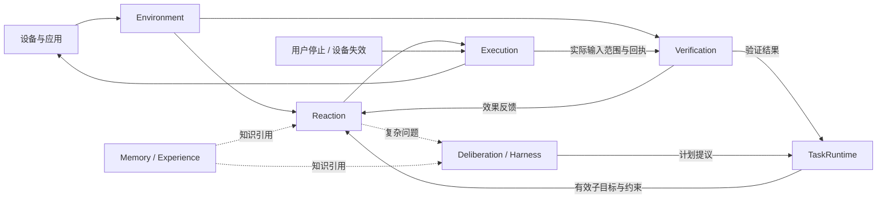

# 架构评审 R1：先冻结功能模块，再确定进程与工程布局

- 日期：2026-09-30
- 对象：一期 Electron + Rust 桌面开发计划，以及 `Generic_Interaction_System_Complete_Design_v0.3.md`
- 结论：需要修订逻辑架构；保留 macOS 优先、通用应用、截图结合界面结构、本地 S1、Harness S2 的方向。
- 记录范围：保存本次对话中已完成的第一轮评审。MediaPipe 是此后新增要求，由后续架构稿和 R2 评审处理。

## 评审发现

### R1-01：环境感知与设备适配混合

原计划将截图、AX、OCR 和几何检测集中描述为 macOS 设备后端能力，缺少独立的感知调度、对象解析、证据融合和状态变化接口。增加视觉模型、Canvas 或另一设备时，容易把感知业务继续塞进设备实现。

修正：设备适配提供来源帧和结构化采集；Environment 的 Perception 处理感知、融合与调度；StateCore 接纳候选观测并维护环境事实、对象和当前绑定。

### R1-02：Reaction 的完整生命周期未定义

候选生成、S1 选择、技能推进、S0、等待反馈和局部恢复分散在目录与进程说明中，缺少统一推进者。TaskRuntime 和技能运行时可能同时重试或推进同一工作。

修正：Reaction 在已接纳子目标、范围和预算内处理快速闭环；TaskRuntime 维护根任务、工作流节点、预算、取消和计划安装。确定性流程直接推进，语义选择请求 S1，复杂问题异步请求 S2。

### R1-03：组合快照的状态所有权不清楚

v0.3 的 BeliefSnapshot 展示环境、任务、技能和 held input。若 Environment 把整份快照视为可修改状态，会形成多个权威写入者。

修正：Environment 写环境事实；TaskRuntime 写任务状态；Reaction 写决策和技能状态；Execution 写许可和实际输入账本。决策视图只组合这些状态的不可变引用及各自版本。

### R1-04：长期记忆被简化为 SQLite 与轨迹

存储和日志不能代替结构知识、工作流版本、检索、适用范围和失效机制。历史坐标或句柄不能成为长期可直接执行对象。

修正：Memory/Experience 独立维护版本化知识；一期支持人工维护的 release、任务固定版本、候选经验和 Episode 索引。自动提炼、训练与自动发布后置。

## 相似系统的参考

| 系统 | 参考设计 | 本项目采用的边界 |
|---|---|---|
| Agent S2 | Manager / Worker / specialist grounding 与不同时间尺度的规划 | 分开长期规划、局部反应和目标定位；日常选择仍采用 S1 快模型 |
| Microsoft UFO | HostAgent / AppAgent；数据采集与动作执行服务分开 | 分开跨应用任务、应用环境理解和设备执行 |
| OpenHands SDK | Conversation 管理生命周期和事件；Agent 推理，Workspace/Tool 执行 | 每类状态一个权威写入者，其他组件消费事件或只读投影 |
| OpenAdapt | 工作流编译、执行、postcondition 和独立效果验证 | 动作回执与业务效果分开，技能携带效果契约 |
| Nav2 | 规划、局部控制、反应式条件与有界恢复 | 条件重检查、技能可中断、恢复有界、规划与控制分频 |

参考来源：

- [Agent S2 架构论文](https://arxiv.org/html/2504.00906v1#S3)
- [UFO HostAgent](https://microsoft.github.io/UFO/ufo2/host_agent/overview/)
- [UFO 数据采集与动作执行](https://microsoft.github.io/UFO/mcp/overview/)
- [OpenHands Conversation](https://docs.openhands.dev/sdk/arch/conversation)
- [OpenAdapt Workflow Program IR](https://github.com/OpenAdaptAI/openadapt-flow/blob/main/docs/design/WORKFLOW_PROGRAM_IR.md)
- [OpenAdapt EffectVerifier](https://github.com/OpenAdaptAI/openadapt-flow/blob/main/docs/design/EFFECT_VERIFIER.md)
- [Nav2 行为树说明](https://docs.nav2.org/rolling/getting_started/nav2_behavior_trees/detailed_behavior_tree_walkthrough/detailed_behavior_tree_walkthrough/)

本轮比较依据官方论文、文档和公开接口；没有运行这些第三方系统。

## 推荐的七个内核模块

| 模块 | 职责 | 权威状态 / 主要输出 |
|---|---|---|
| Environment | 采集调度、OCR/视觉解析、变化检测、证据接纳 | EnvironmentSnapshot、EnvironmentDelta、当前对象与绑定 |
| TaskRuntime | 根任务、工作流、预算、取消、计划安装 | ActiveSubgoal、可信任务范围与控制上下文 |
| Reaction | 状态投影、候选、S1、技能、S0、局部恢复 | 决策接纳、技能状态、ActionIntent、观察/规划请求 |
| Deliberation | Harness 复杂规划、未知机制分析、阶段复核 | PlanProposal、ReviewProposal |
| Execution | 输入仲裁、许可、Guard、提交、撤销、释放 | 输入账本、ActionReceipt、释放结果 |
| Verification | 以冻结契约和动作后证据判定效果 | 满足 / 不满足 / 未知的 EffectResult |
| Memory/Experience | 结构知识、技能版本、经验、检索与隔离 | 带精确版本和适用范围的知识引用 |

Electron Operator 是产品控制台。协议、模型后端、存储、轨迹和调度器为基础设施。功能模块不要求分别成为进程、crate 或网络服务。

## Reaction 定义

在当前有效子目标和预算内，根据环境变化，选择并推进下一项有界行为。

```text
Reaction
├── StateCompiler       当前状态投影与动态候选
├── DecisionRouter      S1 调用、结果接纳、去重和升级
├── SkillRuntime        技能绑定、等待反馈、有限恢复
└── LocalControllers    S0 短动作与局部反馈控制
```

输出为 StartSkill、ContinueSkill、ObserveMore、RequestPlanning 或 Yield/Stop。根目标、完成标准和预算由 TaskRuntime 保持；实际输入最终由 Execution 准入。

用户停止、许可到期、关键焦点/几何失效直接进入 Execution 的停止路径。它们不能依赖 Reaction 或任何模型返回。



## 目录与扩展原则

逻辑目录先对应 environment、tasks、reaction、deliberation、execution、verification、memory；之后再确定 crate 与进程的物理布局。

三个扩展轴保持独立：

1. DeviceAdapter：macOS 等设备的来源与输入。
2. Capability：表单、列表、设置等通用技能、候选工厂和效果契约。
3. EnvironmentPack：TextEdit 等应用的识别、版本和领域适配。

一期保留全部职责边界，以 AX/OCR、通用 UI 技能、版本化人工知识和经验索引建立最小实现；游戏、手机、训练和自动发布后置。
